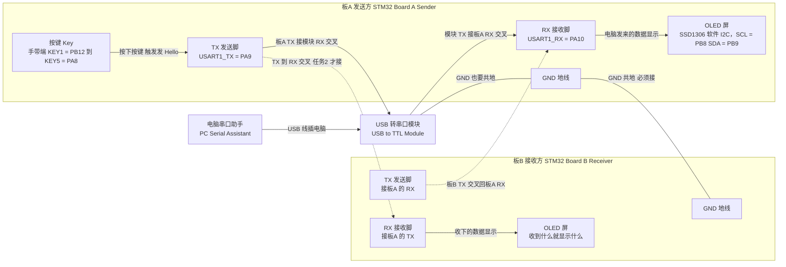
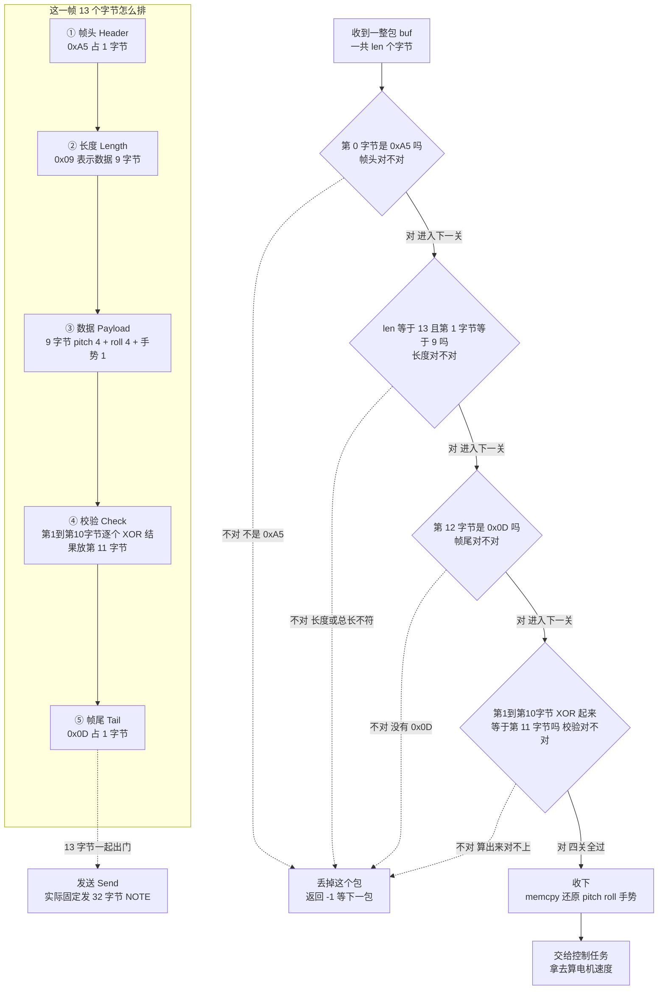
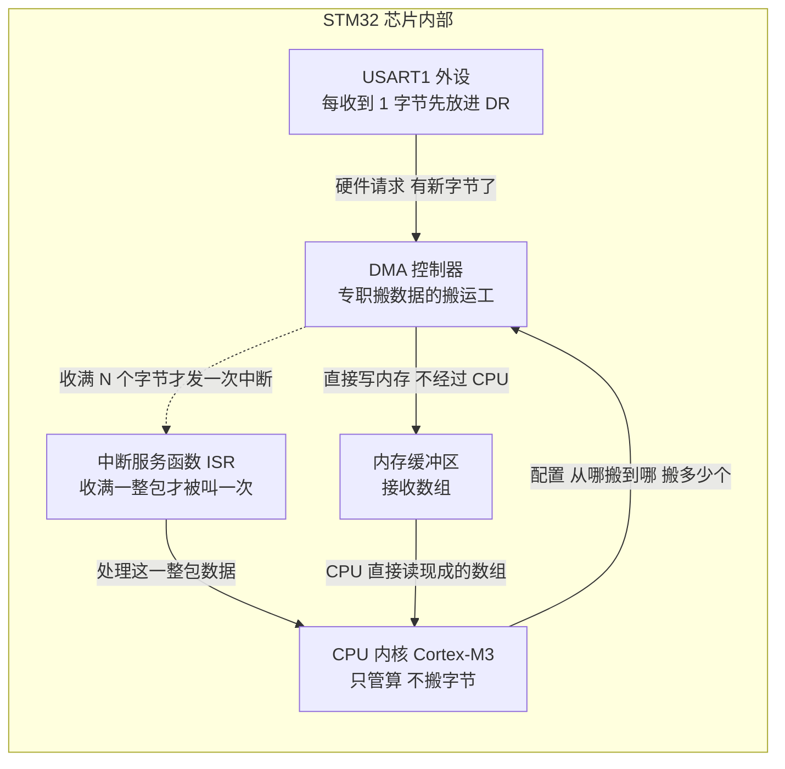

# 阶段一 · 双机通信基础 保姆级图解（接线图 + 一帧数据怎么被拆开）

> 本文件按《图解协议》生成：**每张 Mermaid 图的正下方**都紧跟「👀 导游解说」和「📖 本图名词词典」，一个都不少。
> 对应题目：第 1 阶段「双机通信基础」——① STM32 与电脑串口双向通信（按键发 `Hello`、电脑发数据显示在 OLED）；② 两块 STM32 用 UART 互连（TX-RX 交叉、共地）；③ 自定义协议（帧头 `0xA5`、帧尾 `0x0D`，格式 `[0xA5][长度][数据][校验][0x0D]`）；④ 在 ③ 基础上改用 UART + DMA。
> 对应你工程里的代码：[usart.c](../annotated/FreeRTOS小车/SYSTEM/usart/usart.c)（串口初始化 + printf 重定向 + 收帧中断）、[小车端 main.c](../annotated/FreeRTOS小车/USER/main.c)（`Protocol_Unpack` + `task_rx`）、[手带端 main.c](../annotated/遥控/User/main.c)（`Protocol_Pack` + 每 100ms 发一帧）、[手带端 nRF24L01_API.c](../annotated/遥控/APP/nRF24L01_API.c)、[小车端 nRF24L01_API.c](../annotated/FreeRTOS小车/HARDWARE/LED/nRF24L01_API.c)。

---

## 〇、这个阶段用大白话说要做什么

这一阶段就一件事：**让两块板子和一台电脑“开口说话”**。先让电脑当你的耳朵和嘴——按一下板上的按键，电脑里的串口助手蹦出一行 `Hello`；反过来你在电脑上敲字，板子把收到的内容显示在 OLED 小屏上。然后换个对象：拿掉电脑，两块 STM32 用两根线（我的 TX 接你的 RX、我的 RX 接你的 TX）加一根地线连起来，一块发、一块收、收的那块显示出来。再往后升级成“说黑话”：约定 `[0xA5][长度][数据][校验][0x0D]` 的格式，让接收方一眼认出“从哪开始、到哪结束、中间有没有传错”。最后一步把“逐字节搬数据”这种体力活交给 DMA。

⚠️ 先说实话：**你工程里最终没有走有线 UART**，两块板是用 **nRF24L01 无线模块**说话的。但有线串口的痕迹完整保留在小车端 `usart.c`：`USART1` 115200 + `printf` 重定向 + 以 `0x0D 0x0A` 结尾的收帧中断；协议帧的思想（`0xA5` 帧头、`0x0D` 帧尾、XOR 校验）和题目要求**一模一样**。所以下面每条都写两遍：题目要什么、你代码里有什么。

### 题目任务清单

| 任务 | 题目要求 | 怎么算过关 | 你工程里的实现 |
| :--- | :--- | :--- | :--- |
| 任务1 | STM32 与电脑串口**双向**通信：按键发字符串（如 `Hello`），电脑发来的数据显示在 OLED | 串口助手里能看到 `Hello`；OLED 上能看到电脑敲的字 | **改用无线**：手带端没有 USART 代码，按键靠 nRF24L01 把状态发出去；小车端 `usart.c` 保留了 `uart_init(115200)`、`fputc` 版 printf 重定向、`USART1_IRQHandler` 收帧中断，用于调试打印和 VOFA+ 波形 |
| 任务2 | 两块 STM32 用 UART 互连（**TX-RX 交叉、共地**），一块发一块收并显示 | 拔掉电脑也能通信；两块板的 GND 必须连一起 | **改用无线**：手带端 `NRF24L01_TX_Mode_Init(TX_ADDR1)` 发，小车端 `NRF24L01_RxPacket_Multi()` 收；两块板之间的 UART 互连代码没有写 |
| 任务3 | 自定义协议：帧头 `0xA5`、帧尾 `0x0D`，格式 `[0xA5][长度][数据][校验][0x0D]` | 接收方能验帧、拆出数据，坏包要丢掉 | **实现了，且和题目一致**：`Protocol_Pack()` 组 13 字节帧（`0xA5` + 长度 9 + 9 字节数据 + XOR 校验 + `0x0D`），`Protocol_Unpack()` 逐道检查后才收下 |
| 任务4 | 在任务3基础上改用 **UART + DMA** 传输 | 数据由 DMA 搬进内存，CPU 不再逐字节搬运 | **未实现**（工程里没有 DMA 代码），实际用 nRF24L01 每 100ms 发一帧代替；⚠️ 发送时固定发 32 字节，和 13 字节帧长不一致，源码注释已标 NOTE |

---

## 一、图一：两块板子 + 电脑串口助手怎么接线

> [!example] 👀 导游解说：这张图在讲什么？
>
> - **`板A 发送方`大方框**：按键、串口、屏幕都在它身上，就是任务1 里“你按一下、它说一句”的那块板。
> - **`按键 Key` 框**：手带端 5 个按键 `KEY1 = PB12`、`KEY2 = PB13`、`KEY3 = PB14`、`KEY4 = PB15`、`KEY5 = PA8`，`prekey()` 每 1ms 扫一次，按下就触发“发一句 Hello”。
> - **`TX = PA9` / `RX = PA10`**：小车端 `uart_init()` 真实配置的两根脚，`PA9` 配成复用推挽输出（往外说），`PA10` 配成浮空输入（往里听）。
> - **`电脑串口助手` → `USB 转串口模块` 的 `USB` 线**：电脑 USB 口听不懂单片机的电平，得先过这块小板子翻译，电脑上才会出现一个 COM 口。
> - **两条实线 `模块 TX 接板A RX`、`板A TX 接模块 RX`**：这就是题目说的**交叉接法**，我的嘴对着你的耳朵；注意是两条方向相反的箭头，不是一根线来回跑。
> - **两条没有箭头的线 `GND 也要共地`、`GND 共地 必须接`**：地线只表示“两边 0V 拴在一起”，没有方向，所以画 `---`。不共地时两边 0V 不一样高，收数据就时好时坏。
> - **两条虚线 `-.->` 连到板B**：虚线代表**另一次实验才接**——任务1 只接 USB 转串口模块，任务2 拔掉模块、把两根线交叉接到板B。⚠️ 同一对 TX/RX 别同时挂三方，两台“嘴”抢一根线，收到的必是乱码。
> - **两个 `OLED 屏` 框**：板A 的屏显示“电脑发来的字”，板B 的屏显示“板A 发来的字”。这张图**没有菱形判断**，所以没有分支；下一张有，我会一条一条说清走哪边。

> [!info] 📖 本图名词词典
> | 缩写/字母 | 全称 | 中文意思 | 在实物/代码里到底是什么？ |
> | :--- | :--- | :--- | :--- |
> | **TX** | Transmit | 发送 | 单片机往外吐数据的脚，接对方的 RX；小车端是 `PA9`。 |
> | **RX** | Receive | 接收 | 单片机收数据的脚，接对方的 TX；小车端是 `PA10`。 |
> | **GND / 共地** | Ground | 地 / 0V 参考点 | 板上的地线脚；两块板、模块之间的 GND 必须接一起，叫“共地”，否则电平判断没有共同基准。 |
> | **UART / USART** | Universal (Synchronous/)Asynchronous Receiver/Transmitter | 通用（同步）异步收发器 | 最常用的“串口”：两根线、不要时钟线、两端约好同样速度就能收发；STM32 里这个外设叫 `USART1`，`uart_init()` 配的就是它。 |
> | **波特率 Baud / 115200** | Baud Rate | 每秒传多少个二进制位 | 两端必须填一样，一边 115200 一边 9600 收到的就是乱码；`uart_init(115200)` 就是这个值。 |
> | **8N1** | 8 data bits, No parity, 1 stop bit | 8 位数据、无校验、1 位停止位 | 就是 `uart_init()` 里 `USART_WordLength_8b` + `USART_Parity_No` + `USART_StopBits_1`。 |
> | **TTL 电平** | Transistor-Transistor Logic level | 单片机能直接吃的电平 | 3.3V 算高、0V 算低；电脑 USB 口不是这种电平，不能直连。 |
> | **USB** | Universal Serial Bus | 通用串行总线 | 电脑上那个扁口，插上后电脑会认出一个 COM 口。 |
> | **USB 转串口模块** | USB to TTL module | USB 转 TTL 的小板子 | 一头 USB 插电脑，另一头引出 TX / RX / GND；模块芯片型号以你手上板子丝印为准。 |
> | **串口助手** | Serial Assistant | 电脑上的串口调试窗口 | COM 口就是电脑给这个串口编的号（COM3、COM4…）；你选好口、敲字、点发送、看收到的那个窗口。 |
> | **OLED / SSD1306** | Organic Light-Emitting Diode / driver chip | 有机发光二极管屏 / 它的驱动芯片型号 | 一小块单色蓝屏，负责显示 `Hello`、角度、模式；屏背后的控制芯片是 SSD1306，你工程里用软件 I2C 驱动它。 |
> | **I2C** | Inter-Integrated Circuit | 两线串行总线 | 只用 SCL、SDA 两根线就能挂很多设备的总线。 |
> | **SCL / SDA** | Serial Clock / Serial Data | 时钟线 / 数据线 | 手带端 OLED 是 `PB8 = SCL`、`PB9 = SDA`（软件 I2C）。 |
> | **PA9 / PA10** | Port A Pin 9 / 10 | A 端口第 9、10 号引脚 | 小车端 USART1 的 TX / RX，`uart_init()` 真实配置的两根脚。 |
> | **交叉接法** | Cross connection | 我的发送接你的接收 | 你的 TX 是嘴、RX 是耳朵，嘴对耳朵才说得通；TX 接 TX 等于两张嘴互相喊。 |
> | **按键扫描 / presstime** | — | 定时扫按键、判断长按 | 手带端 `prekey()` 每 1ms 扫一次，`presstime = 500ms` 用来判断长按。 |

---

## 二、图二：一帧数据长什么样 + 接收端怎么拆包

> [!example] 👀 导游解说：这张图在讲什么？
>
> 上半部分像**信封**：从哪开始（`0xA5`）、多长（`9`）、内容（9 字节）、防伪章（校验）、到哪结束（`0x0D`）。下半部分是**收发室门卫**，逐关检查，任何一关不过就退回去。下面逐条说清“什么情况走哪条分支”（顺序和 `Protocol_Unpack()` 完全一致）：
> - **第 1 关 `帧头对不对`**：第 0 字节等于 `0xA5` → 走**右边**进第 2 关；不等于 `0xA5` → 走**虚线**到 `丢掉这个包`，返回 -1。防的是“这包根本不是我的协议”（上电杂散字节、别的设备乱发）。
> - **第 2 关 `长度对不对`**：`len` 等于 13 **并且**第 1 字节等于 `9`，两个条件同时满足 → 走**右边**进第 3 关；只要有**一个**不满足（总长不是 13，或长度字段不是 9）→ 走**虚线**丢掉。防的是“收到半包 / 粘了两包 / 上电没对齐”。
> - **第 3 关 `帧尾对不对`**：第 12 字节等于 `0x0D` → 走**右边**进第 4 关；不等于 → 丢掉。防的是“字节错位”——中间少一个字节，帧尾就跑到别的位置，这一关立刻发现。
> - **第 4 关 `校验对不对`**：第 1 到第 10 字节逐个 XOR 起来等于第 11 字节 → 走**右边**收下；不等于 → 丢掉。防的是“某一位被干扰翻了”（无线环境最常见）。校验范围**包含长度字节、不含帧头帧尾**，收发两端必须用同一范围，否则永远对不上（源码已用 NOTE 标出）。
> - **四关全过** → `收下`：`memcpy` 把第 2~5 字节拷回 `pitch`、第 6~9 字节拷回 `roll`、第 10 字节取成手势，再交给控制任务。
> - **一个坏包长什么样**：`0xA5` 被打成 `0xA4` → 第 1 关就丢；数据里改了一个字节却忘了改校验 → 第 4 关丢。**宁可丢一包，也不能把坏数据拿去驱动电机**。
> - **顺带对比 `usart.c`**：那边收的是给人看的调试文本，所以用 `0x0D 0x0A`（回车+换行）当结尾；这边收的是给机器看的协议帧，只用 `0x0D` 当帧尾。**两者都拿 `0x0D` 当“这句话说完了”的信号**，思想是同一个。

> [!info] 📖 本图名词词典
> | 缩写/字母 | 全称 | 中文意思 | 在实物/代码里到底是什么？ |
> | :--- | :--- | :--- | :--- |
> | **帧 Frame** | Frame | 一包完整的数据 | 一次通信的最小完整单位，你这里是 13 个字节。 |
> | **帧头 Header / 0xA5** | Frame Header | 一帧的开头标记 | 常量 `FRAME_HEAD`，值 `0xA5`（十进制 165）；选它是因为数值特殊，和浮点数据里的字节不容易撞上（工程习惯，不是硬规定）。 |
> | **帧尾 Tail / 0x0D** | CR, Carriage Return | 回车符 | 常量 `FRAME_TAIL`，十进制 13；协议帧尾，也是调试文本一行的结束信号。 |
> | **0x0A** | LF, Line Feed | 换行符 | 十进制 10；`usart.c` 里要求 `0x0D` 后面紧跟 `0x0A` 才算一帧收完。 |
> | **十六进制 HEX** | Hexadecimal | 逢 16 进 1 的写法 | 一个字节刚好写成两位，如 `0xA5`；串口助手切到 HEX 就长这样。 |
> | **字节 Byte** | Byte | 8 个二进制位 | 串口一次收发的最小单位，`0xA5` 占 1 个字节。 |
> | **长度字段** | Length | 后面数据有多少字节 | 你这里是 `PAYLOAD_LEN = 9`，注意它是**数据长度**，不是整帧长度（整帧 13）。 |
> | **数据 Payload** | Payload | 真正要传的内容 | 9 字节 = `pitch` 4 字节 + `roll` 4 字节 + 手势 1 字节。 |
> | **校验 Check / XOR** | Checksum / Exclusive OR | 校验字节 / 异或运算 | 放在第 11 字节；XOR 是“相同得 0、不同得 1”，把 10 个字节异或成一个，接收端重算比对，不一样就说明中途有字节变了。 |
> | **小端序 / float** | Little Endian / Floating point | 低位字节在前 / 浮点数 | `pitch`、`roll` 是 `float`，各 4 字节按小端排，所以接收端 `memcpy` 原样拷回就能还原。 |
> | **memcpy** | Memory Copy | 内存拷贝函数 | `memcpy(out + 2, &p->pitch, 4)` 把 4 个字节原样搬进缓冲区，不做类型转换。 |
> | **buf / len** | Buffer / Length | 缓冲区 / 长度 | `buf` 是收到的字节数组，`len` 是这一包一共多少字节。 |
> | **Protocol_Pack** | — | 组帧函数 | 手带端按 帧头/长度/数据/校验/帧尾 的顺序把 13 字节写进 `out`。 |
> | **Protocol_Unpack** | — | 拆帧函数 | 小车端上面那四道检查，全过了才还原数据。 |
> | **USART_RX_STA** | — | 串口接收状态字 | `usart.c` 里 bit15 记“收完没有”、bit14 记“收到 0x0D 没有”、低 14 位记已收字节数。 |
> | **丢包** | Drop the frame | 把坏帧扔掉 | 返回 -1，等下一帧；坏数据绝不送去控制电机。 |

---

## 三、图三（加分理解）：DMA 怎么把数据搬进内存

> 说明：这是**原理图**，讲题目任务4 要你做的事。你工程里没有 DMA 代码，所以这里**不出现任何 DMA 通道号和寄存器地址**——没有的东西绝不编。

> [!example] 👀 导游解说：这张图在讲什么？
>
> 把 DMA 想成**快递柜**：以前快递员（CPU）每来一个包裹都得亲自跑一趟（每来一个字节进一次中断），一天跑一万趟别的活全干不了；现在装了快递柜（DMA），包裹往柜子里一塞就走，收件人（你的代码）攒够一批再一次性取走。
> - **`USART1 外设` 框**：收到的字节先落在 `DR` 数据寄存器，同时把 `RXNE` 标志置 1。
> - **`DMA 控制器` 框**：串口每来一个字节，它就去 `DR` 取一次、写进内存，全程不问 CPU。
> - **`内存缓冲区` 框**：你代码里定义的那个接收数组（比如 `USART_RX_BUF` 这类），数据是**硬件直接写进去的**，不是中断里一句一句拷的。
> - **`中断服务函数 ISR` 框 + 那条虚线**：这是关键区别——中断**不是每字节来一次**，而是“搬够 N 个字节”或“一整包收完”才来一次。以前 13 个字节进 13 次中断，现在只进 1 次。
> - **`CPU 内核` 框**：省下的时间归它，可以算 PID、刷 OLED、扫按键；而那条反向的 `配置 从哪搬到哪 搬多少个` 说明 DMA 不会自己知道要干嘛，得 CPU 先配好再让它自己跑。

> [!info] 📖 本图名词词典
> | 缩写/字母 | 全称 | 中文意思 | 在实物/代码里到底是什么？ |
> | :--- | :--- | :--- | :--- |
> | **DMA** | Direct Memory Access | 直接存储器访问 | 专职搬数据的硬件，能在 CPU 不参与时把外设里的字节成批搬进内存。 |
> | **CPU / 内核** | Central Processing Unit | 中央处理器 | 芯片里真正执行你代码的部分；`Cortex-M3` 是 STM32F103 的内核型号。 |
> | **外设 Peripheral** | Peripheral | 单片机内部的功能模块 | `USART1`、`TIM2`、`SPI` 都算外设，它们由硬件自己跑，不占 CPU。 |
> | **DR / SR / TXE** | Data Register / Status Register / Transmit data register Empty | 数据寄存器 / 状态寄存器 / 发送寄存器空 | 收到的字节先落 `USART1->DR`（`fputc` 也是往它写来实现发送）；`usart.c` 里 `while((USART1->SR & 0X40) == 0)` 就是在等 `TXE` 这一位变 1。 |
> | **RXNE** | Receive data register Not Empty | 接收寄存器非空 | 收到新字节就置 1；串口接收中断就是靠它触发的。 |
> | **中断 Interrupt** | Interrupt | 打断主程序、跳去执行一段专用代码 | 每来一个字节就把 CPU 叫过去一次，叫一次就有一次开销。 |
> | **ISR** | Interrupt Service Routine | 中断服务函数 | `USART1_IRQHandler` 就是 USART1 的 ISR。 |
> | **NVIC** | Nested Vectored Interrupt Controller | 嵌套向量中断控制器 | 管所有中断的总调度台；`uart_init()` 里给它设了抢占优先级 3、子优先级 3。 |
> | **轮询 Polling** | Polling | 循环问“好了没” | 站在原地一直查标志位，CPU 被占死；无线接收那边就是 20ms 轮询一次。 |
> | **缓冲区 Buffer** | Buffer | 临时放数据的数组 | DMA 把字节搬进来的那个数组，CPU 随后直接读它。 |
> | **DMA 请求 / N 字节阈值** | DMA Request | 外设向 DMA 发出的搬运请求 | 串口每收到一个字节就“举手”一次；攒够你设的 N 个字节才报一次中断，N 没有固定值，越大越省 CPU 但数据到得越晚。 |

---

## 四、代码对照：这个阶段落在哪些文件里

| 文件 | 关键函数 / 变量 | 干什么 |
| :--- | :--- | :--- |
| [usart.c](../annotated/FreeRTOS小车/SYSTEM/usart/usart.c) | `uart_init(u32 bound)` | 开 USART1 和 GPIOA 时钟，`PA9` 复用推挽输出、`PA10` 浮空输入，8N1、无流控、收发都开，最后开 `RXNE` 接收中断并设 NVIC（抢占 3 / 子 3）。 |
| 同上 | `fputc(int ch, FILE *f)` | `printf` 重定向：先等 `SR` 的 TXE 位，再把字符写进 `USART1->DR`，于是 `printf` 内容从 `PA9` 出去；配套还有 `#pragma import(__use_no_semihosting)`、`_sys_exit()`、`FILE __stdout`，为了不用 MicroLIB（Keil 自带的精简 C 库）。 |
| 同上 | `USART1_IRQHandler(void)` | 每收 1 字节进一次中断：bit14 记“收到 0x0D 没有”，下一个字节是 `0x0A` 才置 bit15 表示一帧收完；收到别的就清零重来；超长也清零重来。 |
| 同上 | `USART_RX_BUF` / `USART_RX_STA` | 接收缓冲区数组（上限宏 `USART_REC_LEN`）与状态字，二者配合完成“按 `0x0D 0x0A` 收帧”。 |
| [手带端 nRF24L01_API.c](../annotated/遥控/APP/nRF24L01_API.c) | `NRF24L01_Init()` / `NRF24L01_Check()` | 前者只配 `PA0~PA5` 六根 GPIO 并给默认电平；后者往模块里存发送地址的 `TX_ADDR` 寄存器写 5 字节测试图案（`0xAA 0xBB 0xCC 0xDD 0xEE`）再读回比对，返回 0 表示在线。 |
| 同上 | `NRF24L01_TX_Mode_Init(uchar *tx_addr)`、`NRF24L01_SendData(uchar *data, uchar len)` | 切发送模式并设发送地址；再把一包数据写进模块的发送缓冲区发出去。 |
| [小车端 nRF24L01_API.c](../annotated/FreeRTOS小车/HARDWARE/LED/nRF24L01_API.c) | `NRF24L01_RX_MultiChannel_Init()`、`NRF24L01_RxPacket_Multi()` | 多通道接收（通道 0 地址 `0x11...`、通道 1 地址 `0x22...`）；后者轮询取一包，取到返回 0 并带出通道号。 |
| [手带端 main.c](../annotated/遥控/User/main.c) | `Protocol_Pack()`、`main()` | 组帧：`out[0]=0xA5`、`out[1]=9`、`out[2..5]=pitch`、`out[6..9]=roll`、`out[10]=gesture`、`out[11]=XOR(out[1..10])`、`out[12]=0x0D`；每 100ms 发一次，实际固定发 32 字节。 |
| [小车端 main.c](../annotated/FreeRTOS小车/USER/main.c) | `Protocol_Unpack()`、`task_rx` | 四道检查通过后 `memcpy` 还原 `pitch`、`roll`，限幅 ±80，用互斥量写进 `g_pitch/g_roll/g_gesture`；`task_rx` 每 20ms 轮询收一包。 |

---

## 五、零散缩写速查（上面三张图没覆盖到的）

| 缩写/字母 | 全称 | 中文意思 | 在实物/代码里到底是什么？ |
| :--- | :--- | :--- | :--- |
| **nRF24L01 / 2.4GHz** | 2.4 gigahertz | 2.4G 频段无线收发模块 | 你工程实际用的无线模块，替掉了题目要求的有线 UART；手带端发、小车端收。2.4GHz 是它的工作频段，和 WiFi、蓝牙挤在同一片“公共马路”上。 |
| **GPIO** | General Purpose Input/Output | 通用输入输出口 | 单片机上那些能被程序控制高低电平的引脚；`uart_init()` 里配 `PA9`/`PA10`、nRF 软件 SPI 里一位一位模拟时序，用的都是 GPIO。 |
| **SPI** | Serial Peripheral Interface | 串行外设接口 | 靠 SCK/MOSI/MISO/CSN 几根线的高速总线；你工程用的是**软件 SPI**，用 GPIO 一位一位模拟。 |
| **CSN / CE** | Chip Select Not / Chip Enable | 片选（低有效）/ 芯片使能 | `CSN`：手带端 `PA0`、小车端 `PA2`，拉低才允许说话；`CE`：手带端 `PA1`、小车端 `PA3`，收发模式靠它触发。 |
| **SCK / MOSI / MISO** | Serial Clock / Master Out Slave In / Master In Slave Out | 时钟线 / 主出从入 / 主入从出 | 手带端 `PA2` / `PA3` / `PA4`，小车端 `PA4` / `PA5` / `PB0`。 |
| **IRQ** | Interrupt Request | 中断请求脚 | 手带端 `PA5`、小车端 `PB1`；模块有事件时拉这个脚通知单片机。 |
| **printf / fputc** | Print Formatted | 格式化打印 / 字符输出底层函数 | `printf` 最后会一个字符一个字符调用 `fputc`；工程里把 `fputc` 改成往 `USART1->DR` 写，内容就从 `PA9` 发出去。 |
| **PID** | Proportional-Integral-Derivative | 比例-积分-微分控制 | 第二阶段的主角；这里只提到“省下的 CPU 时间可以拿去算 PID”，本篇不展开。 |
| **u8 / u16 / u32 / uchar** | unsigned char / int / long | 无符号整型简写 | 正点原子工程里的类型别名：`u8`、`uchar` 是 1 字节，`u16` 是 2 字节，`u32` 是 4 字节，函数原型里的 `u32 bound` 就是它。 |
| **VOFA+** | — | 上位机波形软件 | 小车端用它看波形（只做了打印，没做在线改 PID）。 |
| **NOTE** | — | 源码里的提醒注释 | 标着“原样保留，疑似问题”的地方（如固定发 32 字节、校验包含长度字节），答辩时主动说出来是加分项。 |

---

## 六、答辩三问（老师最爱问）

1. **问：串口为什么要交叉接、为什么要共地？** 答：TX 是“嘴”、RX 是“耳朵”，嘴必须对着耳朵，所以我的 `PA9`（TX）接你的 RX，你的 TX 接我的 `PA10`（RX）；TX 接 TX 等于两张嘴对喊，谁也听不见。共地是因为高/低电平是**相对 0V** 判断的，两块板不共地，各自的 0V 不一样高，接收端就会把 1 读成 0，现象是“有时能收、有时全乱码”。`uart_init()` 把 `PA9` 配成复用推挽、`PA10` 配成浮空输入，就是在告诉芯片“这根往外说、那根往里听”。
2. **问：帧头、帧尾、校验分别防什么？** 答：帧头 `0xA5` 防“这不是我该收的包”——上电杂散字节、别的设备乱发，第一关就拦掉。帧尾 `0x0D` 防“字节错位”——中间少一个或多一个字节，帧尾就跑到别的位置，一比对就露馅（`usart.c` 更严格，要求 `0x0D` 后面还得跟 `0x0A`，那是给调试文本用的）。校验防“某一位被干扰翻了”——长度对、头尾都对，但中间某个字节错了，重算 XOR 一定对不上，`Protocol_Unpack()` 返回 -1 丢掉。三者是三道不同方向的防线，缺一个都会出“看着收到了、其实数据是错的”这种最危险的 bug。
3. **问：DMA 比中断收数据好在哪？** 答：中断是“每来一个字节敲一次门”，13 字节就进 13 次中断，每次都要保存现场、跳转、恢复现场，波特率一高 CPU 大半时间都在开关门；DMA 让硬件自己去 `USART1->DR` 取字节、直接写进内存，**CPU 一次都不参与搬运**，只在“搬够一批”时被叫一次，省下的时间就能算 PID、刷 OLED、扫按键。代价是要多配一套 DMA，而且缓冲区被硬件偷偷写，别在搬一半时去读它。你工程里没用 DMA（任务4 没做），实际是 nRF24L01 无线 + 20ms 轮询代替，这点要主动承认。

---

## 七、自测清单（能全部打勾就说明这个阶段真的会了）

- [ ] 能不看笔记画出“板A TX → 板B RX、板B TX → 板A RX、两边 GND 相连”，并说出为什么不能 TX 接 TX
- [ ] 能指着图二数出 13 个字节各自的含义，并说出长度字段 `9` 是**数据长度**而不是整帧长度
- [ ] 能按顺序背出 `Protocol_Unpack()` 的四道关卡，并各举一个“会被这一关拦住”的坏包例子
- [ ] 能在 `usart.c` 里指出 `uart_init()`、`fputc()`、`USART1_IRQHandler()` 三处，并说出 `PA9`/`PA10`、115200、8N1、`0x0D 0x0A` 分别在哪里起作用
- [ ] 能用“快递柜”的比喻讲清 DMA 和中断的区别，并坦白说明任务4 没实现、是用 nRF24L01 替代的
