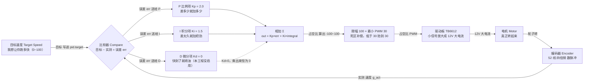
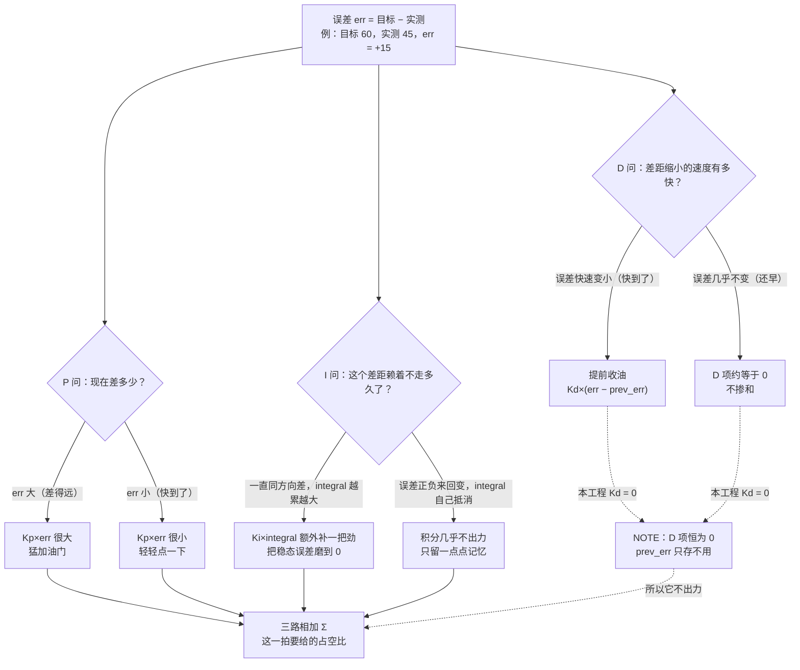
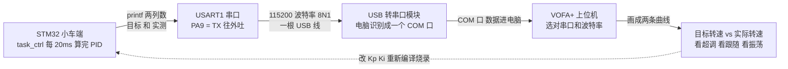

# 阶段七 · 速度闭环 PID 保姆级图解（目标速度 + 实测速度 + 三个旋钮）

> 本文件按《图解协议》生成：每张 Mermaid 图**正下方**都紧跟「👀 导游解说」和「📖 名词词典」两个模块。
> 对应题目：第七阶段 —— 速度闭环 PID（固定目标整定 + 目标可调 + 手势控速）；对应代码：
> [main.c](../annotated/FreeRTOS小车/USER/main.c)、[Encoder.c](../annotated/FreeRTOS小车/HARDWARE/LED/Encoder.c)、[usart.c](../annotated/FreeRTOS小车/SYSTEM/usart/usart.c)。
> 图里每一个引脚、函数名、参数都来自你自己的工程源码，不是猜的。

---

## 〇、大白话：PID 到底在干嘛？

想象你在考试：**你想要 60 分，结果只考了 45 分。**

- 你发现差了 15 分 —— 这个 15 就是**误差**；
- 差得越多，下一把就多使点劲 —— 这是 **P（比例）**：“差多少就补多少”；
- 如果每次都比目标低、怎么使劲都追不上，说明光按差距补还不够，得**把历史欠账也补上** —— 这是 **I（积分）**：“差太久就加把劲”；
- 如果你眼看快考到 60 了还不收手，一冲就冲到 70 —— 这时候要**提前收油** —— 这是 **D（微分）**：“快到了就先收油”。

所以整篇记住一句话：**想要 60，实际只有 45，PID 决定再多给多少电。**
给多了会冲过头（叫**超调**），给少了永远差一截（叫**稳态误差**），三个参数就是在这两者之间找平衡。

| 考试里的东西 | 小车里对应的东西 | 你代码里的名字 |
| :--- | :--- | :--- |
| 我想考 60 分 | 我想让轮子跑到速度 60 | `pid_left.target`（目标速度） |
| 我实际考了 45 分 | 编码器数出来轮子只跑到 45 | `g_act_left`（实测速度） |
| 差了 15 分 | 目标 − 实测 = 15 | `err`（误差） |
| 我决定下一把多使多大劲 | 这一拍给多少 PWM 占空比 | `PID_Calc()` 的返回值 |

### 题目任务清单

| 任务 | 题目要求 | 怎么算过关 | 你工程里的实现 |
| :--- | :--- | :--- | :--- |
| 任务1 | 固定目标速度的**速度闭环 PID**，用 **VOFA+** 打印“当前转速 vs 目标转速”波形来整定参数 | 给一个固定目标，实际速度能稳稳跟上去，波形上两条线贴合、不来回振荡 | `PID_Init(&pid_left, 2.0f, 1.50f, 0.0f)`（右轮同参数）；`PID_Calc()` 里误差/积分限幅 100、输出限幅 100；`task_ctrl` 每 **20ms** 跑一次；反馈来自编码器 **52 线、减速比 9.27666**；`printf` 经 **USART1 115200** 送 VOFA+ |
| 任务2 | 目标速度**可调**（按键或串口），理解 P/I/D 的影响 | 动一下目标，实际速度跟着变，能说出调大调小谁的影响 | 本工程的目标速度不是按键改的，而是由**手势角度实时映射**改写（死区 10°、转向阈值 15°、线性映射到 0~100），同样做到了“目标可调”；**NOTE**：串口在线改 PID 没实现，只做了打印 |
| 任务3 | **手势控速**：IMU 姿态角映射为目标速度，实时跟随、方向一致、倾斜越多越快；屏幕显示**目标转速、实际转速、手势、模式** | 手往前压车就走、压得越多越快、手端平就停；屏幕上四项都有 | `task_rx` 收到帧 → `g_pitch/g_roll` → `task_ctrl` 映射成 `targetL/targetR` → PID → PWM；`task_disp` 每 50ms 刷 OLED 显示目标/实际/手势/状态 |

---

## 一、图一：闭环是怎么“自己看着办”的？（控制框图）

> [!example] 👀 导游解说：这张图在讲什么？
>
> 这张图是一个**圈**，从左往右走一圈又回到起点，所以叫“闭环”。跟着箭头走：
>
> - **最左边 `目标速度 Target Speed`**：这是“我想要多少”。任务1 里它是个固定数字（比如 60），任务3 里它是手势角度算出来的。对应代码里 `pid_left.target`。
> - **菱形 `比较器 Compare`**：这是整个闭环里最朴素的一步，做一道减法：**目标 − 实测 = 误差**。代码里就一行 `float err = p->target - feedback;`。误差是正数说明轮子转慢了，要加油门；负数说明转快了，要减油门。
> - **中间三个框 `P / I / D`**：三个“参谋”，拿到同一个误差、各自出主意，最后在 `相加 Σ` 那里汇总。**注意它们是并排的三路，不是串起来的** —— 三个参谋同时看同一个误差。
> - **`P 比例项 Kp = 2.0`**：最简单直接，误差 × 2.0 就是它出的力。误差 15 就给 30。
> - **`I 积分项 Ki = 1.5`**：把每一拍的误差**累加**起来再乘 1.5。它的作用是“欠账一起还”，专门对付“总是差一点点”的情况。
> - **`D 微分项 Kd = 0`**：看误差**变小的速度**。**你工程里 Kd = 0**，所以这条虚线箭头乘出来永远是 0 —— **D 这一路实际上是“挂了空挡”**。代码里 `prev_err` 照样存了，但输出公式 `out = kp*err + ki*integral` 里根本没有它，源码注释已用 **NOTE** 标出这是有意简化。
> - **`相加 Σ`**：`out = Kp×err + Ki×integral`，这就是这一拍要给的 PWM 数值，范围被卡在 -100~100。
> - **`限幅 + 最小 PWM 30`**：先卡上限幅（防止算出一个 300 这种离谱数字），再做**死区补偿**：电机 PWM 小于 30 时只会“嗡嗡”不转，所以只要方向对、数值不到 30，就强行抬到 30 让它起转。
> - **`驱动板 TB6612`**：单片机只能吐 3.3V 小信号，驱动板把它放大成 12V 大电流灌给电机。
> - **`电机 → 编码器`**：轮子转起来，尾巴上的编码器开始“哒哒哒”吐脉冲。
> - **`实测 速度 g_act` 往回拐向比较器**：这是整张图的**灵魂箭头**。换算公式是 `enc / 52 / 0.02 / 9.27666 × 5`（52 = 13 线四倍频，0.02 = 20ms 采样周期，9.27666 = 减速比，×5 是拉进 0~100 的经验缩放）。**没有这条回头线，就是开环**——蒙着眼睛给电，轮子转多快全靠运气。
>
> **这张图没有菱形以外的分支陷阱，但有一条要记住：三个参谋必须同时拿到“同一个误差”。** 你的代码是每 20ms 采一次编码器、立刻算一次误差，所以三路用的是同一拍的数，不会打架。

> [!info] 📖 本图名词词典
> | 缩写/字母 | 全称 | 中文意思 | 在实物/代码里到底是什么？ |
> | :--- | :--- | :--- | :--- |
> | **PID** | Proportional-Integral-Derivative | 比例-积分-微分控制器 | 一套“看差距决定加多少油”的算法，三个字母就是三个参谋。 |
> | **Kp** | Proportional Gain | 比例系数 | 你代码里 2.0；误差 × 2.0 = P 这一路出的力。 |
> | **Ki** | Integral Gain | 积分系数 | 你代码里 1.5；累加误差 × 1.5 = I 这一路出的力。 |
> | **Kd** | Derivative Gain | 微分系数 | 你代码里 0.0；等于把 D 这一路关了。 |
> | **误差 err** | Error | 偏差 | `target - feedback`，正数=转慢了要加油，负数=转快了要减油。 |
> | **目标速度** | Target Speed | 想要的速度 | `pid_left.target`，0~100 的抽象速度，不是转/分。 |
> | **实测速度** | Actual / Feedback Speed | 测出来的速度 | `g_act_left`，由编码器脉冲换算，和目标是同一把尺子才能相减。 |
> | **闭环** | Closed Loop | 闭环控制 | 有“测 → 比 → 改”的回路，能自己纠错。 |
> | **开环** | Open Loop | 开环控制 | 只给电不管结果，阶段二的纯 PWM 调速就是开环。 |
> | **PWM / 占空比** | Pulse Width Modulation / Duty Cycle | 脉冲宽度调制 / 高电平占比 | 一秒钟开关两万次，用“开多久”表示力气大小；代码里就是 `Motor_SetPWM()` 的 0~100。 |
> | **限幅** | Clamp / Limit | 卡住上下界 | 算出来超过 100 就当 100，低于 -100 就当 -100，防止失控。 |
> | **积分饱和** | Integral Windup | 积分越积越大退不出来 | 长时间同方向差，`integral` 涨到天上去，等误差反向了还要很久才退回来，车就会冲过头。 |
> | **积分限幅 100** | Integral Clamp | 积分封顶 | `PID_INT_MAX = 100.0f`，`integral` 超过 ±100 就卡住，专门治积分饱和。 |
> | **输出限幅 100** | Output Clamp | 输出封顶 | `PID_OUT_MAX = 100.0f`，保证返回的 PWM 一定落在 -100~100。 |
> | **驱动板 TB6612** | Motor Driver | 电机驱动芯片 | 把单片机的 3.3V 小信号放大成 12V 大电流，阶段二的主角。 |
> | **编码器** | Encoder | 测速的“眼睛” | 电机尾部传感器，轮子每转一点就吐一个脉冲。 |
> | **52 线** | 13 lines × 4 | 每转 52 个计数 | 编码器 13 线，A/B 两相互相错开、四个边沿都数（四倍频）→ 13 × 4 = 52。 |
> | **减速比 9.27666** | Gear Ratio | 减速比 | 电机内部齿轮把转速降下来、力气放大 9.27666 倍，用来把电机轴转速折成输出轴转速。 |
> | **20ms 采样周期** | Sampling Period | 多久算一次 | `vTaskDelay(pdMS_TO_TICKS(20))`，50Hz；编码器窗口、接收轮询、PID 全是 20ms，改周期必须重新调参。 |
> | **task_ctrl** | Control Task | 控制任务 | FreeRTOS 里的控制任务，优先级 2，每 20ms 跑一遍“读姿态 → 算目标 → 读编码器 → PID → 出 PWM”。 |
> | **最小 PWM 30** | Minimum PWM / 死区补偿 | 起步最低油门 | 电机有启动死区，PWM 不到 30 只嗡嗡不转，所以方向对时强行抬到 30。 |
> | **VOFA+** | VOFA+ 上位机 | 串口波形软件 | 电脑上的软件，把串口收到的数字画成实时曲线，用来看“目标 vs 实际”。 |
> | **串口** | Serial Port / UART | 串口 | 单片机用一根线一位一位往外吐数据；你工程里是 **USART1**，`PA9 = TX`、`PA10 = RX`。 |
> | **波特率 115200** | Baud Rate | 每秒传多少位 | 你代码里 `uart_init(115200)`，电脑端也必须设 115200，否则全是乱码。 |

---

## 二、图二：三个参数分别管什么？（三路分支 + if/else）

> [!example] 👀 导游解说：这张图在讲什么？
>
> 这张图把“一个误差”拆给三个参谋分别审问，**每一层都是一个 if/else 岔路口**，我一个一个说清楚什么情况走哪条边：
>
> **第一层：P 问“现在差多少？”**
> - **走左边 `err 大`**：比如目标 60、实测 45，差 15，`2.0 × 15 = 30`，直接给 30 的油门 —— 差得远就猛给；
> - **走右边 `err 小`**：比如实测已经 58 了，差 2，`2.0 × 2 = 4`，只轻轻点一下。
> - 这就是 P 的性格：**差距一缩小，它自己就软下来**，所以 P 是“自带收敛”的。
>
> **第二层：I 问“这个差距赖着不走多久了？”**
> - **走左边 `integral 越累越大`**：如果每拍都差 5，`integral` 就会 5、10、15……一路涨，I 这一路的力也越来越大，硬把最后那点差距磨平；
> - **走右边 `正负来回抵消`**：误差一会正一会负，累加值自己就抵消回 0 附近，I 基本不插手。
> - 但注意：`integral` 不能让它无限涨，代码里用 `PID_INT_MAX = 100` **封顶**，这就是防**积分饱和**。
>
> **第三层：D 问“差距缩小的速度有多快？”**
> - **走左边 `误差快速变小`**：说明你快到了、而且冲势很猛，D 会**反向出力收油**，把超调压下去；
> - **走右边 `误差几乎不变`**：D 出力接近 0，等于不管事。
> - **但你工程里 Kd = 0**，所以这一层现在两条路都通向 `NOTE：D 项恒为 0`，`prev_err` 只存不用。答辩被问就说：“结构留好了，参数为 0，属有意简化；加上 D 能压超调，但要重新整定。”
>
> **三路在 `相加 Σ` 汇合**：这就是 `out = Kp×err + Ki×integral`（D 项缺席）。
>
> 最后用三段“如果只调一半会怎样”收尾，这是老师最爱追问的：
> - **只有 P（Ki=0、Kd=0）**：响应快、简单，但会留下**稳态误差** —— 比如目标 60，实际可能永远停在 57 上不去，因为误差小到 P 出的力刚好被摩擦力吃掉。P 调太大还会**来回振荡**，像开车猛打方向盘。
> - **P + I（你现在这套 2.0 / 1.5 / 0）**：I 把最后那 3 的欠账慢慢补上，最终能贴到 60。但 I 太猛会**超调**（冲到 65 再回落），甚至积分饱和后“刹不住”。
> - **再加 D（Kd > 0）**：D 会在快到时提前收油，**超调变小、过渡更平顺**，代价是对噪声敏感（编码器数出来有毛刺，D 会把毛刺放大成抖动），所以 Kd 一般给得很小。

> [!info] 📖 本图名词词典
> | 缩写/字母 | 全称 | 中文意思 | 在实物/代码里到底是什么？ |
> | :--- | :--- | :--- | :--- |
> | **P 比例** | Proportional | 比例项 | `kp * err`，误差当前有多大就出多大力。 |
> | **I 积分** | Integral | 积分项 | `ki * integral`，把历史误差累加，专门消稳态误差。 |
> | **D 微分** | Derivative | 微分项 | `kd * (err - prev_err)`，看误差变化快慢，用来压超调。 |
> | **integral** | Integral Accumulator | 误差累加器 | 结构体里的 `float integral`，每 20ms 加一次 err，带 ±100 封顶。 |
> | **prev_err** | Previous Error | 上一拍误差 | `float prev_err`，本来给 D 用，现在只存不用（已标 NOTE）。 |
> | **PID_Init** | PID Initialize | PID 初始化 | `PID_Init(&pid_left, 2.0f, 1.50f, 0.0f)`，写参数并把 target/integral/prev_err 清零。 |
> | **PID_Calc** | PID Calculate | PID 计算 | 一次完整计算：算误差 → 累加并限幅积分 → 算输出 → 输出限幅，返回 -100~100。 |
> | **死区补偿** | Dead-Zone Compensation | 起步补油 | PWM 小于 30 电机不转，所以抬到 30，保证“说走就走”。 |
> | **稳态误差** | Steady-State Error | 稳态时消不掉的差 | 只有 P 时常见的“永远差一点”，靠 I 消。 |
> | **振荡** | Oscillation | 来回摆 | 实际速度在目标上下反复冲，通常是 Kp 太大或 Ki 太猛。 |
> | **超调** | Overshoot | 冲过头 | 从 0 冲到 65 再回落到 60，那段超出的 5 就是超调。 |
> | **积分饱和** | Integral Windup | 积分积到爆表 | `integral` 涨太大导致反向时要很久才退出，靠积分限幅治。 |

---

## 三、图三：VOFA+ 上那两条曲线是怎么来的？（可选，但答辩很好用）

> [!example] 👀 导游解说：这张图在讲什么？
>
> - **`task_ctrl` 那个框**：PID 就是在这里算的，每 20ms 一次。整定时在这里加一句 `printf`，把“目标”和“实测”两个数按 VOFA+ 认的格式吐出去。
> - **`USART1`**：单片机自带的串口，`PA9` 是发（TX）、`PA10` 是收（RX）。`printf` 之所以能打到串口，是因为 `usart.c` 里重写了 `fputc()`，把每个字符塞进 `USART1->DR` 发走 —— 这叫 **printf 重定向**。
> - **`115200 8N1`**：波特率 115200，8 位数据、无校验、1 位停止位。**电脑那头必须设成一模一样**，否则波形全是乱码，这是新手最常踩的坑。
> - **`USB 转串口模块`**：电脑没有串口，靠一个小板子（CH340 之类）把 USB 变成串口，电脑里就多出一个 COM 口。
> - **`VOFA+`**：选对 COM 口和 115200，就能看到两条线一起动 —— 一条是目标（阶跃上去后是平的），一条是实际（爬上去、可能冲过头再回来）。
> - **怎么用波形整定**：实际线**一直贴着目标下面爬不上去** → 加 Ki；**冲过目标再大幅回落、来回摆** → 减 Kp 或减 Ki；**起步太肉、半天不动** → 加 Kp。改完参数重新编译烧录，再看一遍曲线，反复几次就整好了。
> - **虚线回到单片机**：说明整定是“改代码 → 烧录 → 看波形”的**离线圈**，VOFA+ 只能看不能改。**NOTE**：题目进阶项里的“在线改 PID”，你工程里没做，只做了打印。

> [!info] 📖 本图名词词典
> | 缩写/字母 | 全称 | 中文意思 | 在实物/代码里到底是什么？ |
> | :--- | :--- | :--- | :--- |
> | **VOFA+** | VOFA+ 上位机软件 | 串口波形工具 | 电脑端软件，把串口数字实时画成曲线，整定 PID 全靠它。 |
> | **上位机** | Host Computer / PC Software | 电脑端的软件 | 相对“下位机（单片机）”而言，就是电脑上跑的那个程序。 |
> | **printf** | Print Formatted | 格式化打印 | C 语言输出函数，重定向后每打一个字符就从串口发一位。 |
> | **fputc** | File Put Character | 单字符输出 | `usart.c` 里重写的函数，printf 最后就是调它把字符塞进 `USART1->DR`。 |
> | **USART1** | Universal Synchronous/Asynchronous Receiver Transmitter 1 | 通用同步/异步串口 1 | 你小车上的调试串口，`PA9 = TX`、`PA10 = RX`。 |
> | **TX / RX** | Transmit / Receive | 发送 / 接收 | TX 往外发，RX 往里收；接模块时 TX 要接对方 RX（交叉）。 |
> | **串口** | Serial Port / UART | 串口 | 一位一位传数据的接口，接线只有 TX、RX、GND 三根。 |
> | **波特率 115200** | Baud Rate | 每秒传输的位数 | `uart_init(115200)`；电脑端不一致就乱码。 |
> | **8N1** | 8-N-1 | 8 数据位 无校验 1 停止位 | 串口帧格式，两边必须一致。 |
> | **COM 口** | Communication Port | 电脑上的串口号 | 插上 USB 转串口后在设备管理器里看到的 COM3、COM5 之类。 |
> | **阶跃响应** | Step Response | 目标突然跳变的反应 | 目标从 0 一下变 60，实际速度的爬升曲线就叫阶跃响应。 |
> | **USB 转串口** | USB-to-Serial | USB 转串口模块 | 小板子，把电脑的 USB 变成单片机能懂的串口电平。 |

---

## 四、代码对照：这一阶段落在哪些文件里

| 文件 | 关键函数 / 宏 | 干什么 |
| :--- | :--- | :--- |
| [main.c](../annotated/FreeRTOS小车/USER/main.c) | `PID_t` 结构体、`PID_OUT_MAX`、`PID_INT_MAX` | 定义 PID 的“数据形状”和两个限幅（都是 100.0f） |
| [main.c](../annotated/FreeRTOS小车/USER/main.c) | `PID_Init()` | 写 Kp=2.0 / Ki=1.5 / Kd=0，并把 target、integral、prev_err 清零 |
| [main.c](../annotated/FreeRTOS小车/USER/main.c) | `PID_Calc()` | 误差 → 积分（±100 限幅）→ `kp*err + ki*integral` → 输出 ±100 限幅 |
| [main.c](../annotated/FreeRTOS小车/USER/main.c) | `task_ctrl()` | 20ms 周期：手势映射目标 → 差速 → 读编码器 → PID → 最小 PWM 30 → `Motor_SetPWM()` |
| [main.c](../annotated/FreeRTOS小车/USER/main.c) | `task_disp()` | 50ms 周期刷 OLED：目标速度、实际速度、手势、状态 |
| [Encoder.c](../annotated/FreeRTOS小车/HARDWARE/LED/Encoder.c) | `Encoder_Init()` / `Encoder_Get()` | TIM3（PA6/PA7 左）、TIM4（PB6/PB7 右）配成编码器模式（TI12 四倍频）；读 CNT 增量并立刻清零，天然形成 20ms 采样窗口 |
| [usart.c](../annotated/FreeRTOS小车/SYSTEM/usart/usart.c) | `fputc()` / `uart_init(115200)` | printf 重定向到 USART1（PA9/PA10，115200-8N1，VOFA+ 波形就靠它）；并开接收中断 |

---

## 五、答辩三问（老师最爱问）

1. **问：为什么非要闭环？开环给个固定 PWM 不是也能转吗？**
   答：开环时电池电压一掉、地面一脏、轮子一压，转速立刻变，同一个 PWM 早上跑 60、下午跑 45。闭环每 20ms 拿编码器量一次实际速度，跟目标比一下，差多少补多少，所以能**自动抵抗这些干扰**。一句话：**开环是蒙着眼睛给电，闭环是看着速度表踩油门。**

2. **问：Kp、Ki、Kd 调大调小分别会怎样？**
   答：**Kp 调大** → 反应猛、起步快，但太大会振荡甚至“嗡嗡”抖；**Kp 调小** → 温柔但迟钝，追不上目标、稳态误差大。**Ki 调大** → 消稳态误差快，但太大会超调、来回晃；**Ki 调小** → 永远差一点点。**Kd 调大** → 压超调、过渡平顺，但太大会把编码器噪声放大成抖动；**Kd 调小或为 0** → 就是你现在这套，靠 P+I 也够用。调的顺序永远是**先 P 后 I 最后 D**。

3. **问：积分限幅是干什么的？不加会怎么样？**
   答：`integral` 是每 20ms 累加一次的，如果轮子被卡住、目标一直是 60，误差一直是 60，`integral` 就会一路涨到几百上千 —— 这就是**积分饱和**。等轮子松开、速度冲过 60 变成负误差时，这个巨大的积分还要很久才退回来，车就会**长时间冲过头、刹不住**。代码里 `PID_INT_MAX = 100` 把 `integral` 卡在 ±100，就是防这个。

---

## 六、自测清单（能全部打勾就说明这个阶段真的会了）

- [ ] 能不看笔记，把图一那个圈从“目标速度”一路讲到“编码器实测回到比较器”
- [ ] 能指着代码说出 `PID_Calc()` 里误差、积分限幅、输出限幅分别在哪一行、限的是多少（都是 100）
- [ ] 能说清 P/I/D 各管什么，以及“只有 P 会留稳态误差、加 I 消掉但可能超调、加 D 压超调”
- [ ] 能解释为什么 Kd = 0、`prev_err` 存了却不用（有意简化，接口留好）
- [ ] 能说清 VOFA+ 那条链路：`printf` → `fputc` → USART1（PA9）→ USB 转串口 → 电脑 115200

---

> 下一步：想重讲哪张图（比如“重讲编码器测速公式”“重讲积分饱和”），把一句话发我，我按同样格式继续补到 `00_图解字典与硬件名词/` 目录下。
