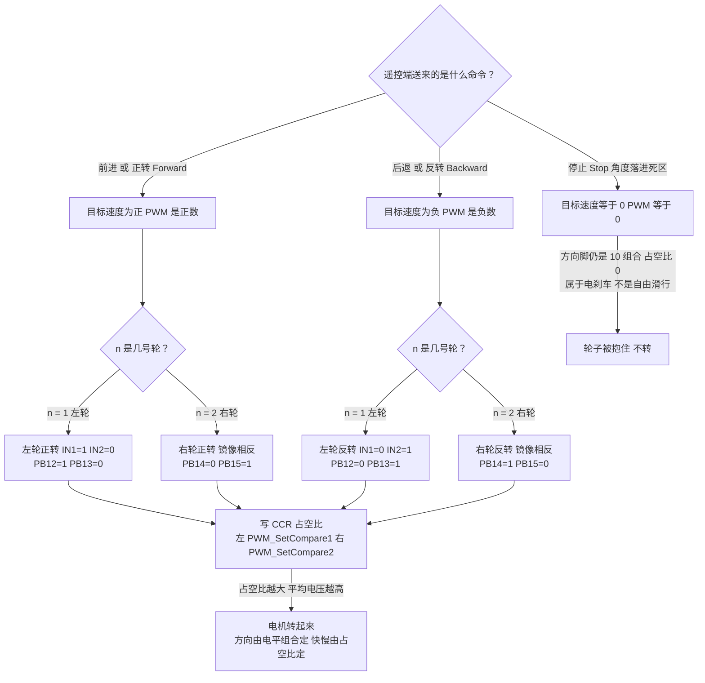
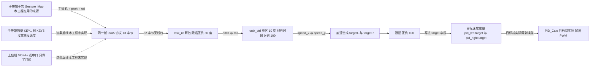

# 阶段三 · 双机通信控制电机 保姆级图解

> 本文件按《图解协议》生成：每张 Mermaid 图的**正下方**都紧跟「👀 导游解说」和「📖 名词词典」，一个都不少。
> 对应题目：第三阶段 —— 一块板发指令、另一块板收指令并控制电机**正反转**，而且指令要能**切换目标速度**。
> 对应代码：[遥控/User/main.c](../annotated/遥控/User/main.c)、[FreeRTOS小车/USER/main.c](../annotated/FreeRTOS小车/USER/main.c)、
> [Motor.c](../annotated/FreeRTOS小车/HARDWARE/LED/Motor.c)。引脚、帧格式、参数全部来自 [`_事实清单.md`](_事实清单.md)，没有一个是编的。

---

## 〇、这个阶段用大白话说要做什么

前两个阶段，你分别学会了“**两块板子能互相说话**”和“**一块板子能让电机转**”。这个阶段就是拿根绳把这两件事拴在一起：

**用你手上戴的那块板（手带端）当遥控器，去指挥小车上那块板（小车端）的电机干活。** 手往前一压，小车前进；手往后一仰，小车后退；手端平，小车停；压得越狠，目标速度越大、轮子转得越快。

所以本质区别是：第一阶段的“能发消息”只是**寄信**，这个阶段升级成“**发命令能干活**”——信里写的不是一句 Hello，而是一条让电机正转、反转、转多快的**军令**。一句话记住：**手带端负责“想”，小车端负责“做”，中间那条 0xA5 帧就是命令书。**

### 题目任务清单

| 任务 | 题目要求 | 怎么算过关 | 你工程里的实现 |
| :--- | :--- | :--- | :--- |
| 任务1 | 一块板发指令，另一块板接收并控制电机**正反转** | 手一动，两个轮子能正着转也能倒着转，方向跟手势对得上 | 手带端 `遥控/User/main.c` 用 `Gesture_Map()` 判手势、`Protocol_Pack()` 组 **0xA5 帧**，经 nRF24L01 发出；小车端 `FreeRTOS小车/USER/main.c` 的 `task_rx` 解包后由 `task_ctrl` 调 `Motor_SetPWM` 下发方向 |
| 任务2 | 指令能**切换目标速度**，电机端能响应 | 倾斜角度变大，轮子明显变快；端平就停；不是只有“转/不转”两档 | 小车端把角度做**死区 10° + 线性映射**成 0~100 的目标速度，写进 `pid_left.target` / `pid_right.target`，由 `PID_Calc` 算出 PWM 占空比 |

---

## 一、图一：一条指令的旅行路线

```mermaid
graph LR
    subgraph HAND["① 手带端 Handheld Remote 发命令的人"]
        direction TB
        IMU["MPU6050 六轴姿态传感器 IMU"]
        KEY["按键 KEY1 到 KEY5 Button"]
        GEST["手势映射 Gesture_Map"]
        PACK["协议组帧 Protocol_Pack<br/>0xA5 帧头 + 9 字节载荷 + 异或校验 + 0x0D 帧尾"]
        TXM["nRF24L01 发送模式 TX"]
    end
    subgraph AIR["② 空中 2.4GHz Air"]
        RF["无线信道 Radio Channel"]
    end
    subgraph CAR["③ 小车端 FreeRTOS Car 干活的人"]
        direction TB
        RXM["nRF24L01 多通道接收 RX"]
        RX["接收任务 task_rx 每 20ms 轮询"]
        UNPACK["协议解包 Protocol_Unpack 5 道校验"]
        MAP["速度映射 task_ctrl<br/>死区 10 度 + 转向阈值 15 度"]
        PID["速度环 PID pid_left 与 pid_right"]
        DRV["TB6612 驱动板<br/>PA0 与 PA1 油门 PB12 到 PB15 方向"]
        MOT["左右两个 12V 减速电机 Motor"]
    end
    IMU -->|"读出 pitch 与 roll 两个角度"| GEST
    KEY -->|"1ms 扫描出的按键编号"| GEST
    GEST -->|"1 字节手势码 1 到 5"| PACK
    PACK -->|"13 字节有效帧"| TXM
    TXM ==>|"固定 32 字节无线包"| RF
    RF ==>|"同样 32 字节"| RXM
    RXM -->|"原始 32 字节 buf"| RX
    RX -->|"交给解包函数看前 13 字节"| UNPACK
    UNPACK -->|"校验通过的 pitch roll gesture"| MAP
    MAP -->|"左右轮目标速度 targetL 与 targetR"| PID
    PID -->|"PWM 值 -100 到 100"| DRV
    DRV ==>|"12V 大电流"| MOT
    MOT -.->|"编码器脉冲回报实际转速"| PID
```

> [!example] 👀 导游解说：这张图在讲什么？
>
> 从左往右，跟着一条指令走完全程：
>
> - **`① 手带端` 大框**：你手上那块板，只负责“想”，一根电机线都没接。**`MPU6050`** 是手环上的六轴传感器（软件 I2C，PB6/PB7），告诉你手往前压了多少度（pitch）、往左歪了多少度（roll）；**`KEY1 到 KEY5`**（PB12/PB13/PB14/PB15/PA8，1ms 扫一次、长按 500ms）是手上另一条输入通道，但**这版发出去的帧，手势是 MPU6050 算的，不是按键按的**。
> - **`Gesture_Map` 框**：把角度翻译成 1 个字节的手势码。**先判 pitch 再判 roll**，阈值 15°：pitch>+15 前进（1）、pitch<-15 后退（2）、roll>+15 左转（3）、roll<-15 右转（4）、都不满足是停止（5）。
> - **`Protocol_Pack` 框**：把命令装进信封。固定 13 字节：`0xA5 | 长度 9 | pitch 4 字节 | roll 4 字节 | 手势 1 字节 | 异或校验 | 0x0D`。
> - **`nRF24L01 发送模式` → `无线信道`**：2.4GHz 模块隔空喊话，**固定发 32 字节**、每 100ms 一帧。注意这个坑：信封上写 13 字节，实际寄出 32 字节，多出来的 19 个 0 是 `memset` 清出来的填充。
> - **`多通道接收` 框**：小车端同款模块，开两个通道（通道 0 地址 `0x11...`、通道 1 地址 `0x22...`）等着收；**`task_rx`** 每 20ms 问一次“有没有新包”。
> - **`Protocol_Unpack` 框**：拆信封 + 验真伪，5 道校验全过才认这条命令，否则整帧丢掉。
> - **`速度映射 task_ctrl` 框**：|pitch|≤10° 当没动（死区），超过 10° 就按 10°~80° 线性映射到 0~100；roll 的阈值是 15°。
> - **`速度环 PID` 框**：拿“我想要 60”和“编码器说现在 45”算差值，决定油门加多少（`Kp=2.0、Ki=1.5、Kd=0`）。
> - **`TB6612 驱动板` 框**：真正出力气的壮汉，PA0/PA1 是油门（20kHz PWM），PB12~PB15 是方向盘。**最右边的电机**一转，编码器就往回吐脉冲——那条**往回拐的虚线**就是闭环的命根子。
>
> 每条边“发的是什么”图上都标了：角度 → 手势码 → 13 字节帧 → 32 字节包 → 原始 buf → 有效帧 → 目标速度 → PWM → 12V 电流 → 编码器脉冲。

> [!info] 📖 本图名词词典
> | 缩写/字母 | 全称 | 中文意思 | 在实物/代码里到底是什么？ |
> | :--- | :--- | :--- | :--- |
> | **0xA5 / 0x0D** | Hex A5 / Hex 0D | 帧头 / 帧尾 | 十六进制的 165 和回车符 CR：收到 0xA5 才认为“一帧开始了”，收到 0x0D（第 13 字节）才算收完。 |
> | **帧 / 载荷 Frame / Payload** | Frame / Payload | 一帧数据 / 帧里真正有用的内容 | 一次通信的一整包 13 字节；其中 9 字节是载荷 = pitch 4 + roll 4 + 手势 1，帧头帧尾不算。 |
> | **异或校验 XOR** | Exclusive OR Checksum | 校验和 | 把第 1 到第 10 字节逐个异或，结果写进第 12 字节；收端重算，对不上就丢帧。**从长度字节开始算**，两端必须完全一致。 |
> | **Protocol_Pack** | Protocol Pack | 协议打包函数 | 手带端 `User/main.c` 的静态函数，把结构体拼成 13 字节。 |
> | **Protocol_Unpack** | Protocol Unpack | 协议解包函数 | 小车端 `USER/main.c` 的静态函数，校验并把字节还原成 pitch/roll/gesture。 |
> | **Gesture_Map** | Gesture Map | 手势映射函数 | 手带端的函数，用 15° 阈值把两个角度翻译成 1~5 的手势码。 |
> | **GESTURE_FWD/BACK/LEFT/RIGHT/STOP** | Gesture Forward / Back / Left / Right / Stop | 前进/后退/左转/右转/停止 | 五个宏，值为 1/2/3/4/5；`GESTURE_NONE=0` 是“无手势”初值，不是有效指令。 |
> | **pitch** | Pitch Angle | 俯仰角 | 手往前压/往后仰的角度，正数=前进、负数=后退。 |
> | **roll** | Roll Angle | 横滚角 | 手往左歪/往右歪的角度，正数=左转、负数=右转。 |
> | **MPU6050** | MPU-6050 | 六轴姿态传感器 | 一个芯片里塞了 3 轴加速度计 + 3 轴陀螺仪，用互补滤波解角度（无磁力计，Yaw 恒为 0）。 |
> | **IMU** | Inertial Measurement Unit | 惯性测量单元 | 对“能测姿态的传感器”的统称，这里指的就是 MPU6050。 |
> | **nRF24L01** | Nordic RF 24L01 | 2.4GHz 无线收发模块 | 指甲盖大的小板子，代替蓝牙 HC-05 做无线双机通信；手带端接 PA0~PA5，小车端接 PA2/PA3/PA4/PA5/PB0/PB1。2.4GHz 就是它用的频段，和 WiFi、蓝牙同段，免许可。 |
> | **SPI** | Serial Peripheral Interface | 串行外设接口 | 一种“几根线打配合”的高速通信方式；你工程里是**软件 SPI**，靠代码手动翻转 SCK 电平，不是硬件 SPI 外设。 |
> | **CE / CSN** | Chip Enable / Chip Select Not | 芯片使能 / 片选（低有效） | CE 是“发射按钮”，拉高一下触发发送；CSN 拉低才“点名”这个模块，它才肯听你说话。 |
> | **TX / RX** | Transmit / Receive | 发送 / 接收 | 手带端工作在发送模式，小车端工作在接收模式，是**同一种模块的两个角色**。 |
> | **task_rx** | Task Receive | 接收任务 | 小车端优先级 3 的 FreeRTOS 任务，栈 256 字，20ms 一轮。 |
> | **task_ctrl** | Task Control | 控制任务 | 小车端优先级 2 的任务，20ms 一轮：映射速度 → 读编码器 → 跑 PID → 下发 PWM。 |
> | **FreeRTOS** | Free Real-Time Operating System | 免费的实时操作系统 | 让单片机“同时干几件事”的小系统；静态创建了 rx、ctrl、disp 三个任务，并用互斥量保护共享变量。 |
> | **PID** | Proportional-Integral-Derivative | 比例-积分-微分控制器 | “看差距、按差距加油门”的算法；你代码只用了 P 和 I，D 项留接口没参与运算。 |
> | **PWM / 占空比** | Pulse Width Modulation / Duty Cycle | 脉冲宽度调制（油门）/ 高电平占比 | 一秒开关两万次，用“开的时间占比”表示快慢；CCR 写 50 就是 50%，本工程 CCR 范围 0~100。 |
> | **死区 10°** | Dead Zone | 死区 | 角度小于 10° 一律当 0，防止手抖让车原地抽动；roll 的转向死区更大，是 15°。 |
> | **TB6612** | TB6612FNG | 双路电机驱动芯片 | 功率放大器：小信号进、12V 大电流出，能同时带左右两个电机。 |
> | **编码器** | Encoder | 测速“小眼睛” | 电机尾部传感器，转一圈给 13 个脉冲（A/B 四倍频后 52 个计数），代码用它反推实际转速。 |
> | **小端 Little Endian** | Little Endian | 低字节在前 | float 的 4 个字节在内存里低字节排前面；两端都用 `memcpy` 原样搬，所以不用换字节序。 |

---

## 二、图二：电机正转 / 反转 / 停止怎么判断

> [!example] 👀 导游解说：这张图在讲什么？
>
> 这是 `Motor_SetPWM(n, PWM)` 的“思维导图”：只有两个输入——**哪个轮子**（n=1 左、n=2 右）和**一个带正负号的数**（-100~100）。组合起来就把命令变成了 4 根引脚上的 0/1 和 1 个占空比。
>
> **第一个菱形 `遥控端送来的是什么命令？`——三种情况走三条路：**
>
> - **左边 `POS` 分支**：命令是前进/正转，目标速度是正数，PWM 也是正数 → 再看 n 是几号轮。
> - **中间 `NEG` 分支**：命令是后退/反转，目标速度是负数，PWM 也是负数 → 再看 n 是几号轮。
> - **右边 `ZERO` 分支**：命令是停止（角度落进 10° 死区，或左右分量都小于 0.1），PWM 直接给 0。**注意：代码里 0 走的是“PWM≥0”那条 if，所以方向脚仍被置成 10 组合、只有占空比为 0**——两个输出脚同低，电机两端被短接，这叫**电刹车**，轮子是被抱住的，不是自由滑行。
>
> **第二个菱形 `n 是几号轮？`——左右各走一条：**
>
> - **n=1 且 PWM 为正** → `LF`：`PB12=1、PB13=0`，即 IN1=1、IN2=0，左轮正转。
> - **n=1 且 PWM 为负** → `LB`：`PB12=0、PB13=1`，即 IN1=0、IN2=1，左轮反转。
> - **n=2 且 PWM 为正** → `RF`：`PB14=0、PB15=1`。**最容易记错**：右电机镜像安装，所以同样“正转”，右轮的电平组合是 `01`，跟左轮正好相反。
> - **n=2 且 PWM 为负** → `RB`：`PB14=1、PB15=0`，右轮反转。
>
> **四个分支汇到同一个 `CCR` 框**：方向定了以后，把 PWM 的**绝对值**写进比较寄存器——左轮 `PWM_SetCompare1()`，右轮 `PWM_SetCompare2()`。记住：**符号管方向（4 根线的 0/1），绝对值管快慢（CCR 占空比）**。另外两个真实细节：① PWM 形参是 `int8_t`（-128~127），调用方已限幅 ±100，不会溢出；② n 既不是 1 也不是 2 时函数什么都不做，电机保持上一次状态，传错参数没有任何提示。

> [!info] 📖 本图名词词典
> | 缩写/字母 | 全称 | 中文意思 | 在实物/代码里到底是什么？ |
> | :--- | :--- | :--- | :--- |
> | **IN1 / IN2（IN3 / IN4）** | Input 1 / 2（Input 3 / 4） | 左电机方向输入 / 右电机方向输入 | 驱动板上控制方向的两个逻辑脚，一高一低决定正反转；IN1/IN2 对应 PB12/PB13，IN3/IN4 对应 PB14/PB15。 |
> | **AIN1 / AIN2、BIN1 / BIN2** | A/B-channel Input 1 / 2 | A 路（左）/ B 路（右）输入 | TB6612 丝印上的叫法，和 IN1~IN4 是同一件事。原理图上 **PB12→AIN2、PB13→AIN1**（顺序和名字是反的），**PB14→BIN1、PB15→BIN2**。 |
> | **PB12 / PB13** | Port B Pin 12 / 13 | B 端口第 12、13 号引脚 | 左轮两根方向线，`Motor_Init` 里配成推挽输出、速度 50MHz。 |
> | **PB14 / PB15** | Port B Pin 14 / 15 | B 端口第 14、15 号引脚 | 右轮两根方向线；因电机镜像安装，正转是 `PB14=0、PB15=1`。 |
> | **真值组合 10 / 01** | Truth Table 10 / 01 | 两根脚“一高一低”的两种状态 | 10 表示前一根高、后一根低，01 反过来；H 桥就靠这两种组合把电流方向倒过来。 |
> | **H 桥** | H-Bridge | H 形换向电路 | 驱动芯片内部 4 个开关，能把电机两端正负对调，所以电机能正转也能反转。 |
> | **CCR** | Capture/Compare Register | 捕获/比较寄存器 | 装占空比数字的寄存器，范围 0~100（ARR 是 100）。写 CCR 就等于踩油门。 |
> | **PWM_SetCompare1 / 2** | PWM Set Compare 1 / 2 | 设置通道 1 / 通道 2 占空比 | `PWM.c` 里的函数：1 号写 TIM2_CH1（PA0，左轮），2 号写 TIM2_CH2（PA1，右轮）。 |
> | **电刹车 / 自由滑行** | Electrical Braking / Coast | 电气制动 / 惯性滑行 | 电刹车=两输出脚同低、电机两端短接，轮子被拽住；自由滑行=把 IN1、IN2 都置 0 让 H 桥断开，靠惯性慢慢停。**你代码里只有电刹车，没有滑行分支**，注释已用 NOTE 标出。 |
> | **镜像安装** | Mirror Mounting | 左右对称安装 | 两个电机面对面装在车两侧，同一组电平会让它们朝相反方向转，所以右轮代码故意反过来写。 |
> | **占空比** | Duty Cycle | 油门开度 | CCR ÷ ARR，0 是完全没电、100 是满电；PWM 频率 = 72MHz÷36÷100 = 20kHz。 |
> | **int8_t** | 8-bit signed integer | 8 位有符号整数 | 只能装 -128~127，所以 PWM 参数天生带着“正负号”这个方向信息。 |

---

## 三、图三：目标速度从哪来（可选补充图）

> [!example] 👀 导游解说：这张图在讲什么？
>
> 它回答答辩常问的一句：**“目标速度到底是谁给的？”**
>
> - **实线部分（已经在跑）**：手势 → 角度 → 死区与线性映射 → 差速合成 → 限幅 → 写进 `pid_left.target` / `pid_right.target`。`target` 只是 PID 结构体里的一个字段，写进去之后 `PID_Calc` 才会拿它去减反馈值。
> - **映射公式（pitch 方向）**：`speed_x = (pitch - 10) / (80 - 10) * 100`。所以 10° 是 0、80° 是满速 100，中间线性变化——这就是“倾斜越多、目标速度越大”的由来。
> - **两条虚线（题目允许、你工程没做）**：按键加减档、上位机在线改目标速度，都能实现“切换目标速度”，但你最终走的是手势路线，VOFA+ 只做了打印波形。答辩如实说“方案评估过、接口留了但没实现”，比硬编一个假实现更稳。
> - **为什么先限幅 ±80°**：解算偶尔跳变，角度一大线性映射就会给出超 100 的目标，所以 `task_rx` 里先把 pitch/roll 封在 ±80°。

> [!info] 📖 本图名词词典
> | 缩写/字母 | 全称 | 中文意思 | 在实物/代码里到底是什么？ |
> | :--- | :--- | :--- | :--- |
> | **目标速度 Target** | Target Speed | 想要的速度 | 范围 -100~100，正=前进、负=后退、0=停；存在 PID 结构体的 `target` 字段里。 |
> | **实际速度 Feedback** | Feedback Speed | 测到的速度 | 编码器换算来的 `g_act_left` / `g_act_right`：除 52、除 0.02s、除减速比 9.27666、再乘 5。 |
> | **pid_left.target** | PID Left Target | 左轮 PID 的目标值 | 结构体 `PID_t` 的成员，`task_ctrl` 每 20ms 写一次，`PID_Calc` 拿来算误差。 |
> | **线性映射** | Linear Mapping | 线性换算 | 把 10°~80° 按比例缩到 0~100，代码里除的分母是 `80 - 10 = 70`。 |
> | **差速** | Differential Drive | 差速转向 | 左轮 = 前进 + 转向，右轮 = 前进 − 转向；一个快一个慢，车就拐弯。 |
> | **限幅 Clamp** | Clamp / Saturate | 上下限封顶 | 两个分量相加最大能到 200，必须夹回 ±100，否则超过电机驱动的接受范围。 |
> | **VOFA+ / 上位机** | VOFA+ / Host Computer | 串口波形软件 / 电脑端程序 | 电脑上收串口数据画曲线的工具（相对于单片机这个“下位机”）；你只用它打印“实际 vs 目标转速”，没做在线改参。 |
> | **串口 / USART1** | Serial Port / USART1 | 串口 / 通用串口 1 | 一根线一位一位传数据的接口；小车端 PA9=TX、PA10=RX，115200-8N1，`printf` 重定向到它上面。 |
> | **REVERSE_TURN / PID_Calc** | Reverse Turn / PID Calculate | 转向取反开关 / PID 计算函数 | 宏 =1 时把转向分量乘 -1，纠正左右装反；`PID_Calc` 做“误差 → 积分（±100 限幅）→ Kp·err + Ki·integral → 输出限幅 ±100”。 |

---

## 四、代码对照：这个阶段落在哪些文件里

| 文件 | 关键函数 / 宏 | 干什么 |
| :--- | :--- | :--- |
| [遥控/User/main.c](../annotated/遥控/User/main.c) | `Gesture_Map()`、`Protocol_Pack()`、`NRF24L01_SendData()` | 判手势、组 0xA5 帧、每约 100ms 发一包 32 字节 |
| [FreeRTOS小车/USER/main.c](../annotated/FreeRTOS小车/USER/main.c) | `Protocol_Unpack()`、`task_rx()`、`task_ctrl()`、`PID_Calc()` | 收包解包、20ms 映射速度、跑 PID、调 `Motor_SetPWM` |
| [Motor.c](../annotated/FreeRTOS小车/HARDWARE/LED/Motor.c) | `Motor_Init()`、`Motor_SetPWM(n, PWM)` | 4 根方向脚配推挽输出；PWM 符号定方向、绝对值定占空比 |
| [nRF24L01_API.c（小车端）](../annotated/FreeRTOS小车/HARDWARE/LED/nRF24L01_API.c) | `NRF24L01_RX_MultiChannel_Init()`、`NRF24L01_RxPacket_Multi()` | 多通道接收，一次读满 32 字节 |

---

## 五、答辩三问（老师最爱问）

1. **问：指令在天上飞，怎么保证不被干扰、不被认错？**
   答：靠三层。①**帧格式**——帧头 0xA5、长度域 9、帧尾 0x0D，三个位置都对上才算“像我的帧”；②**异或校验**——把长度字节到手势字节逐字节异或再比对，空中翻错的位会被抓出来，`Protocol_Unpack` 里 5 道检查任何一道不过就 `return -1` **整帧丢掉**，绝不拿坏数据开车；③**周期重发**——每 100ms 一帧，丢一帧毫秒级就补上，人根本感觉不到。
2. **问：为什么发目标和收目标必须约定同一个帧格式？**
   答：因为接收端**按固定下标取字节**：`buf[2]` 起 4 字节当 pitch、`buf[6]` 起 4 字节当 roll、`buf[10]` 当手势、`buf[11]` 当校验。发端若改了长度域或校验范围，收端算出的校验永远对不上，帧会被全丢掉；改了字节序，角度会变成乱七八糟的数字。所以两边是**一份契约**：`Protocol_Pack` 和 `Protocol_Unpack` 必须同改同测，`len==13`、`buf[1]==9`、校验从下标 1 算到 10，一处都不能单方面动。
3. **问：正转反转、快慢，分别由什么决定？**
   答：**正反转由方向脚的电平组合决定，快慢由 CCR 占空比决定**。代码用一个带符号的 `PWM` 把它们串起来：`PWM >= 0` 走正转分支（左轮 PB12=1、PB13=0），`PWM < 0` 走反转分支（PB12=0、PB13=1），再把**绝对值**写进 CCR。右轮因镜像安装，正转是 PB14=0、PB15=1，正好相反。`PWM = 0` 时方向组合仍是 10、占空比为 0，属于**电刹车**而非自由滑行。

---

## 六、自测清单（能全部打勾就说明这个阶段真的会了）

- [ ] 能不看笔记画出一条指令的路线：手势 → 13 字节帧 → 32 字节包 → `task_rx` → 映射 → PID → `Motor_SetPWM` → 轮子
- [ ] 能背出帧格式 `0xA5 | 长度 9 | pitch | roll | 手势 | 校验 | 0x0D`，并说清校验从哪个字节算到哪个字节
- [ ] 能说出左轮正转是 `PB12=1、PB13=0`、右轮正转是 `PB14=0、PB15=1`，并解释右轮为什么是反的
- [ ] 能解释“符号管方向、绝对值管快慢”，以及 PWM=0 为什么是电刹车
- [ ] 能在代码里指出 `Gesture_Map`、`Protocol_Pack`、`Protocol_Unpack`、`task_rx`、`task_ctrl` 各在哪一行、各干什么
