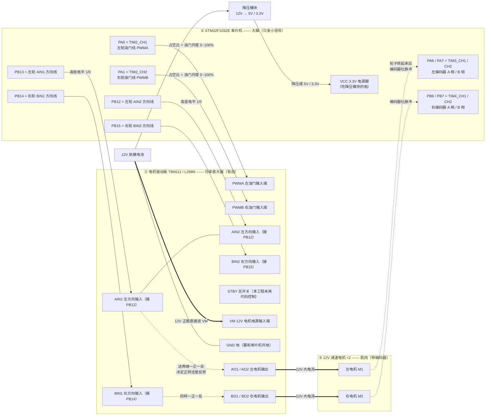
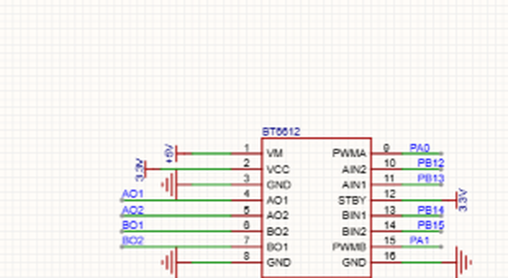
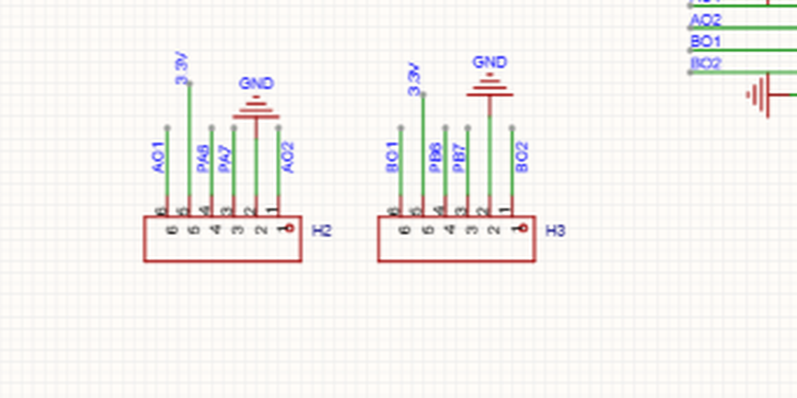
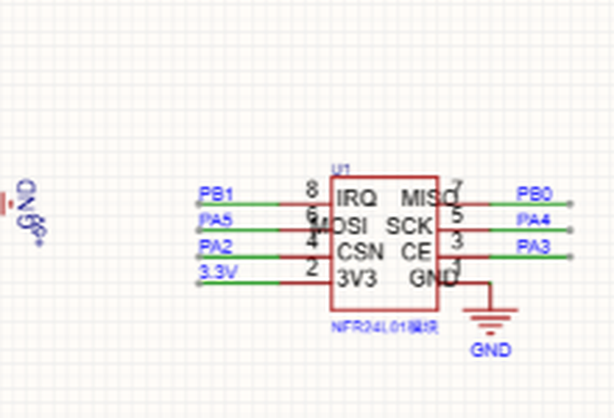
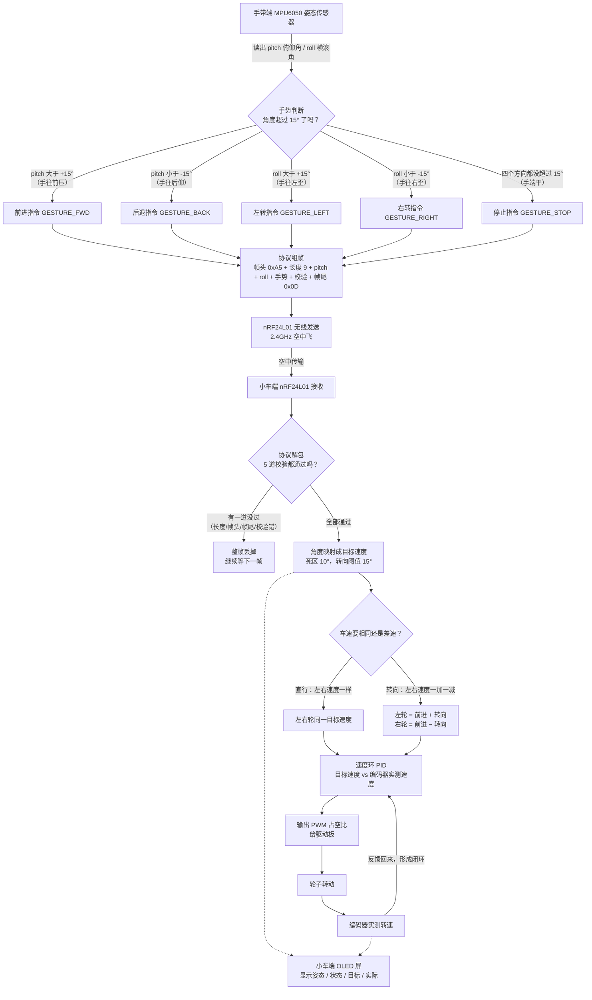

# 阶段二 · 电机驱动 保姆级图解（引脚接线图 + 调速数据流）

> 本文件按你的《图解协议》生成：每张 Mermaid 图**正下方**都紧跟「👀 看图说话」和「📖 字母缩写词典」。
> 图里出现的每一个引脚、定时器、通道，全部来自你自己工程的源码，不是猜的：
> [Motor.c](../annotated/FreeRTOS小车/HARDWARE/LED/Motor.c)、[PWM.c](../annotated/FreeRTOS小车/HARDWARE/LED/PWM.c)、
> [Encoder.c](../annotated/FreeRTOS小车/HARDWARE/LED/Encoder.c)、[led.c](../annotated/FreeRTOS小车/HARDWARE/LED/led.c)、
> [nRF24L01_API.c](../annotated/FreeRTOS小车/HARDWARE/LED/nRF24L01_API.c)。

---

## 〇、三十秒先建立画面（先记这个，再看图）

把你家小车想成一个人：

| 人体的部位 | 小车里对应什么 | 在本篇图里的位置 |
| :--- | :--- | :--- |
| **大脑** | STM32 单片机（只会算数、发命令，没力气） | 图一最左边那组框 |
| **神经** | 6 根细线（4 根方向线 + 2 根油门线） | 图一中间的箭头 |
| **肌肉放大器** | 电机驱动板（把 3.3V 的小信号放大成 12V 的大电流） | 图一中间那组框 |
| **肌肉** | 两个 12V 减速电机（真正干活的） | 图一最右边 |
| **眼睛** | 电机屁股后面的编码器（数转了多少圈） | 图一右下角回头的虚线 |
| **心脏/胃** | 12V 电池 + 降压模块（供电） | 图一左下角 |

一句话总结：**大脑用手指头比划方向（4 根方向线），用嗓门大小控制力气（2 根 PWM 油门线），眼睛再把轮子实际转多快报回大脑。**

---

## 一、图一：一个电机是怎么被“管”住的？（接线引脚图）

> [!example] 👀 导游解说：这张图在讲什么？
>
> 咱们从左往右、像导游带团一样走一遍：
>
> - **最左边那个大框 `① STM32F103ZE 单片机`** 代表：小车的大脑，一块蓝色小板子。它自己没劲，只能输出很小的电压，所以**不能直接接电机**（一接就烧）。
> - **`PA0`、`PA1` 这两个小框**代表：大脑发出的两根“油门信号线”，学名叫 **PWM**。它输出的不是固定的 3.3V，而是**一秒钟内疯狂开关两万次**（20kHz），开的时间长一点，电机就转得快一点，这就是“油门”。
> - **`PB12`、`PB13` 这两个小框**代表：左电机的两根“方向信号线”。它俩只会输出高电平（1）或低电平（0），**两根线的组合就决定了轮子是正着转还是倒着转**（就像你用手推门，往前推和往后拉）。
> - **`PB14`、`PB15`** 同理，管的是右电机。
> - **中间那个大框 `② 电机驱动板`** 代表：功率放大器。它像个“听话的壮汉”：大脑让它往左，它就把 12V 电池的电按正确方向灌给电机；大脑给的油门是 30%，它就只给 30% 的电。
> - **`PWMA / PWMB` 两个框**代表：壮汉的“油门输入端”，分别接大脑的 PA0 / PA1。
> - **`AIN1 / AIN2`、`BIN1 / BIN2`** 代表：壮汉的“方向输入端”，分别接大脑的 PB12/13、PB14/15。
> - **`AO1 / AO2`、`BO1 / BO2`** 代表：壮汉的两只手，真正接在电机两根线上的输出端。
> - **最右边 `③ 12V 减速电机`** 代表：真正干活的肌肉。它里面自带减速齿轮（所以叫减速电机），力气大、转速慢，适合推小车。
> - **右下角那条往回拐的虚线 `编码器吐脉冲`** 代表：电机屁股后面有个“小眼睛（编码器）”，轮子每转一点点它就“哒”一下，这些“哒哒”声（电脉冲）通过 `PA6/PA7`（左）、`PB6/PB7`（右）回报给大脑——**大脑靠数“哒”的个数，就知道轮子实际转多快了**。这条“回报线”就是后面做 PID 闭环的前提。
> - **左下角 `12V 航模电池` 和 `降压模块`** 代表：电池同时喂两边——一边把 12V 直接给驱动板（力气大），一边降压成 5V/3.3V 给单片机（单片机很娇气，只能吃低压）。
>
> **如果图里有 `if/else` 分支（这张图没有，但下一张有），我会明确说“什么情况下走左边、什么情况下走右边”。**
>
> 再讲一遍“方向是怎么定的”，这是答辩最爱问的（下面按**原理图实际连接**来说，已和截图核对过）：
> - 左轮**代码里的正转**：`PB12 = 1`（对应 AIN2 = 1）、`PB13 = 0`（对应 AIN1 = 0）；
> - 左轮**代码里的反转**：`PB12 = 0`、`PB13 = 1`；
> - 右轮因为电机是**镜像安装**的（左右调了个个儿），所以代码里故意反过来：`PB14 = 0`（BIN1）、`PB15 = 1`（BIN2）才是右轮正转；
> - STBY 这根“总开关”在原理图上**直接接 3.3V（常高）**，所以代码里根本不需要管它；
> - 如果大脑说“油门 = 0”，代码仍会把方向脚置成 `10`、PWM 置 0，此时 H 桥两个输出脚都低——**轮子是被“电刹车”抱住的，不是自由滑行**（这是你源码里的真实行为，注释里已用 NOTE 标出）。

> [!info] 📖 本图名词词典
> | 缩写/字母 | 全称 | 中文意思 | 在实物/代码里到底是什么？ |
> | :--- | :--- | :--- | :--- |
> | **PA0** | Port A Pin 0 | A 端口第 0 号引脚 | 单片机 A 组引脚的第 0 根腿，这里被定时器 2 的通道 1 借走当“左油门”。 |
> | **PA1** | Port A Pin 1 | A 端口第 1 号引脚 | A 组第 1 根腿，当“右油门”。 |
> | **PB12 / PB13** | Port B Pin 12 / 13 | B 端口第 12、13 号引脚 | 左电机的两根方向线：原理图上 **PB12 → AIN2、PB13 → AIN1**（代码注释把这两脚统称“左 IN1/IN2”，位置以原理图为准）。 |
> | **PB14 / PB15** | Port B Pin 14 / 15 | B 端口第 14、15 号引脚 | 右电机的两根方向线：原理图上 **PB14 → BIN1、PB15 → BIN2**。 |
> | **PA6 / PA7** | Port A Pin 6 / 7 | A 端口第 6、7 号引脚 | 左编码器 A、B 两相继电器输入，被定时器 3 的通道 1、2 读走。 |
> | **PB6 / PB7** | Port B Pin 6 / 7 | B 端口第 6、7 号引脚 | 右编码器 A、B 两相输入，被定时器 4 的通道 1、2 读走。 |
> | **TIM2** | Timer 2 | 定时器 2 | 单片机内部一个“会数数的秒表”，这里被配置成“自动开关”模式，专门产生 PWM 波形。 |
> | **TIM3 / TIM4** | Timer 3 / Timer 4 | 定时器 3 / 4 | 同样会数数，但这里被配置成“编码器模式”，专门数电机编码器发来的脉冲。 |
> | **CH1 / CH2** | Channel 1 / 2 | 通道 1 / 通道 2 | 一个定时器有 4 条“输出管道”，每条能单独输出一路波形或单独接一路输入。 |
> | **PWM** | Pulse Width Modulation | 脉冲宽度调制（俗称“油门”） | 一秒钟开关两万次，通过“开的时间占多少”来表示速度 0~100%。 |
> | **占空比** | Duty Cycle | 高电平占一个周期的比例 | 代码里 `PWM_SetCompare1(50)` 就是 50% 油门。 |
> | **CCR** | Capture/Compare Register | 捕获/比较寄存器 | 存“占空比”的那个数字，写进 CCR 就等于写油门，取值 0~100。 |
> | **ARR** | Auto-Reload Register | 自动重装载寄存器 | 决定“一个 PWM 周期数多少下”，你工程里是 100（写的是 `100 - 1`）。 |
> | **PSC** | Prescaler | 预分频器 | 把 72MHz 先除以 36 变成 2MHz，再数 100 下 → 20kHz。 |
> | **20kHz** | 20 kilo-Hertz | 每秒两万次 | 你代码里算出来的 PWM 频率：72MHz ÷ 36 ÷ 100 = 20000Hz。超出人耳听觉，电机不会“吱吱”叫。 |
> | **IN1 / IN2** | Input 1 / Input 2 | 输入 1 / 输入 2 | 驱动板上控制左电机方向的两个人，一高一低决定正反转。 |
> | **IN3 / IN4** | Input 3 / Input 4 | 输入 3 / 输入 4 | 控制右电机方向的两个输入。 |
> | **AIN1 / AIN2** | A-channel Input 1 / 2 | A 路（左）输入 1 / 2 | TB6612 模块上丝印的名字，和 IN1/IN2 是同一件事，只是模块厂商叫法不同。 |
> | **BIN1 / BIN2** | B-channel Input 1 / 2 | B 路（右）输入 1 / 2 | 右电机的方向输入（对应 IN3/IN4）。 |
> | **PWMA / PWMB** | PWM A / PWM B | A 路 / B 路 油门输入 | 模块上接 PWM 的两个脚，分别接 PA0、PA1。 |
> | **STBY** | Standby | 待机/总使能脚 | TB6612 的“总开关”：接高电平电机才可能转，接低电平全停。**你代码里没有控制这根线**——原理图上它直接接 3.3V（常高）。L298N 没有 STBY，而是用 ENA/ENB 当油门+使能。 |
> | **AO1 / AO2** | A Output 1 / 2 | A 路（左）电机输出 | 驱动板真正接左电机两根线的端子。 |
> | **BO1 / BO2** | B Output 1 / 2 | B 路（右）电机输出 | 驱动板真正接右电机两根线的端子。 |
> | **VM** | Motor Voltage | 电机供电（大电压） | 驱动板的 12V 输入，接电池正极。 |
> | **VCC** | Voltage Common Collector | 逻辑供电（小电压） | 驱动板自身的 5V/3.3V 逻辑电源。 |
> | **GND** | Ground | 地（负极） | 电池负极、驱动板地、单片机地**必须连在一起（共地）**，否则信号没有参考，会乱跳。 |
> | **H 桥** | H-Bridge | H 形电路 | 驱动板内部 4 个开关组成的“换向电路”，能把电流方向倒过来，所以电机能正反转。 |
> | **A 相 / B 相** | Phase A / Phase B | 编码器的两路信号 | 编码器输出的两路方波，互相错开 90°，靠谁先谁后就能判断正反转。 |
> | **编码器** | Encoder | 编码器（测速眼睛） | 电机尾部的传感器，轮子每转一个小角度就发一个脉冲。 |
> | **13 线 / 52** | 13 lines / 52 counts | 13 线编码器 / 每圈 52 个计数 | 电机转一圈编码器出 13 个脉冲，A/B 两相都数（四倍频）= 52，正好是代码里除的那个 52。 |
> | **四倍频** | 4× decoding | 四倍频计数 | A 相上升沿、下降沿 + B 相上升沿、下降沿都计数，一圈 13 × 4 = 52。 |
> | **减速比 9.27666** | Gear Ratio | 减速比 | 电机内部齿轮把转速降低、力气放大的倍数，代码里用它把“电机轴转速”换算成“输出轴转速”。 |
> | **推挽输出** | Push-Pull Output | 推挽输出 | 引脚能主动输出高电平，也能主动输出低电平（用来驱动方向脚）。 |
> | **复用推挽** | Alternate Function Push-Pull | 复用功能推挽 | 引脚不再由你写 1/0，而是交给定时器自动产生 PWM 波形。 |
> | **共地** | Common Ground | 共地 | 所有板子的 GND 连到一起，否则电压没有“参照物”。 |
> | **降压模块** | Buck Converter | 降压模块 | 把 12V 电池降到 5V/3.3V 给单片机用（题目要求必须电池供电、不能插电脑 USB）。 |

---

## 一·补：对着你真实的原理图截图再看一眼

下面三张是从你 Altium 原理图里裁出来的局部图（原图在 [_hw](../_hw) 文件夹），
拿它们和上面那张“示意图”对照着看，就不会记错了。

### 图一补-A：TB6612 电机驱动模块（`_hw/c1_tb6612.png`）

> [!example] 👀 导游解说：这张截图在讲什么？
>
> 这就是驱动板上那 16 个脚，照着编号一个一个看：
> - **1 脚 VM**：接 **12V**（电机的“大电”，专门给电机使劲用）；
> - **2 脚 VCC**：接 **3.3V**（芯片自己的“小饭”，它内部控制逻辑要吃 3.3V）；
> - **3、8、16 脚 GND**：接地，要和单片机共地；
> - **4 脚 AO1、5 脚 AO2**：接**左电机**的两根线（电机不区分正负，接反了只是转向反过来）；
> - **6 脚 BO2、7 脚 BO1**：接**右电机**的两根线（注意原理图上 BO2 在 BO1 上面，别数错）；
> - **9 脚 PWMA**：接 **PA0**，左轮油门；
> - **10 脚 AIN2**：接 **PB12**，左轮方向线之一；
> - **11 脚 AIN1**：接 **PB13**，左轮方向线之二；
> - **12 脚 STBY**：接 **3.3V**（常高）——等于把驱动板“总开关”一直按在开的位置；
> - **13 脚 BIN1**：接 **PB14**，右轮方向线之一；
> - **14 脚 BIN2**：接 **PB15**，右轮方向线之二；
> - **15 脚 PWMB**：接 **PA1**，右轮油门。
>
> ⚠️ **最容易记混的地方**：原理图上 `AIN2` 排在 `AIN1` 上面，所以是 **PB12→AIN2、PB13→AIN1**（顺序和名字是反的）；而代码注释里把 PB12/PB13 笼统写成“IN1/IN2”。**答辩时按原理图说**，不要说错。

> [!info] 📖 本截图补充名词
> | 缩写 | 全称 | 中文 | 说明 |
> | :--- | :--- | :--- | :--- |
> | **VM** | Motor Voltage | 电机电源 | 驱动板第 1 脚，接 12V 电池正极。 |
> | **VCC** | Voltage Common Collector | 逻辑电源 | 驱动板第 2 脚，接 3.3V，只给芯片内部逻辑用。 |
> | **STBY** | Standby | 待机（总开关） | 第 12 脚，接高电平才能工作，本板直接接 3.3V。 |
> | **AO1 / AO2** | A Output 1 / 2 | A 路（左）电机输出 | 第 4、5 脚，左电机两根线。 |
> | **BO1 / BO2** | B Output 1 / 2 | B 路（右）电机输出 | 第 6、7 脚，右电机两根线（BO2 在上、BO1 在下）。 |
> | **U1** | Unit 1 | 元件编号 1 | 原理图里给芯片自动编的号，TB6612 就是 U1。 |

### 图一补-B：电机 + 编码器的 6 针接口 H2 / H3（`_hw/d1_enc_headers.png`）

> [!example] 👀 导游解说：这张截图在讲什么？
>
> 这是板上两个 6 针插座 **H2（左）** 和 **H3（右）**，一根 6 芯线把“电机 + 编码器”一起引出去：
> - **H2 的 6 根线**：`AO1`、`PA6`、`PA7`、`3.3V`、`GND`、`AO2`
>   → 其中 AO1/AO2 是**左电机的两根粗线**；PA6/PA7 是**左编码器的 A 相和 B 相**；3.3V 给编码器供电；GND 共地。
> - **H3 的 6 根线**：`BO1`、`PB6`、`PB7`、`3.3V`、`GND`、`BO2`
>   → 其中 BO1/BO2 是**右电机的两根粗线**；PB6/PB7 是**右编码器的 A 相和 B 相**。
> - 换句话说：**一个接口 = 电机的 2 根线 + 编码器的 4 根线（A、B、3.3V、GND）**，这是小车最常用的接法。
>
> 插线时按插座上的**针脚号 1~6** 对着插，不要凭线的颜色记（不同批次的线颜色会变）。

> [!info] 📖 本截图补充名词
> | 缩写 | 全称 | 中文 | 说明 |
> | :--- | :--- | :--- | :--- |
> | **H2 / H3** | Header 2 / Header 3 | 2 号 / 3 号插座 | 板上两个 6 针排针/端子，分别接左、右电机+编码器。 |
> | **3.3V / 3V3** | 3.3 Volt | 3.3 伏电源 | 给编码器内部电路供电（编码器一般是霍尔或光电，吃 3.3V/5V）。 |
> | **A 相 / B 相** | Phase A / Phase B | A 相、B 相信号 | 编码器两路方波，相位差 90°，单片机靠它们数脉冲、判方向。 |

### 图一补-C：nRF24L01 无线模块（`_hw/c1_nrf.png`）

> [!example] 👀 导游解说：这张截图在讲什么？
>
> 这是小车端那块 8 脚无线模块（原理图编号 U1）：
> - **1 脚 GND**：接地；
> - **2 脚 3V3**：接 **3.3V** 供电——**千万别接 5V，模块会烧**；
> - **3 脚 CE**：接 **PA3**，发送/接收的“使能开关”；
> - **4 脚 CSN**：接 **PA2**，片选，“点名”模块才跟它说话；
> - **5 脚 SCK**：接 **PA4**，时钟节拍；
> - **6 脚 MOSI**：接 **PA5**，单片机 → 模块的数据；
> - **7 脚 MISO**：接 **PB0**，模块 → 单片机的数据；
> - **8 脚 IRQ**：接 **PB1**，模块“有事叫你”的信号线。
>
> 对照代码里的宏定义：`NRF_CSN PAout(2)`、`NRF_CE PAout(3)`、`NRF_SCK PAout(4)`、`NRF_MOSI PAout(5)`、`NRF_MISO PBin(0)`、`NRF_IRQ PBin(1)`——**一一对应，完全一致**。
>
> ⚠️ 这就解释了前面说的 **PA5 冲突**：PA5 既是无线模块的 MOSI，又是 `led.c` 里 LED1 的引脚。如果你的板子上确实焊了 LED1，那么无线收发时灯会乱闪，甚至影响 SPI 波形。

> [!info] 📖 本截图补充名词
> | 缩写 | 全称 | 中文 | 说明 |
> | :--- | :--- | :--- | :--- |
> | **V1 / U1** | 元件编号 | 第 1 号芯片 | 原理图里的自动编号，本图里 nRF 模块是 U1（裁图标注 V1）。 |
> | **3V3** | 3.3 Volt | 3.3 伏 | nRF24L01 只能吃 3.3V，接 5V 会烧。 |
> | **IRQ** | Interrupt Request | 中断请求 | 模块有数据/发送完成时拉低，通知单片机。 |

---

## 二、图二：手一歪，轮子为什么就转？（数据流图，含 if / else 分支）

> [!example] 👀 导游解说：这张图在讲什么？
>
> 这张图是从“手一歪”到“轮子转”的全过程，从上往下走：
>
> 1. **最上面 `MPU6050 姿态传感器`**：手环上的那个小方块，能感觉到你手往前压还是往左歪，输出两个角度：`pitch`（前后俯仰）、`roll`（左右横滚）。
> 2. **菱形 `手势判断`**：这是第一个“岔路口”（if/else）。**四条路怎么走，全看角度有没有超过 15°**：
>    - 如果 **pitch 大于 +15°**（手往前压）→ 走右边第一条岔路，发“**前进**”指令；
>    - 如果 **pitch 小于 -15°**（手往后仰）→ 发“**后退**”；
>    - 如果 **roll 大于 +15°**（手往左歪）→ 发“**左转**”；
>    - 如果 **roll 小于 -15°**（手往右歪）→ 发“**右转**”；
>    - 如果**四个方向都没超过 15°**（手端平）→ 走最下面那条岔路，发“**停止**”。
>    代码里是有顺序的：**先判 pitch，再判 roll**，所以手同时往前压又往左歪时，会先算“前进”。
> 3. **`协议组帧` 那个框**：不管选的是哪种手势，最后都要塞进同一个“信封”里才能寄出去。信封格式固定：`帧头 0xA5 | 长度 9 | pitch 4 字节 | roll 4 字节 | 手势 1 字节 | 校验 1 字节 | 帧尾 0x0D`。
> 4. **`nRF24L01 无线发送` → `小车端接收`**：两个 2.4GHz 小模块隔空传数据，就像对讲机。
> 5. **菱形 `协议解包`**：小车收到信封后要检查 5 件事（长度对不对、帧头是不是 0xA5、长度域是不是 9、帧尾是不是 0x0D、校验和够不够）。**这是第二个岔路口**：
>    - **有一项不对** → 走左边，整帧丢掉（防止空中干扰的乱码被当成命令，让车突然乱窜）；
>    - **五项全对** → 走右边，认为这是一条可信的指令，继续往下。
> 6. **`角度映射成目标速度`**：把 -80°~+80° 的角度，换算成 0~100 的“目标速度”。这里有个**死区 10°**：手抖幅度小于 10° 就当没动，防止车在原地抖。
> 7. **菱形 `车速要相同还是差速？`**：往哪个方向走：
>    - **直行**（只压了前后、没歪）→ 左右轮给**同一个**目标速度；
>    - **转向**（歪了）→ **差速**：左轮 = 前进速度 + 转向速度，右轮 = 前进速度 − 转向速度，一个快一个慢，车就拐弯了。原地转的时候，前进速度是 0，左右轮一正一负。
> 8. **`速度环 PID`**：大脑每秒算 50 次：“我想要 60 的速度，编码器说现在只有 45，那我就再多给一点电”。这就是**闭环**。
> 9. **`输出 PWM` → `轮子转` → `编码器实测` → 再回到 PID**：这条**往回拐的线**就是“闭环”的灵魂——没有它，车就是“蒙着眼睛开”。
> 10. **右下角虚线 `OLED 屏`**：把姿态、状态、目标速度、实际速度显示出来，方便你调试和拍视频。
>
> 一句话记住这张图：**手歪 → 角度超 15° → 选手势 → 装信封 → 无线寄 → 小车验信封 → 换算速度 → PID 加油门 → 轮子转 → 编码器回报 → 再修正。**

> [!info] 📖 本图名词词典
> | 缩写/字母 | 全称 | 中文意思 | 在实物/代码里到底是什么？ |
> | :--- | :--- | :--- | :--- |
> | **MPU6050** | MPU-6050 六轴传感器 | 六轴姿态传感器 | 手环上那个小芯片，同时有 3 轴加速度计 + 3 轴陀螺仪。 |
> | **pitch** | Pitch Angle | 俯仰角 | 手往前压 / 往后仰的角度，代码里正数=前进，负数=后退。 |
> | **roll** | Roll Angle | 横滚角 | 手往左 / 往右歪的角度，代码里正数=左转，负数=右转。 |
> | **yaw** | Yaw Angle | 偏航角（航向） | 手转圈的角度；你工程里没有磁力计，所以 yaw 恒为 0，不参与控制。 |
> | **阈值 15°** | Threshold | 门槛值 | 角度超过 15° 才算一个手势，防止手抖误触发。 |
> | **死区 10°** | Dead Zone | 死区 | 小于 10° 一律当 0 处理，车不会因为手抖而原地抽动。 |
> | **GESTURE_FWD** | Gesture Forward | 前进手势 | 代码里的宏，值为 1。 |
> | **GESTURE_BACK** | Gesture Back | 后退手势 | 宏值为 2。 |
> | **GESTURE_LEFT / RIGHT** | Gesture Left / Right | 左转 / 右转手势 | 宏值分别为 3、4。 |
> | **GESTURE_STOP** | Gesture Stop | 停止手势 | 宏值为 5；注意 `GESTURE_NONE = 0` 是“无手势”的初始值。 |
> | **帧头 0xA5** | Frame Header | 一帧的开头标志 | 十六进制 0xA5，接收端看到它才认为“一帧开始了”。 |
> | **帧尾 0x0D** | Frame Tail | 一帧的结尾标志 | 十六进制 0x0D（也就是回车符 CR），标志一帧结束。 |
> | **校验（异或 XOR）** | Checksum / XOR | 校验和 | 把中间几个字节做“异或”运算得到一个数，接收端重算一遍，对不上就说明传坏了。 |
> | **nRF24L01** | Nordic RF 24L01 | 2.4GHz 无线模块 | 一块指甲盖大的无线收发芯片，代替蓝牙 HC-05 做双机通信（题目允许二选一）。 |
> | **2.4GHz** | 2.4 giga-hertz | 2.4G 频段 | 和 WiFi、蓝牙同一个频段，不需要许可证。 |
> | **解包** | Unpack / Parse | 拆信封 | 把收到的原始字节按协议格式拆开，提取出 pitch、roll、手势。 |
> | **目标速度** | Target Speed | 想要的速度 | PID 想让它达到的速度（0~100）。 |
> | **实际速度** | Actual / Feedback Speed | 测到的速度 | 编码器数出来、换算得到的真实速度。 |
> | **PID** | Proportional-Integral-Derivative | 比例-积分-微分控制器 | 一种“看差距、按差距大小加油门”的算法；P 管“差多少”，I 管“差太久就加把劲”，D 管“快到了就收油”。 |
> | **Kp / Ki / Kd** | 比例 / 积分 / 微分系数 | 三个可调旋钮 | 你代码里 `PID_Init(&pid_left, 2.0f, 1.50f, 0.0f)`：Kp=2.0、Ki=1.5、Kd=0（D 项没用上）。 |
> | **闭环** | Closed Loop | 闭环控制 | 有“测速 → 比较 → 修正”的回路；只是“给电不管结果”叫开环。 |
> | **差速** | Differential Drive | 差速转向 | 左右轮速度不一样，车就会拐弯；这是两轮小车的转向原理。 |
> | **PWM 占空比** | Duty Cycle | 油门开度 | 0%~100%，对应代码里的数 0~100。 |
> | **编码器** | Encoder | 测速眼睛 | 电机尾部传感器，转一圈给 13 个脉冲（A/B 两相四倍频后 52 个计数）。 |
> | **OLED** | Organic Light-Emitting Diode | 有机发光显示屏 | 小车上的小屏幕，显示“姿态/状态/目标/实际”四行字。 |
> | **SCREEN_FLIP** | Screen Flip | 屏幕倒装开关 | 代码里的宏，=1 时显示内容上下颠倒，因为屏幕是倒着装的。 |
> | **REVERSE_TURN** | Reverse Turn | 左右反向开关 | 代码里的宏，=1 时把转向方向反一下，装反了电机就改这里。 |

---

## 三、附：小车端引脚总账（谁占了哪根腿）

| 引脚 | 谁在用 | 用途 | 备注 |
| :--- | :--- | :--- | :--- |
| **PA0** | TIM2_CH1 | 左电机 PWM（PWMA） | 20kHz，0~100% |
| **PA1** | TIM2_CH2 | 右电机 PWM（PWMB） | 20kHz，0~100% |
| **PA2** | 软件 SPI | nRF24L01 的 CSN（片选） | 见 nRF24L01_API.c |
| **PA3** | 软件 SPI | nRF24L01 的 CE（使能） | 发送/接收切换用 |
| **PA4** | 软件 SPI | nRF24L01 的 SCK（时钟） | 手动翻转 |
| **PA5** | 软件 SPI **+** LED1 | nRF24L01 的 MOSI **和** LED1 | ⚠️ 两处都配置了这个脚，见下方“追问点 1” |
| **PA6 / PA7** | TIM3_CH1 / CH2 | 左编码器 A 相 / B 相 | 硬件编码器模式，四倍频 |
| **PB0 / PB1** | GPIO 输入 | nRF24L01 的 MISO / IRQ | 模块输出给单片机 |
| **PB6 / PB7** | TIM4_CH1 / CH2 | 右编码器 A 相 / B 相 | 注意 TIM4 CH2 传的是下降沿，用于镜像反相 |
| **PB12 / PB13** | GPIO 输出 | 左电机 AIN2 / AIN1 | 代码里 PB12=1、PB13=0 称为正转（10=正转、01=反转） |
| **PB14 / PB15** | GPIO 输出 | 右电机 BIN1 / BIN2 | 因镜像安装，PB14=0、PB15=1 才是右轮正转 |
| **H2（6 针接口）** | 左电机 + 左编码器 | AO1/AO2 + PA6/PA7 + 3.3V + GND | 一根 6 芯线同时把电机线和编码器线引到板外 |
| **H3（6 针接口）** | 右电机 + 右编码器 | BO1/BO2 + PB6/PB7 + 3.3V + GND | 与 H2 对称 |
| **PC13** | GPIO 输出 | LED0 | 低电平点亮 |
| **PA9 / PA10** | USART1 | 串口 TX / RX（115200） | 接电脑看 VOFA+ 波形、printf 调试 |

> [!info] 📖 本表补充名词
> | 缩写 | 全称 | 中文 | 说明 |
> | :--- | :--- | :--- | :--- |
> | **CSN** | Chip Select Not | 片选（低有效） | 拉低才“选中”这个无线模块，它才听你说话。 |
> | **CE** | Chip Enable | 芯片使能 | 拉高一下触发发送，拉高保持就是接收模式。 |
> | **SCK** | Serial Clock | 串行时钟 | SPI 通信的节拍器。 |
> | **MOSI** | Master Out Slave In | 主出从入 | 单片机发给模块的数据线。 |
> | **MISO** | Master In Slave Out | 主入从出 | 模块回给单片机的数据线。 |
> | **IRQ** | Interrupt Request | 中断请求 | 模块有事要报告时拉低这根线。 |
> | **USART1** | Universal Synchronous/Asynchronous Receiver Transmitter 1 | 通用串口 1 | 单片机和外接设备“打字聊天”的接口。 |
> | **TX / RX** | Transmit / Receive | 发送 / 接收 | TX 接对方 RX，RX 接对方 TX（交叉接）。 |
> | **115200** | Baud Rate 115200 | 波特率 | 每秒传 115200 个位，电脑串口助手要和它设成一样。 |

---

## 四、附：答辩时最容易被追问的 5 个点

1. **“PA5 到底接了什么？”** —— 你的工程里 `led.c` 把 PA5 配成 LED1 推挽输出，而 `nRF24L01_API.c` 又把 PA5 当软件 SPI 的 MOSI（`NRF_MOSI = PAout(5)`）。**同一根腿被两个模块抢用**，代码照原样保留，注释里已用 NOTE 标出。答辩时可以说：“这是我合并两份模板代码时留下的引脚冲突，实际硬件如果 LED1 没焊就无影响，若焊了则 LED 会随 SPI 数据闪烁。”
2. **“STBY 接哪了？”** —— 原理图上 TB6612 的 STBY 直接接 3.3V（常高），所以电机模块一直处于“可工作”状态，代码里不需要控制它；如果是 L298N 则没有 STBY，只有 ENA/ENB（既当油门又当使能）。
3. **“PWM 为什么是 20kHz？”** —— 72MHz ÷ 36（PSC=36-1）÷ 100（ARR=100-1）= 20kHz。选 20kHz 是因为超出人耳听觉，电机不会啸叫，同时开关损耗也能接受。
4. **“编码器一圈为什么是 52？”** —— 电机编码器 13 线，A/B 两相都数（四倍频）→ 13 × 4 = 52；代码里 `enc / 52.0f / 0.02f` 就是“每 20ms 数到的脉冲 → 每秒转多少圈”。
5. **“右轮为什么方向反着写？”** —— 左右电机是镜像安装的（面对面装），同样的电平组合会让两个轮子朝相反方向转，所以代码里右轮的正转电平组合故意反过来。

---

> 下一步：把你想重讲的图（Mermaid 代码或一句话，比如“重讲通信协议帧”“重讲 PID 数据流”“重讲编码器测速”）发我，我继续按这个格式补到 `00_图解字典与硬件名词/` 目录下。
