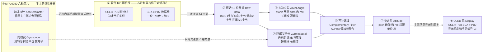
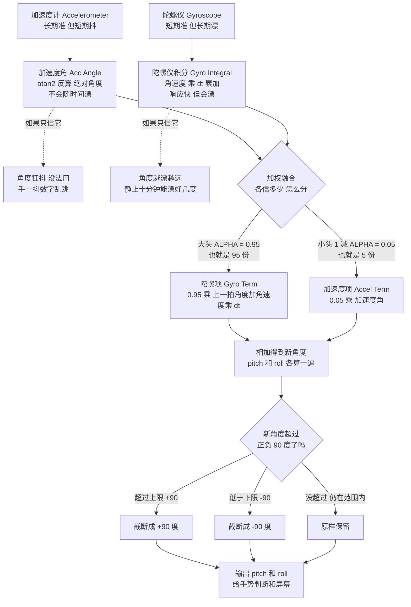
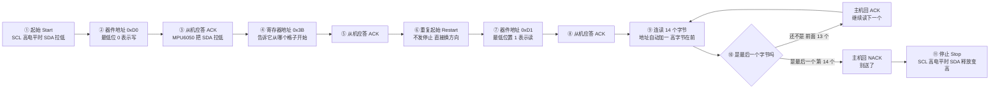

# 阶段五 · MPU6050 数据读取与姿态解算 保姆级图解（I2C 读原始数据 + 互补滤波出角度）

> 本文件按《图解协议》生成：每张 Mermaid 图的**正下方**都紧跟「👀 导游解说」和「📖 名词词典」。
> 对应题目：第五阶段 —— MPU6050 的 I2C 通信正常、能读到原始数据；做姿态解算；角度稳定无剧烈跳动，并解决 yaw 零漂。
> 对应你工程里的代码：[MPU6050.c](../annotated/遥控/APP/MPU6050.c)、[MyI2C.c](../annotated/遥控/APP/MyI2C.c)、[main.c](../annotated/遥控/User/main.c)。
> 图里每一个引脚、寄存器值、系数，全部来自你自己的源码与 `_事实清单.md`，没有一个是编的。

---

## 〇、这个阶段用大白话说要做什么

你手里那块手带，**它怎么知道你的手往前压了还是往左歪了**？想象你端着一杯水：水永远保持水平，杯子歪多少，水面相对杯壁就斜多少 —— MPU6050 里的**加速度计**就是这么干的，它靠“重力往哪边倒”算倾斜；可你晃一下手，水面剧烈晃荡，所以它的数字**抖得要命**。

MPU6050 里还住着另一个器官 **陀螺仪**，它测的是“你转得多快”（角速度）。转得快它立刻答上来、一点不抖；但它**不会算总数**，你必须把每一小段转过的角度自己加起来（这叫**积分**），而“加”的次数一多，误差就滚雪球 —— 这就是**漂移**。

所以这个阶段只干两件事：**把芯片里的 14 个字节老实读出来**（任务①），再用**互补滤波**把“抖但准的加速度计”和“稳但会漂的陀螺仪”**按比例掺在一起**，得到又稳又跟手的角度（任务②③）。你工程里掺的比例是 **95% 信陀螺仪、5% 信加速度计**。

### 题目任务清单

| 任务 | 题目要求 | 怎么算过关 | 你工程里的实现 |
| :--- | :--- | :--- | :--- |
| 任务1 | MPU6050 的 **I2C 通信**正常，能读到原始数据 | 能读出加速度 XYZ、陀螺仪 XYZ 的 16 位原始值（不是恒定 0 或 0xFFFF） | `MPU6050_Init()` 依次写 6 个配置寄存器；`MPU6050_ReadMultiReg()` **从 0x3B 起连读 14 字节**；`MPU6050_GetData()` 拼成 6 个 `int16_t` |
| 任务2 | 姿态解算（低年级可直接用加速度算角，高年级**必须**互补滤波或卡尔曼滤波） | 能输出 pitch / roll 两个角度，且说明白用了哪种融合算法 | `MPU6050_GetAngle()`：加速度角用 **atan2** 反算，陀螺仪角速度先减零偏再 **× LOOP_TIME=0.01s 积分**，再用 `ALPHA=0.95` **互补滤波**加权 |
| 任务3 | 角度输出稳定、无剧烈跳动，并解决 **yaw 零漂** | 手不动时角度基本不动；手慢抬慢放角度跟着走、不抽 | 三道保险：**ALPHA=0.95**（不信抖的那 5%）、**DLPF 低通**（`CONFIG=0x06`）、**±90° 限幅**；yaw 因“无磁力计”**恒置 0** |

> [!warning] ⚠️ 这句话答辩一定要说出口：本工程**没有磁力计**，所以 yaw 恒为 0
> - **pitch（俯仰）/ roll（横滚）** 有重力当“绝对参照物”，加速度计永远测得出一个**不会随时间漂**的角度 —— 所以这两轴能被修正、被拉回来。
> - **yaw（偏航，手往左转了多少度）** 转的是**水平面**，重力在水平面上**没有投影**，加速度计对它**完全无感**；本该由磁力计（电子罗盘）当地理参照，而这块板子上**没有磁力计**。
> - 结论：**只用 MPU6050，yaw 一定会漂**（零偏和噪声必然累积）。本工程的做法很干脆 —— `angle->Yaw = 0;` **不输出 yaw、也不拿 yaw 做控制**，手势只用 pitch/roll（阈值 15°）。这不是漏写，是设计选择。

---

## 一、图一：从“手歪了”到“屏幕上的角度”

> [!example] 👀 导游解说：这张图在讲什么？
> 从左往右走，这条链路就是任务①的全部内容：
> - **最左边的 `① MPU6050 六轴芯片`**：手带板上那颗小方块，“六轴”= 加速度计 3 轴 + 陀螺仪 3 轴。它是**感觉器官**，不带脑子，只把“我感觉到什么”变成数字。
> - **`加速度计` / `陀螺仪` 两个小框**：芯片里**两个独立传感器**。加速度计像“杯子里的水面”，能算出你歪了多少度（**绝对**，不怕时间）；陀螺仪像“转速表”，只知道转得多快（**相对**，必须自己累加）。
> - **`② 软件 I2C 两根线`**：单片机跟芯片说话的**唯一通道**。注意“软件”二字 —— 这不是 STM32 内部硬件 I2C 外设，而是用**两个普通 GPIO 脚手动翻电平**模拟时序，所以代码在 `MyI2C.c` 里。
> - **`SCL = PB6`、`SDA = PB7`**：你板子上的真实引脚（`MyI2C.c` 里 `GPIO_Pin_6 | GPIO_Pin_7`）。⚠️ 那个文件行尾注释写“PB10 和 PB11”，是**模板抄来没改的旧注释**，实际是 GPIOB 的第 6、7 脚。
> - **`③ 原始 16 位数据`**：一次复合传输把 **14 字节**全取回。为什么 14？加速度 X/Y/Z 各 2 字节 = 6，温度 2 字节（`buf[6]`、`buf[7]`，代码**跳过不用**），陀螺仪 X/Y/Z 各 2 字节 = 6。
> - **岔开的 `④` 和 `⑤`**：**同一批数据走了两条完全不同的路**。`④` 用 `atan2(ax, sqrt(ay²+az²))` 把重力方向**反算**成 `acc_pitch`/`acc_roll`；`⑤` 把角速度减零偏、除以 16.4 变 °/s，再乘 `LOOP_TIME` **累加**到上一拍角度上。至于虚线上那句 `只给角速度 不给角度` —— 陀螺仪**出厂就不输出角度**，角度是你自己积分出来的，这点答不出会被追问。
> - **`⑥` → `⑦` → `⑧`**：两路在 `⑥` 按比例掺起来，得到 `⑦` 结构体（`Pitch`/`Roll` 是 float，单位度；`Yaw` 固定写 0），最后在 `⑧` OLED 上显示 —— 注意 OLED 用的是**另一组** I2C 线 `PB8/PB9`，别和 MPU6050 的 `PB6/PB7` 搞混。
>
> 一句话记住：**手歪 → 两个传感器各出一份数据 → 读回 14 字节 → 一路反算、一路积分 → 加权掺一起 → pitch/roll → 屏上显示。**

> [!info] 📖 本图名词词典
> | 缩写/字母 | 全称 | 中文意思 | 在实物/代码里到底是什么？ |
> | :--- | :--- | :--- | :--- |
> | **MPU6050** | MPU-6050 六轴运动处理芯片 | 六轴姿态传感器 | 手带板上那颗小芯片 = 3 轴加速度计 + 3 轴陀螺仪 + 温度传感器。**没有磁力计**。 |
> | **加速度计** | Accelerometer | 加速度传感器 | 测“重力往哪个轴倒”的器官。静止时测到 1g，靠它在三轴的投影反算倾角。 |
> | **陀螺仪** | Gyroscope | 角速度传感器 | 测“每秒转多少度”的器官。输出是**角速度**不是角度，要角度必须自己积分。 |
> | **I2C** | Inter-Integrated Circuit | 集成电路总线 | 两根线就能连一堆芯片的总线协议；本工程是**软件模拟**（手动翻转 GPIO），代码在 `MyI2C.c`。 |
> | **SCL = PB6** | Serial Clock | 串行时钟线 | 节拍线，接 PB6。每跳一次，双方交换一位数据。 |
> | **SDA = PB7** | Serial Data | 串行数据线 | 数据线，接 PB7。0 和 1 都从这根线上一 bit 一 bit 过。 |
> | **开漏输出 OD** | Open-Drain | 开漏输出 | `MyI2C_Init()` 里配的 `GPIO_Mode_Out_OD`。写 1 只是“松手”，高电平靠外部上拉电阻，这样多颗芯片才能共用一根线。 |
> | **0xD0** | Slave Address | 从机地址（写） | MPU6050 的 7 位地址是 **0x68**，左移一位加读写位得 `0xD0`（写）/ `0xD1`（读）。代码 `#define MPU6050_ADDRESS 0xD0`。 |
> | **寄存器** | Register | 芯片内部的小抽屉 | 一排编号小格子，每格存 1 字节。读数据=读格子，做配置=往格子里写。 |
> | **0x3B** | ACCEL_XOUT_H | 加速度 X 轴高字节寄存器 | 数据的“起点格子”。从它开始连读 14 格，就拿到全部六轴数据。 |
> | **16 位补码** | 16-bit Two's Complement | 16 位有符号数 | 原始值可能是负数（如 −2048）。拼成 `int16_t` 时按补码解释，负数才正确；拼法是**高字节左移 8 位再与低字节相或**。 |
> | **LSB** | Least Significant Bit | 最低有效位（这里指“一个数字代表多少物理量”） | “16.4 LSB/(°/s)”意思是：陀螺仪数字每变 16.4，才等于 1 °/s，所以代码里要**除以** 16.4。 |
> | **g** | Gravity | 重力加速度单位 | 1g ≈ 9.8 m/s²。量程 ±16g、灵敏度 2048 LSB/g，所以 `ax / 2048.0f` 就是“几个 g”。 |
> | **dps / °/s** | Degrees Per Second | 度每秒（角速度单位） | 陀螺仪输出单位。手快甩一下几百 °/s，所以量程选 ±2000°/s。 |
> | **atan2** | Arc Tangent of Two Arguments | 双参数反正切 | 给“对边”和“邻边”两个数直接返回角度（弧度），覆盖整个圆周、不会像 asin 那样越界。代码 `atan2f(ax_g, sqrt_yz) * 57.2958f` 换成度。 |
> | **dt / LOOP_TIME** | Delta Time / Loop Time | 采样时间间隔 | 每次积分代表“过了多少秒”。代码写死 `LOOP_TIME = 0.01f`（10ms），所以 `MPU6050_GetAngle()` 要**每 10ms 左右调一次**，调慢了角度就算错。 |
> | **pitch** | Pitch Angle | 俯仰角 | 手往前压 / 往后仰的角度。`+15°` 以上算“前进”，`−15°` 以下算“后退”。 |
> | **roll** | Roll Angle | 横滚角 | 手往左 / 往右歪的角度。`+15°` 以上算“左转”，`−15°` 以下算“右转”。 |
> | **yaw** | Yaw Angle | 偏航角（航向角） | 手在水平面上转了多少度。**本工程无磁力计，`angle->Yaw = 0` 恒为 0**，不参与控制。 |
> | **ALPHA** | α（滤波系数） | 加权系数 | `#define ALPHA 0.95f`：**95% 相信陀螺仪**、5% 相信加速度计。 |
> | **零偏** | Gyro Bias / Offset | 陀螺仪零偏 | 手完全不动时陀螺仪理想输出为 0，实际有几十个 LSB 固定偏置。不减掉它，积分会一直朝一个方向漂。 |
> | **OLED** | Organic Light-Emitting Diode | 有机发光显示屏 | 手带上的小屏，用**它自己的一组**软件 I2C：`SCL = PB8`、`SDA = PB9`（与 MPU6050 的 PB6/PB7 是两套线）。 |

---

## 二、图二：互补滤波为什么能“又稳又跟手”？

> [!example] 👀 导游解说：这张图在讲什么？
> 这张图讲**一个公式**，分三层看：
> - **第一层：两个器官性格相反。** `加速度计` 长期准（拿重力当参照，手停多久都算出同一角度，**永远不漂**）但短期糟（一抖就跟着抖）；`陀螺仪` 短期准（转多快立刻反映，一点不抖）但**只会累加**，累加就把误差一起累进去，越漂越远。
> - **第二层：只信一路会怎样（两条虚线）。** 走 `如果只信它` 到 `角度狂抖`：**只用加速度计** —— 手一抖、手带被电机振动带着震，角度就乱跳，直接违反任务③，而且分不清你是“故意压 20°”还是“手抖了 20°”。走另一条到 `角度越漂越远`：**只用陀螺仪** —— 刚上电 10 秒特别漂亮、特别跟手，接着手明明没动，角度却在**慢慢匀速往一个方向爬**，病根就是陀螺仪**零偏**加积分累积（这跟题目问的 yaw 零漂是同一个病）。
> - **第三层：菱形 `加权融合 各信多少 怎么分`** —— 它不是“二选一”的开关，而是“**按比例分**”的岔路口，代码只有一行：
>   - **走大头 `ALPHA = 0.95`（95 份）**：新角度里 **95% 来自陀螺仪积分**。为什么给这么多？因为手是**动的**，跟手性靠陀螺仪，它不抖。
>   - **走小头 `1 减 ALPHA = 0.05`（5 份）**：新角度里 **5% 来自加速度计的绝对角**。这 5% 像一根**很软的橡皮筋**，每 10ms 把陀螺仪漂出去的那一点往回拉一点，漂移就被摁住了 —— 这就是“既有陀螺仪的稳、又有加速度计的准”。
>   - 两根线在 `相加得到新角度` 汇合：`pitch = 0.95 × (上一拍 pitch + 角速度 × 0.01) + 0.05 × acc_pitch`，`roll` 同结构再算一遍。
> - **最后菱形 `新角度超过正负 90 度了吗`** 是限幅，三个分支逐条说清：**超过上限 +90°** → 走上面硬截成 **+90°**；**低于下限 −90°** → 走下面硬截成 **−90°**；**没超过、仍在 ±90° 内**（绝大多数情况）→ 走中间**原样保留**。为什么限幅？一是俯仰超过 90° 物理含义就变了（等于翻过去），二是代码里解耦用了 `tanf(pitch)`，`tan` 在 ±90° 附近**发散到无穷大**，不限幅数值会炸。
>
> 一句话记住：**加速度计管“长期别跑偏”，陀螺仪管“短期跟得上”，95 比 5 掺一下，最后卡在 ±90°。**

> [!info] 📖 本图名词词典
> | 缩写/字母 | 全称 | 中文意思 | 在实物/代码里到底是什么？ |
> | :--- | :--- | :--- | :--- |
> | **互补滤波** | Complementary Filter | 互补滤波器 | “信陀螺”（高通）+“信加速度计”（低通）两条路互补合成一个角度。代码就是两行加权和。 |
> | **ALPHA = 0.95** | α = 0.95 | 陀螺仪权重 | 新角度 **95% 继承陀螺仪的预测**。α 越大越跟手、抗漂越弱。 |
> | **1 − ALPHA** | 1 − α = 0.05 | 加速度计权重 | 新角度里 **5% 用来纠偏**，是“防漂的橡皮筋”。 |
> | **加权平均** | Weighted Average | 按比例平均 | 不是相加除以 2，而是各乘一个权重再相加，两权重之和 = 1。 |
> | **时间常数 0.2s** | Time Constant | 纠偏时间常数 | 源码注释给的等效值：α=0.95、每 10ms 一拍，约 0.2 秒把偏差纠正约 63%。 |
> | **高频噪声** | High-frequency Noise | 高频抖动 | 手抖、电机振动带来的快速上下跳，加速度计最怕这个。 |
> | **低频漂移** | Low-frequency Drift | 缓慢漂移 | 几十秒才看得出一次的“整体偏移”，陀螺仪积分最怕这个。 |
> | **积分** | Integration | 累加求角度 | `pitch += 角速度 × dt`。dt 越小越准，但误差仍会一点点累积。 |
> | **dt** | Delta Time | 时间步长 | 代码里就是 `LOOP_TIME = 0.01f`。**它不是实测值**，是写死的常量，所以调用周期必须接近 10ms。 |
> | **漂移** | Drift | 漂移 | 手不动、角度却自己在变。来源：零偏 + 积分累积 + 温度变化。 |
> | **观测 / 预测** | Measurement / Prediction | 观测值 / 预测值 | 加速度角是“观测”（直接量出来），陀螺积分是“预测”（推出来）。互补滤波 = 预测为主、观测为辅。 |
> | **解耦** | Decoupling | 轴间解耦 | 手带不水平时，绕 X 轴的转动会“串”进俯仰通道。代码用 `sin_roll`、`tan(pitch)` 补偿，所以**必须限幅**。 |
> | **tan** | Tangent | 正切函数 | 解耦公式里用到。`tan(90°)` 数学上趋于无穷大，这是限幅的第二个理由。 |
> | **限幅 ±90°** | Clamp to ±90° | 上下限截断 | `if(pitch > 90) pitch = 90; if(pitch < -90) pitch = -90;`，roll 同样处理。 |
> | **菱形判断** | Decision Diamond | 流程图判断框 | Mermaid 写作 `W{"文字"}`，表示“这里做一次选择”，一个进、多个出。 |
> | **卡尔曼滤波** | Kalman Filter | 卡尔曼滤波器 | 题目允许的另一条路：按“谁更可信”动态调权重，比固定 α 聪明但复杂。**本工程用互补滤波，没上卡尔曼。** |
> | **一阶低通** | First-order Low-pass Filter | 一阶低通滤波 | 互补滤波的 (1−α) 那一路本质就是低通：只让“慢慢变化”的部分通过，把抖动挡掉。 |
> | **100Hz / SMPLRT_DIV = 0x09** | Sample Rate Divider | 采样率分频 | `MPU6050_Init()` 写 `0x09`：采样率 = 1kHz / (1+9) = **100Hz**，每 10ms 一个样本，**正好对上 LOOP_TIME**。 |
> | **DLPF / CONFIG = 0x06** | Digital Low-Pass Filter | 数字低通滤波器 | 芯片内部硬件滤波。写 `0x06` 后带宽约 5Hz、延迟约 19ms，滤掉电机振动和手抖的高频噪声。 |
> | **16.4 LSB/(°/s)** | Gyro Sensitivity | 陀螺仪灵敏度 | 对应 `GYRO_CONFIG = 0x18`（±2000°/s）。代码 `(gx - 零偏) / 16.4f` 得到 °/s。 |
> | **2048 LSB/g** | Accel Sensitivity | 加速度灵敏度 | 对应 `ACCEL_CONFIG = 0x18`（±16g，**不是** ±2g）。代码 `ax / 2048.0f` 得到 g。 |
> | **校准** | Calibration | 零偏校准 | `MPU6050_CalibrateGyro(采样次数)`：**校准期间手必须完全静止**，否则零偏算错、后面一直漂。 |

---

## 三、图三（可选，答辩加分）：I2C 读一次数据的完整时序

> [!example] 👀 导游解说：这张图在讲什么？
> 这就是 `MPU6050_ReadMultiReg()` 那 20 行代码，一步一步走：
> - **① 起始 → ② 0xD0**：先“咚”一下告诉总线要开始，再喊门牌号；最低位 `0` 表示“我要**写**（下命令）”。
> - **③ 应答 ACK**：被点名的芯片把 SDA 拉低一下，等于举手说“我在”。代码 `MyI2C_ReceiveAck()` 就是读这一下 —— 但**它没有判断返回值**，所以芯片没接好时程序不报错，只表现成数据全 0/全 FF（这点答辩可主动交代）。
> - **④ 寄存器地址 0x3B → ⑤ 应答**：告诉它“从 `0x3B` 这个格子开始读”，这一步仍是“写”，所以用的是写地址。
> - **⑥ 重复起始 Restart**：重点！这里**不发停止、直接再来一个起始**。一旦发了停止，芯片就忘了“刚说到哪一格”，重复起始能保住这个位置。
> - **⑦ 0xD1 → ⑧ 应答**：再喊一次名字，最低位 `1` 表示“我要**读**”。`0xD0 | 0x01 = 0xD1`，代码就是 `MPU6050_ADDRESS | 0x01`。
> - **⑨ 连读 14 字节**：芯片从 0x3B 起，每读一个字节**内部地址自动加一**（0x3B → … → 0x48），一次掏空 14 格，每个值**高字节在前**。
> - **菱形 ⑩ 是最后一个字节吗**，两个分支：**还不是最后一个（前 13 个）** → 走上面，主机回 **ACK**（拉低 SDA），意思是“接着送”，回到 ⑨；**是最后一个（第 14 个）** → 走下面，主机回 **NACK**（放开 SDA 保持高），意思是“够了”。为什么必须 NACK？不 NACK 芯片会以为你还要，一直占着 SDA，你就发不出停止条件了。
> - **⑪ 停止 Stop**：SCL 高电平期间释放 SDA 成高，总线回空闲，本次传输结束。
>
> 一句话记住：**起始 → 喊名字说要写 → 报格子号 → 重复起始 → 喊名字说要读 → 连读 14 个（前 13 回 ACK、最后回 NACK）→ 停止。**

> [!info] 📖 本图名词词典
> | 缩写/字母 | 全称 | 中文意思 | 在实物/代码里到底是什么？ |
> | :--- | :--- | :--- | :--- |
> | **起始 S** | Start Condition | 起始条件 | SCL 高电平期间 SDA 由高变低。代码 `MyI2C_Start()`。 |
> | **重复起始 Sr** | Repeated Start | 重复起始 | 不发停止、直接再发一个起始，用来切换读/写而**不丢失寄存器指针**。 |
> | **停止 P** | Stop Condition | 停止条件 | SCL 高电平期间 SDA 由低变高。代码 `MyI2C_Stop()`，释放总线。 |
> | **ACK** | Acknowledge | 应答（0） | 收方拉低 SDA 表示“收到了/继续”。代码 `MyI2C_SendAck(0)` / `MyI2C_ReceiveAck()`。 |
> | **NACK** | Not Acknowledge | 非应答（1） | 收方放开 SDA 保持高，表示“不要了/结束”。代码 `MyI2C_SendAck(1)`。 |
> | **0xD0 / 0xD1** | Write / Read Address | 写地址 / 读地址 | 0x68 左移一位 = 0xD0；最低位置 1 得 0xD1。差一位决定“下命令”还是“要数据”。 |
> | **地址自增** | Auto-increment | 地址自动加一 | 连读时芯片自己把内部指针加一，所以 14 字节一次读完，不用访问 14 次。 |
> | **MSB first** | Most Significant Bit First | 高位先行 | 一个字节先发 bit7 再发 bit0。`MyI2C_SendByte()` 用 `Byte & (0x80 >> i)` 取位。 |
> | **400kHz** | 400 kilo-Hertz | 400 千赫兹 | MPU6050 支持的 I2C 最高速率。代码每位 `delay_us(10)`，实际几十 kHz，**远低于上限、很稳但慢**。 |
> | **复合时序** | Combined Transfer | 复合传输 | 一次“写地址 + 重复起始 + 读数据”的组合操作，`MPU6050_ReadMultiReg()` 就是标准用法。 |
> | **WHO_AM_I** | Who Am I | 器件身份寄存器（0x75） | 读它正常返回 `0x68`。代码有 `MPU6050_GetID()`，但**本工程没调用它做自检**，属预留调试接口。 |

---

## 四、代码对照：这个阶段落在哪些文件里

| 文件 | 关键函数 / 宏 | 干什么 |
| :--- | :--- | :--- |
| [MPU6050.c](../annotated/遥控/APP/MPU6050.c) | `MPU6050_Init()` | 唤醒并配置：`PWR_MGMT_1=0x01`、`PWR_MGMT_2=0x00`、`SMPLRT_DIV=0x09`（100Hz）、`CONFIG=0x06`（DLPF 约 5Hz）、`GYRO_CONFIG=0x18`（±2000°/s）、`ACCEL_CONFIG=0x18`（±16g） |
| [MPU6050.c](../annotated/遥控/APP/MPU6050.c) | `MPU6050_ReadMultiReg()` | 核心读函数：起始 → 0xD0 → 寄存器地址 → **重复起始** → 0xD1 → 连读 len 字节（前 len−1 个回 ACK、最后一个回 NACK）→ 停止 |
| [MPU6050.c](../annotated/遥控/APP/MPU6050.c) | `MPU6050_GetData()` | 从 `0x3B` 连读 **14 字节**，拼成 AccX/Y/Z、GyroX/Y/Z 六个 `int16_t`；`buf[6]`、`buf[7]` 是温度，直接跳过 |
| [MPU6050.c](../annotated/遥控/APP/MPU6050.c) | `MPU6050_CalibrateGyro()` | 零偏校准：静止采 `samples` 次陀螺仪原始值求平均，写入 `gyroX_offset`/`gyroY_offset`，并把 pitch/roll 清零 |
| [MPU6050.c](../annotated/遥控/APP/MPU6050.c) | `MPU6050_GetAngle()` / `GetAccelAngles()` | 解算主函数：读数据 → `GetAccelAngles()` 用 `atan2f(ax, sqrt(ay²+az²))`、`atan2f(−ay, sqrt(ax²+az²))` 反算 `acc_pitch`/`acc_roll` → 减零偏除 16.4 → 解耦 → `pitch = ALPHA×(pitch+角速度×0.01) + (1−ALPHA)×acc_pitch` → 限幅 ±90° → `Yaw = 0` |
| [MyI2C.c](../annotated/遥控/APP/MyI2C.c) | `MyI2C_Init()` | 把 **PB6(SCL)/PB7(SDA)** 配成**开漏输出**并释成高电平。⚠️ 行尾旧注释写 PB10/PB11，是模板遗留 |
| [MyI2C.c](../annotated/遥控/APP/MyI2C.c) | `MyI2C_Start()` / `MyI2C_Stop()` | 起始条件（SCL 高时拉低 SDA）/ 停止条件（SCL 高时释放 SDA） |
| [MyI2C.c](../annotated/遥控/APP/MyI2C.c) | `MyI2C_SendByte()` / `MyI2C_ReceiveByte()` / `MyI2C_SendAck()` / `MyI2C_ReceiveAck()` | 高位先行的 8 位收发 + 应答位收发，每位靠 `delay_us(10)` 限速；⚠️ `ReceiveAck` 的返回值**没有被判断** |
| [main.c](../annotated/遥控/User/main.c) | `MPU6050_Init()` → `MPU6050_CalibrateGyro(200/1000)` → 主循环取角度 | 上电先初始化再校准（校准期间手要静止），之后在主循环取 pitch/roll 做手势判断与显示 |

> [!note] 💡 一个可以主动交代的小细节
> `main.c` 里写的是 `MPU6050_CalibrateGyro(200/1000)`。C 语言整数相除 **200/1000 = 0**，采样次数传了 0；而函数内 `gyroX_offset = (float)sumX / samples;` 注释已用 NOTE 标出“若传 0 就是除零”。答辩可主动说：“这是参数写法问题，正确应传采样次数 `200` 或 `1000`。” —— 比被老师问出来强。

---

## 五、答辩三问（老师最爱问）

**1. 问：为什么不能只用加速度计？**
答：加速度计短期太抖。它测的是重力投影，手一抖、电机一振动，投影方向就跟着晃，算出的角度**剧烈跳动**，直接违反任务③；而且振动幅度可能比手势还大，程序分不清你是“故意压 20°”还是“手抖了 20°”。所以它只配当“**纠偏的参照物**”，占 `1 − ALPHA = 0.05` 的权重 —— 代码里就是 `(1 - ALPHA) * acc_pitch` 那一项。

**2. 问：零偏校准是干什么的？**
答：陀螺仪**理想**静止时输出应是 0，**实际**总有几十个 LSB 的固定偏置。不减去它，每一拍积分都会多加一点错误角速度，10ms 一次、一秒 100 次，几十秒就漂出好几度 —— 手没动，角度自己在爬。所以 `MPU6050_CalibrateGyro()` 在**手完全静止**时连采多次原始值求平均，得到 `gyroX_offset`/`gyroY_offset`，之后每次积分前 `(gx - gyroX_offset)` 减掉。**校准期间手一动，这个平均值就是错的，后面会一直漂** —— 实操最容易翻车的地方。

**3. 问：yaw 为什么会漂？怎么解决？**
答：yaw 转的是**水平面**，重力在水平面上没有投影，**加速度计对 yaw 完全无感**，没有任何绝对参照物能把它拉回来，只剩陀螺仪积分，而积分必然累积零偏和噪声 —— 所以**只用 MPU6050，yaw 一定会漂**，这是原理决定的，不是代码写得差。三条路：① **加磁力计**（变九轴，用地理北修正 yaw）—— 本工程**没有**；② **静态零偏校准 + 卡尔曼等更好滤波** —— 只能减缓、不能根治；③ **本工程的选择：干脆不用 yaw** —— `angle->Yaw = 0;` 恒置 0，手势只依赖 pitch/roll（阈值 15°），控制上完全不需要航向。**“用一个不会漂的量做控制”，比“想办法修一个注定会漂的量”更工程化。**

---

## 六、自测清单（能全部打勾就说明这个阶段真的会了）

- [ ] 能不看笔记说出 MPU6050 的 I2C 用哪两个引脚（**SCL = PB6、SDA = PB7**），并知道 `MyI2C.c` 里 PB10/PB11 那句注释是模板遗留
- [ ] 能说清“为什么一次读 **14 个字节**”“从哪个寄存器开始（**0x3B**）”“中间 2 个字节是什么（**温度，跳过**）”
- [ ] 能默写互补滤波那一行，并解释 `ALPHA = 0.95` 与 `LOOP_TIME = 0.01f` 各代表什么（95% 信陀螺、每拍 10ms）
- [ ] 能分别说出“只用加速度计”“只用陀螺仪”会出什么问题，以及为什么要各取一部分
- [ ] 能解释“本工程没有磁力计，所以 `Yaw = 0`”，并说清 yaw 漂移的物理原因和三种应对方案
