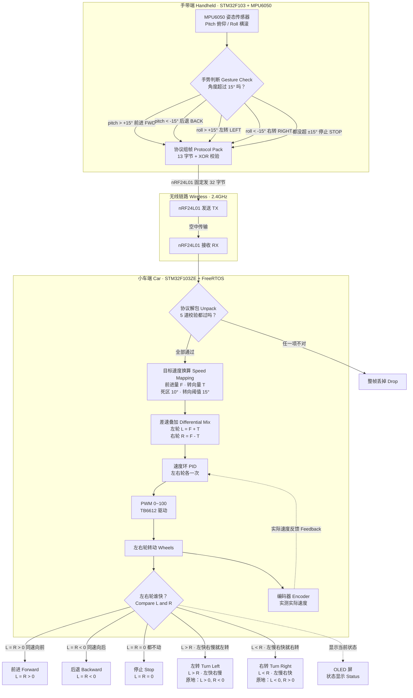
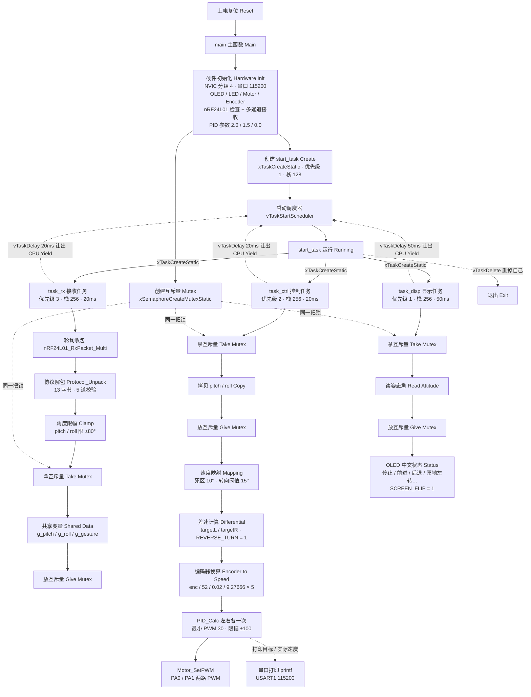

# 阶段八 · 手势控制小车 零基础图解（差速转向 + FreeRTOS 任务框架）

> 这是「2027 赛季电控组三面题」第八阶段的保姆级图解：手一歪，小车就前进、后退、左转、右转。
> 所有引脚、参数、函数名只来自 [_事实清单.md](_事实清单.md) 和你工程里的四个源码文件，清单里没有的一律不编。
> 源码入口：[小车 main.c](../annotated/FreeRTOS小车/USER/main.c)、[Motor.c](../annotated/FreeRTOS小车/HARDWARE/LED/Motor.c)、
> [Encoder.c](../annotated/FreeRTOS小车/HARDWARE/LED/Encoder.c)、[遥控 main.c](../annotated/遥控/User/main.c)。

---
## 〇、三十秒大白话：没有方向盘，车怎么拐弯？
把左右轮想成你的两只手：两只手同速往前推，车就前进；同速往后拉，车就后退；一只手快、一只手慢，车头就会偏；一只手往前、一只手往后，车就原地打转。

**左右轮速度不一样，车就拐弯——这就是差速转向（Differential Drive）。** 本工程的方向约定是：左轮 L 比右轮 R 快（L > R）= 左转，L < R = 右转；方向由 `REVERSE_TURN = 1` 统一校正（它会按实车装法翻转左右，详见导游最后一条），实车拐反了只改这个宏，不用重新接线。

题目写“控制四个电机”，你工程实物接的是**左、右两个驱动电机**（TB6612 的 A 路、B 路）。四个电机可以按“左侧一组、右侧一组、组内同速”来理解，差速公式完全一样；题目本身也明说“两个驱动轮做差速转向就能实现”，所以这是合规实现，不是偷工减料。

---
## 一、题目任务清单：哪些做了、哪些没做

| 编号 | 题目任务 | 你工程里的实现 / 未实现 | 关键证据 |
| :--- | :--- | :--- | :--- |
| 任务 1 | 控制四个电机实现前进、后退、左转、右转 | ✅ **已实现**：题目四电机，本工程用左右两轮差速实现前进/后退/左转/右转/原地转 | `task_ctrl` 里的 `targetL` / `targetR`，最后 `Motor_SetPWM` |
| 任务 2 | 小车运动平稳、响应及时 | ✅ **已实现**：20ms 控制周期 + 速度环 PID + 最小 PWM 30 补偿 + ±100 限幅 + 10° 死区 | `main.c` 的 `task_ctrl`、`PID_Calc`；PWM 20kHz |
| 进阶 ① | 用 FreeRTOS 管理按键 / PID / 通信 / 显示任务 | ✅ **已实现（多任务框架）**：通信 `task_rx`、PID `task_ctrl`、显示 `task_disp` 三个任务 + `start_task`；⚠️ 本工程**没有单独建按键任务**（小车端没做按键扫描），需要时按同样方法再加一个即可 | `main.c` 的静态建任务、`xSemaphoreCreateMutexStatic` |
| 进阶 ② | 用 CAN 通信驱动支持 CAN 的电机 | ❌ **未实现**：工程里没有 CAN 初始化、没有 CAN 收发代码；电机是 TB6612（PWM + 方向脚），不是 CAN 电机 | 全工程无 CAN 相关代码，答辩要如实说 |
| 进阶 ③ | 上位机实时显示姿态/速度，并在线修改 PID | ⚠️ **部分实现**：`printf` 通过 USART1（115200）打印，可给 VOFA+ 这类上位机看波形；**在线改 PID 未实现**，参数写死在 `PID_Init(&pid_left, 2.0f, 1.50f, 0.0f)` | `main.c` 的串口打印；没有“上位机下发参数”的接收逻辑 |

---
## 二、图一：差速转向怎么让车拐弯

> [!example] 👀 导游解说：这张图在讲什么？
>
> 从手到轮子，按箭头走一遍：
>
> - **MPU6050**：手带端那个六轴传感器，读出 `pitch`（手往前压/往后仰）和 `roll`（手往左歪/往右歪）。
> - **菱形“手势判断”**：角度超过 **15°** 才算手势，而且代码**先判 pitch、再判 roll**：pitch > +15° 前进，pitch < -15° 后退，roll > +15° 左转，roll < -15° 右转，四个方向都没超就停止。
> - **协议组帧 → nRF24L01**：五个手势都装进同一个 13 字节“信封”（0xA5、长度 9、pitch、roll、手势、XOR、0x0D），每 100ms 发一次；发送函数固定发 32 字节，这是工程里已知的“帧长 13、发送 32”不一致，源码注释里标了 NOTE。
> - **菱形“协议解包”**：小车端检查长度、帧头、长度域、帧尾、XOR 共五道；**任一项不对 → 整帧丢掉**，绝不拿坏数据去控制电机；**五项全对 → 继续往下算**。
> - **目标速度换算**：pitch/roll 先限幅 ±80°，再用 **10° 死区** 和 **15° 转向阈值**，换成两个量：前进量 F（管前后）和转向量 T（管左右），线性映射到 0~100。
> - **差速叠加**：左轮 L = F + T，右轮 R = F - T（也就是“左轮 = 前进 + 转向、右轮 = 前进 - 转向”）。这一步就是小车的“虚拟方向盘”。
> - **左右轮谁快 → 五个结果，逐条记**：
>   1. **直行前进**：T = 0、F > 0 → L = R > 0，两轮同速向前；
>   2. **直行后退**：T = 0、F < 0 → L = R < 0，两轮同速向后；
>   3. **左转**：F > 0、T > 0 → L > R（左快右慢）；**原地左转**时 F = 0，L = +T、R = -T，一正一负；
>   4. **右转**：F > 0、T < 0 → L < R（左慢右快）；**原地右转**时 F = 0，L = -T、R = +T，也是一正一负；
>   5. **停止**：F = 0、T = 0 → L = R = 0，两轮都不动。
> - **PID → PWM → 轮子**：左右轮各有一个速度环 PID，目标速度来自上面，实际速度来自编码器；PID 算出的 PWM 再经过**最小 PWM 30** 的死区补偿和 **±100** 限幅，才交给 TB6612。
> - **编码器虚线**：轮子实际转多快，编码器就报多快，形成闭环；没有这条线，PID 就是“蒙着眼睛开车”。
> - **方向约定**：本工程用 `REVERSE_TURN = 1` 把转向量整体反一次，所以左右快慢的符号要以这个宏为准；本文为了讲差速，按“**L > R = 左转，L < R = 右转**”的约定画，实车如果拐反了只改这个宏，不要改接线。

> [!info] 📖 本图名词词典
> | 缩写/术语 | 全称 | 中文意思 | 在实物/代码里到底是什么？ |
> | :--- | :--- | :--- | :--- |
> | **差速 Differential Drive** | Differential Drive | 差速转向 | 左右轮给不同速度，车就拐弯；不是方向盘，是“速度差”。 |
> | **左轮 / 右轮 L / R** | Left / Right Wheel | 左驱动轮 / 右驱动轮 | TB6612 的 A 路接左电机、B 路接右电机；代码里用 `targetL` / `targetR` 表示。 |
> | **pitch** | Pitch Angle | 俯仰角 | 手往前压 / 往后仰的角度；> +15° 前进，< -15° 后退。 |
> | **roll** | Roll Angle | 横滚角 | 手往左歪 / 往右歪的角度；> +15° 左转，< -15° 右转。 |
> | **阈值 15° Threshold** | Threshold | 手势门槛 | 角度超过 15° 才认手势；代码先判 pitch，再判 roll。 |
> | **死区 10° Dead Zone** | Dead Zone | 死区 | 小于 10° 一律当 0，防止手抖让车原地抽动。 |
> | **GESTURE_FWD / BACK / LEFT / RIGHT / STOP** | Gesture Forward / Back / Left / Right / Stop | 五个手势宏 | 值分别是 1 / 2 / 3 / 4 / 5；`GESTURE_NONE = 0` 是“无手势”初值。 |
> | **nRF24L01** | Nordic RF 24L01 | 2.4GHz 无线模块 | 手带端发、小车端收；小车端用多通道接收，通道 0/1 地址不同。 |
> | **协议帧 / 13 字节** | Frame | 一包数据的格式 | A5 + 09 + pitch 4 字节 + roll 4 字节 + 手势 1 字节 + XOR 1 字节 + 0D 1 字节 = 13 字节。 |
> | **帧头 0xA5 / 帧尾 0x0D** | Header / Tail | 帧的开头 / 结尾标志 | 0xA5 开头、0x0D（回车）结尾；对不上就说明不是一帧好数据。 |
> | **XOR 异或校验** | Exclusive OR Checksum | 异或校验 | 把长度到手势的字节做异或，接收端重算一遍，不一致就丢帧。 |
> | **解包 Unpack** | Unpack / Parse | 拆信封 | 把 13 字节还原成 pitch、roll、gesture，并做五道检查。 |
> | **F 前进量 / T 转向量** | Forward / Turn Amount | 前进分量 / 转向分量 | 角度映射出来的两个 0~100 的数；F 管前后，T 管左右。 |
> | **目标速度 Target Speed** | Target Speed | 想要的速度 | PID 的输入，来自 F + T（左轮）和 F - T（右轮）。 |
> | **实际速度 Actual Speed** | Actual Speed | 测到的速度 | 编码器换算：`enc / 52.0f / 0.02f / 9.27666f * 5.0f`；最后的 ×5 是经验缩放，量纲不是物理转速。 |
> | **PID** | Proportional-Integral-Derivative | 比例-积分-微分控制器 | Kp=2.0、Ki=1.5、Kd=0；P 看当前差多少，I 看累计差多少，D 看变化快慢。 |
> | **PWM / 占空比** | Pulse Width Modulation / Duty Cycle | 脉冲宽度调制 / 油门开度 | TIM2 产生 20kHz；CCR 0~100 对应 0~100%，PA0 管左轮、PA1 管右轮。 |
> | **编码器 / 52** | Encoder / 52 counts | 测速眼睛 / 每圈计数 | 13 线 × 4 倍频 = 52；TIM3 读左编码器，TIM4 读右编码器，读完清零。 |
> | **TB6612** | TB6612FNG | 双路电机驱动芯片 | 收 PWM + 方向电平，把 12V 大电流给电机；STBY 接 3.3V 常高。 |
> | **REVERSE_TURN** | Reverse Turn | 转向反向宏 | =1 时把转向量整体取反，用来校正实车左右方向。 |
> | **OLED** | Organic Light-Emitting Diode | 有机发光显示屏 | 小车端小屏幕，显示当前状态；`SCREEN_FLIP = 1` 是因为屏幕倒装。 |

---
## 三、图二：FreeRTOS 让四个任务同时干活（start_task 建完就退出）

> [!example] 👀 导游解说：这张图在讲什么？
>
> 这张图讲的是“四个任务怎么排队干活”，从上往下看：
>
> - **main 主函数**：先做硬件初始化（NVIC 分组 4、串口 115200、OLED、LED、电机、编码器、nRF24L01 检查、多通道接收），再初始化左右两个 PID（Kp=2.0、Ki=1.5、Kd=0），创建一把静态互斥量，最后只创建一个 `start_task`，就启动调度器。
> - **start_task**：优先级 1、栈 128，它自己不干具体活，只负责用 `xTaskCreateStatic` 创建 `task_rx`、`task_ctrl`、`task_disp` 三个任务，创建完用 `vTaskDelete` 把自己删掉——**临时工，干完就退场**。
> - **task_rx（优先级 3，20ms）**：轮询 nRF24L01 收包 → 协议解包（长度/帧头/长度域/帧尾/XOR 五道）→ pitch/roll 限幅 ±80° → **拿互斥量** → 写 `g_pitch / g_roll / g_gesture` → 放锁。注意 `g_gesture` 目前只存不用，控制实际只看 pitch/roll（源码 NOTE 已标）。
> - **task_ctrl（优先级 2，20ms）**：**拿互斥量** → 把 `pitch / roll` 拷一份 → 放锁（拷贝完就尽快放，别占着锁算 PID）→ 死区 10°、转向阈值 15° 映射 → 差速 `targetL / targetR` → 读编码器换算实际速度 → `PID_Calc` → 最小 PWM 30 补偿、限幅 ±100 → `Motor_SetPWM`。
> - **task_disp（优先级 1，50ms）**：**拿互斥量** → 读 `pitch / roll` → 放锁 → 再读目标/实际速度 → 拼状态字符串（停止/前进/后退/原地左转/前进左转…）→ OLED 中文显示；因为屏幕倒装，`SCREEN_FLIP = 1`。
> - **为什么接收任务优先级最高？** 因为小车要“跟手”，接收任务决定指令新不新。如果让它排在显示后面，旧指令会积压，车就会慢半拍；而它每次只做“收包、解包、写变量”这几件很短的事，给它最高优先级不会把别的任务饿死。
> - **为什么共享变量要加锁？** `g_pitch` / `g_roll` 必须来自**同一帧**。如果 `task_rx` 写到一半被切走，`task_ctrl` 可能读到“新 pitch + 旧 roll”，算出一个现实中不存在的姿态。`g_gesture` 也一起写，但控制逻辑没读它；互斥量让读写排队：一次拿锁、一次拷走、一次放锁。
> - **任务延时会让出 CPU**：`vTaskDelay` 不是死等，它把当前任务挂起，调度器立刻切去跑别的任务；20ms 到了再回来。裸机里用 `delay_ms` 死等，CPU 就白烧 20ms。
> - **调度器**：FreeRTOS 是抢占式调度，哪个“已就绪”的任务优先级最高就跑哪个；同优先级才轮流。`start_task` 退出后，真正同时“活着”的是 rx、ctrl、disp 三个任务。

> [!info] 📖 本图名词词典
> | 缩写/术语 | 全称 | 中文意思 | 在实物/代码里到底是什么？ |
> | :--- | :--- | :--- | :--- |
> | **FreeRTOS** | Free Real-Time Operating System | 免费实时操作系统 | 跑在 STM32 上的一个小系统，负责任务排队、切换、延时、加锁。 |
> | **裸机 Bare Metal** | Bare Metal | 不带操作系统的单片机程序 | 一个大 `while(1)` 从头跑到尾，所有事排队做。 |
> | **while(1)** | while loop | 死循环 | 裸机的主循环；循环里任何一句延时都会拖住后面所有事。 |
> | **任务 Task** | Task / Thread | 任务（可理解成“独立的小程序”） | 本工程有 `start_task`、`task_rx`、`task_ctrl`、`task_disp`。 |
> | **优先级 Priority** | Priority | 谁先跑 | 数字越大越优先：rx=3 > ctrl=2 > disp=1；start_task 也是 1。 |
> | **栈 Stack** | Stack | 任务自己的“草稿纸” | 每个任务独立栈，存局部变量和函数返回地址；start_task 128，其余 256。 |
> | **互斥量 Mutex** | Mutual Exclusion | 互斥锁 | 一把“厕所钥匙”，谁拿到谁用共享变量，用完还回去；本工程是静态创建。 |
> | **调度器 Scheduler** | Scheduler | 任务调度器 | FreeRTOS 的“总指挥”，决定下一秒 CPU 给哪个任务。 |
> | **抢占式调度 Preemptive** | Preemptive Scheduling | 抢占式 | 高优先级任务一就绪，立刻打断低优先级任务。 |
> | **tick** | System Tick | 系统节拍 | FreeRTOS 的内部时间单位；代码用 `vTaskDelay(pdMS_TO_TICKS(20))` 延时 20ms。 |
> | **vTaskDelay** | Task Delay | 任务延时 | 让当前任务睡一会儿，**主动让出 CPU**；不是死等。 |
> | **vTaskDelete** | Task Delete | 删除任务 | `start_task` 建完三个任务后用它删自己，不再参与调度；静态分配的栈不会被 free。 |
> | **xTaskCreateStatic** | Create Task Static | 静态创建任务 | 任务控制块和栈由用户提供静态内存，不用 malloc；本工程用这种。 |
> | **CAN** | Controller Area Network | 控制器局域网总线 | 汽车上常用的两根线差分总线，多节点、抗干扰、带仲裁；本工程未使用。 |
> | **CAN_H / CAN_L** | CAN High / CAN Low | CAN 高 / 低两根信号线 | CAN 的物理层两根线，靠电压差传数据；要配合 CAN 收发器芯片。 |
> | **上位机 Host PC** | Host Computer | 电脑端的软件 | 在 PC 上看数据、发命令的程序，不是单片机里的代码。 |
> | **VOFA+** | VOFA+ | 串口波形上位机 | 能把串口发来的数字画成曲线的软件；本工程只用 printf 打印，没做在线调参。 |
> | **在线调参 Online Tuning** | Online Parameter Tuning | 运行中改 PID | 不重新烧程序，由上位机发新 Kp/Ki/Kd 让单片机立刻生效；本工程**未实现**。 |
> | **printf** | Print Formatted | 格式化打印 | 单片机通过 USART1 往电脑打字；本工程重定向了 `fputc`。 |
> | **USART1 / 115200** | Universal Synchronous/Asynchronous Receiver Transmitter 1 | 通用串口 1 / 波特率 115200 | PA9=TX、PA10=RX，8N1；电脑串口助手要设成一样。 |

---
## 四、代码对照：图里的每个框，源码在哪

| 文件 | 先看哪个函数 / 位置 | 它负责什么 | 对应图里哪一块 |
| :--- | :--- | :--- | :--- |
| [`../annotated/FreeRTOS小车/USER/main.c`](../annotated/FreeRTOS小车/USER/main.c) | `main()`、`start_task`、`task_rx`、`task_ctrl`、`task_disp`、`PID_Init` / `PID_Calc` | 初始化、建任务、收包解包、差速 + PID、刷屏 | 图二整张；图一的“目标速度换算 / 差速叠加 / PID” |
| [`../annotated/FreeRTOS小车/HARDWARE/LED/Motor.c`](../annotated/FreeRTOS小车/HARDWARE/LED/Motor.c) | `Motor_Init`、`Motor_SetPWM` | 把带正负号的 PWM 变成方向脚电平 + TIM2 占空比，驱动 TB6612 | 图一最下面“PWM → 轮子” |
| [`../annotated/FreeRTOS小车/HARDWARE/LED/Encoder.c`](../annotated/FreeRTOS小车/HARDWARE/LED/Encoder.c) | `Encoder_Init`、`Encoder_Get` | 读 TIM3/TIM4 的编码器计数并清零，供 `task_ctrl` 算实际速度 | 图一“编码器实测”那条反馈虚线 |
| [`../annotated/遥控/User/main.c`](../annotated/遥控/User/main.c) | `Gesture_Map`、`Protocol_Pack`、`TIM4_IRQHandler` | 按 15° 判五个手势、组 13 字节帧、每 100ms 发一帧 | 图一上半部分“手势判断 → 协议组帧” |

---
## 五、答辩三问（背这三段就够）

**问 1：两个轮子为什么能转出四种动作？**

答：因为左右轮的速度是**独立给**的，四种动作只是同一套差速公式的四种取值：两轮同为正且相等 → 前进；同为负且相等 → 后退；一快一慢（L > R 或 L < R）→ 左转 / 右转；一正一负 → 原地转。题目说“四个电机”，可以按左、右两组、组内同速来扩展，公式不用改。

**问 2：FreeRTOS 比裸机 `while(1)` 好在哪？**

答：裸机里所有事排队做，任何一个死等都会拖住别人；FreeRTOS 按优先级抢占，收包任务 `task_rx` 一就绪就能先跑，指令更新更及时；`vTaskDelay` 让任务阻塞，CPU 自动去跑别的任务，不白等；每个任务有独立栈，通信、控制、显示逻辑分开，好维护；互斥量还能防止共享变量被读半截。代价是要多花 RAM/Flash，还要注意栈溢出和优先级设计——小项目裸机也能做，但多周期、多优先级时 RTOS 更稳。

**问 3：CAN 是什么？为什么本工程没用？**

答：CAN 是 Controller Area Network，一种两根线（CAN_H / CAN_L）的差分串行总线，多节点、抗干扰、带仲裁和错误检测，汽车上大量使用。要驱动 CAN 电机，需要“单片机 CAN 外设 + CAN 收发器 + 支持 CAN 的电机驱动器”。你工程里的电机是 TB6612，靠 PWM + 方向脚控制，全工程没有 CAN 初始化、收发和电机协议解析代码，所以**未实现**；答辩时不能说自己做了，只能说“了解原理，若要做需要加 CAN 收发器并补收发代码”。

---
## 六、自测清单（能全部答上，这阶段就过了）

- [ ] 遮住图一，能写出 `L = F + T`、`R = F - T`，并说出前进/后退/左转/右转/原地转分别对应 L 和 R 的什么关系。
- [ ] 能说出 `task_rx`、`task_ctrl`、`task_disp` 的优先级和周期，以及 `start_task` 为什么创建完三个任务就删自己。
- [ ] 能解释“共享变量为什么加锁”，并举一个“读到新 pitch + 旧 roll”的例子。
- [ ] 能指出本工程 **CAN 未实现、在线调 PID 未实现**，并各说一句理由（没有 CAN 代码；PID 参数写死在 `PID_Init`）。
- [ ] 能说出 15° 手势阈值、10° 死区、最小 PWM 30、±100 限幅各自在防什么问题。

> 最后提醒：本文只写这一个文件，引脚与参数以 [_事实清单.md](_事实清单.md) 和原理图为准；清单里没有的硬件，一律写“本阶段不涉及”，不要自己加。
