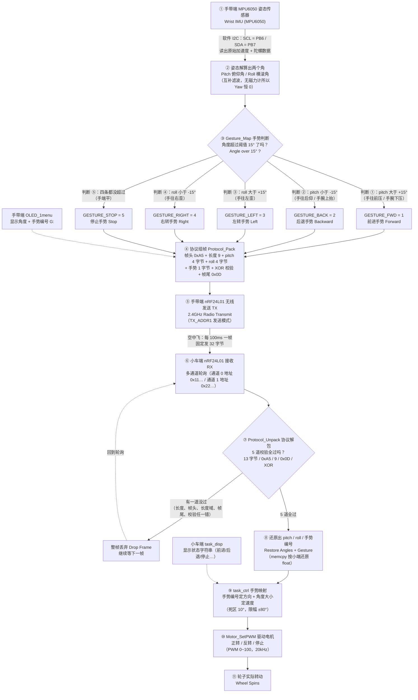

# 阶段六 · 手势控制单个电机 保姆级图解（手势 → 编号 → 无线 → 电机）

> 本文件按你的《图解协议》生成：每张 Mermaid 图**正下方**都紧跟「👀 导游解说」和「📖 本图名词词典」。
> 图里出现的每一个函数名、宏、引脚、协议字段，全部来自你自己的工程源码，不是猜的：
> [遥控/User/main.c](../annotated/遥控/User/main.c)、[遥控/APP/MPU6050.c](../annotated/遥控/APP/MPU6050.c)、
> [遥控/APP/nRF24L01_API.c](../annotated/遥控/APP/nRF24L01_API.c)、[FreeRTOS小车/USER/main.c](../annotated/FreeRTOS小车/USER/main.c)。

---

## 〇、三十秒先建立画面：手一歪，电机就转

把整套系统想成**两个人打手势**：

- **手带端（`遥控` 工程）** = 你的手腕。板子上贴着 MPU6050，它只干一件事：把“手腕现在什么姿势”翻译成两个角度——`pitch`（前后俯仰）、`roll`（左右横滚）。
- **程序** = 翻译官。它把连续变化的角度**砍成 5 个手势编号**（1~5），因为“发一个 1”比“发一串带小数点的角度”更省事、更不容易错。
- **电机端（`FreeRTOS小车` 工程）** = 听命令的工人。收到编号就照做：1 正转、2 反转、3 左转、4 右转、5 停。

一句话记住本阶段：**手一歪 → 角度超过 15° → 变成 1 个编号 → 无线寄过去 → 电机照编号转（或停）。**

---

## 一、题目任务清单（照着题目给自己打分）

| 任务 | 题目原文要求 | 我的工程怎么实现的 | 代码在哪 |
| :--- | :--- | :--- | :--- |
| **任务 1** | 手势映射正确（**正转 / 反转 / 停止**），**有线**连接 | 手带端 `Gesture_Map(pitch, roll)` 用 **15° 阈值**把角度压成 1~5 号手势；电机端按编号做正转 / 反转 / 停。⚠️ 诚实说明：最终版把“有线”整体换成了 nRF24L01 全无线（`遥控` 工程里**没有** USART 初始化代码），有线通道只剩小车端 `USART1`（`PA9 = TX`、`PA10 = RX`，**115200-8N1**），给 `printf` 调试和 VOFA+ 波形用 | `../annotated/遥控/User/main.c`、`../annotated/FreeRTOS小车/USER/main.c` |
| **任务 2** | 手带端通过**无线**发送手势指令，电机端响应 | `Protocol_Pack` 组 13 字节帧 → `NRF24L01_SendData(tx_frame, 32)` 每 **100ms** 发一帧；小车端 `task_rx` **20ms** 轮询 `NRF24L01_RxPacket_Multi` → `Protocol_Unpack` **5 道校验** → 写入 `g_gesture` → `task_ctrl` 映射成方向/速度 → `Motor_SetPWM` | 同上 + `../annotated/FreeRTOS小车/HARDWARE/LED/nRF24L01_API.c` |

**我工程里跟本阶段有关的硬参数（答辩会问，必须背下来）：**

| 参数 | 数值 | 在哪体现 |
| :--- | :--- | :--- |
| 手势阈值 | **15°** | `Gesture_Map` 里四个 `if` 的门槛 |
| 判断顺序 | **先 pitch，后 roll** | `Gesture_Map` 是 `if / else if` 链，先命中先返回 |
| 手势编号 | **1~5**（`GESTURE_NONE = 0` 是无手势初值） | 帧里只占 **1 个字节**（`out[10]`） |
| 发送周期 | **100ms** 一帧 | 手带端 `if(Time_ms > 100)` |
| 接收周期 | **20ms** 轮询一次 | `task_rx` 的 `vTaskDelay` |
| 帧长 | **13 字节**（实际发 **32 字节**，代码注释已标 NOTE） | `Protocol_Pack` / `NRF24L01_SendData` |
| 校验方式 | **异或 XOR**，算 `out[1..10]` 存到 `out[11]` | 两端各算一遍对比 |
| 速度映射 | 死区 **10°**、转向阈值 **15°**、线性映射到 **0~100** | 小车端 `task_ctrl` |

---

## 二、图一：手势 → 编号 → 无线 → 电机（全链路数据流）

> [!example] 👀 导游解说：这张图在讲什么？
>
> 从左上角出发，跟着箭头走一遍，这就是从“手腕一歪”到“轮子转”的全程：
>
> 1. **`① MPU6050`**：手环上那颗小芯片，靠 `PB6`（SCL）、`PB7`（SDA）两根线和单片机聊天。它给的是**原始数据**（加速度、角速度），还不是角度。
> 2. **`② 姿态解算`**：`MPU6050_GetAngle(&angle)` 把原始数据算成两个角。这里用的是**互补滤波**：陀螺仪积分算得快但会漂，加速度算得稳但抖，两者加权（`ALPHA`）取长补短，每 `0.01s` 算一次，限幅 ±90°。因为没装磁力计，`yaw`（转圈角）恒为 0，本阶段**不用它**。
> 3. **菱形 `③ Gesture_Map`**：第一个岔路口，`if / else if` 链，**五个分支按顺序判，谁先成立就返回谁**——这一点非常关键，下面单独讲。
>    - **判断 ①**：`pitch > +15°`（手往前压）→ 返回 **1（前进）**；
>    - **判断 ②**：`pitch < -15°`（手往后仰）→ 返回 **2（后退）**；
>    - **判断 ③**：`roll > +15°`（手往左歪）→ 返回 **3（左转）**；
>    - **判断 ④**：`roll < -15°`（手往右歪）→ 返回 **4（右转）**；
>    - **判断 ⑤**：以上四条都不满足（手端平，两个角都在 ±15° 以内）→ 返回 **5（停止）**。
>    注意：**“停止”不是单独一个手势，而是“什么手势都不是”时的兜底结果**，所以手一放平电机就停，天然安全。
> 4. **关于“先判 pitch 再判 roll”的影响（答辩必问）**：因为 `if / else if` 是**从上往下**匹配，`pitch` 的两个分支排在前面。所以当你的手**又往前压、又往左歪**（`pitch` 和 `roll` 同时超 15°）时，程序在判断 ① 那里就返回了 **1（前进）**，根本走不到判断 ③——**前后动作优先于左右动作**。反过来说，想让“左转 / 右转”生效，手腕就得**别同时前后压超过 15°**，保持基本水平只往两边歪。
> 5. **`④ 协议组帧 Protocol_Pack`**：不管返回几号手势，最后都塞进同一个“信封”：`[0xA5][长度=9][pitch 四字节][roll 四字节][手势一字节][XOR 校验][0x0D]`，加起来 **13 字节**。这样接收端不光知道“几号手势”，还顺手拿到了原始角度，方便阶段七做“倾斜越多转越快”。
> 6. **`⑤ 发送 → ⑥ 接收`**：两个 nRF24L01 模块隔空喊话。手带端用 `NRF24L01_TX_Mode_Init(TX_ADDR1)` 进发送模式；小车端用 `NRF24L01_RX_MultiChannel_Init()` 开多通道轮询。⚠️ 代码里 `NRF24L01_SendData(tx_frame, 32)` **固定发 32 字节**，而帧本身只有 13 字节——这个不一致代码注释里已标 NOTE，答辩被问到要主动承认“发多了 19 个无效字节，接收端按 `len == 13` 截取，所以能跑但不够干净”。
> 7. **菱形 `⑦ Protocol_Unpack`**：第二个岔路口，小车端要查 **5 件事**：总长是不是 13、帧头是不是 `0xA5`、长度域是不是 9、帧尾是不是 `0x0D`、`XOR(buf[1..10])` 是不是等于 `buf[11]`。
>    - **有一项不对** → 走左边 `整帧丢弃`，宁可这一拍不动，也不让空中干扰的乱码变成“突然倒车”；
>    - **五项全对** → 走右边，`memcpy` 按**小端**把 4 个字节还原成 `float` 的 `pitch / roll`，连同手势编号一起写进 `g_pitch / g_roll / g_gesture`（用互斥量保护）。
> 8. **`⑨ task_ctrl 手势映射`**：手势编号定“往哪个方向”，角度大小定“多快”。`pitch / roll` 先限幅 ±80°，再减去 **10° 死区**（手抖小于 10° 当没动）、按 **15° 转向阈值**线性映射到 **0~100** 的速度，最后 `Motor_SetPWM` 真正给电。
> 9. **`⑩ Motor_SetPWM → ⑪ 轮子转`**：真正的执行。本阶段验收“单个电机”时，只用得到 **1（正转）、2（反转）、5（停）** 这三个编号；3 / 4 是给第八阶段两个轮子做**差速转向**预留的。
> 10. **两条虚线 `OLED`**：手带端 `OLED_1menu` 显示角度和 `G:` 编号，小车端 `task_disp` 显示状态字符串（前进 / 后退 / 停止 / 原地左转…），拍视频和答辩就靠这两块屏当“证据”。

> [!info] 📖 本图名词词典
> | 缩写/字母 | 全称 | 中文意思 | 在实物/代码里到底是什么？ |
> | :--- | :--- | :--- | :--- |
> | **MPU6050** | MPU-6050 六轴传感器 | 六轴姿态传感器 | 手带端那颗小芯片，3 轴加速度计 + 3 轴陀螺仪，软件 I2C 接 `PB6 = SCL`、`PB7 = SDA`。 |
> | **I2C** | Inter-Integrated Circuit | 集成电路总线 | 两根线（时钟 SCL + 数据 SDA）就能挂很多芯片的“双线聊天方式”，本工程是**软件模拟**（自己翻转引脚电平）。 |
> | **SCL / SDA** | Serial Clock / Serial Data | 串行时钟 / 串行数据 | 手带端 MPU6050 用 `PB6`（SCL）、`PB7`（SDA）；OLED 另用 `PB8`、`PB9`，两套总线互不干扰。 |
> | **pitch** | Pitch Angle | 俯仰角 | 手往前压 / 往后仰的角度。代码里**正数 = 前进**，负数 = 后退。 |
> | **roll** | Roll Angle | 横滚角 | 手往左 / 往右歪的角度。代码里**正数 = 左转**，负数 = 右转。 |
> | **yaw** | Yaw Angle | 偏航角（航向） | 手转圈的角度；没磁力计所以**恒为 0**，本阶段不参与判断。 |
> | **姿态解算** | Attitude Solution | 由原始数据算角度 | `MPU6050_GetAngle()` 把传感器原始数据换算成 `Pitch / Roll` 的过程。 |
> | **互补滤波** | Complementary Filter | 互补滤波 | `ALPHA` 加权：陀螺积分（短期准）+ 加速度角（长期准），每 `0.01s` 更新一次，限幅 ±90°。 |
> | **阈值 15°** | Threshold | 门槛值 | `Gesture_Map` 里的判断线：角度**超过** 15° 才算做了一个手势，否则算“手端平”。 |
> | **死区 10°** | Dead Zone | 死区 | 小车端速度映射用的，小于 10° 一律当 0，防止手微抖导致电机原地抽动。**和 15° 阈值是两回事，别混着答。** |
> | **手势编号** | Gesture ID | 手势的号码 | 一个 8 位整数（1~5），协议里只占 `out[10]` 这 1 个字节，是两端唯一的“共同语言”。 |
> | **GESTURE_FWD** | Gesture Forward | 前进手势 | 宏，值 **1**；`pitch > +15°` 时返回它。 |
> | **GESTURE_BACK** | Gesture Backward | 后退手势 | 宏，值 **2**；`pitch < -15°` 时返回它。 |
> | **GESTURE_LEFT / RIGHT** | Gesture Left / Right | 左转 / 右转手势 | 宏，值 **3 / 4**；分别对应 `roll > +15°` 和 `roll < -15°`。 |
> | **GESTURE_STOP** | Gesture Stop | 停止手势 | 宏，值 **5**；**四条判断都不满足**时返回它。 |
> | **GESTURE_NONE** | Gesture None | 无手势 | 宏，值 **0**，是“还没算出结果”的初始值，不会发出去。 |
> | **Protocol_Pack** | Protocol Pack | 协议组帧（装信封） | 手带端函数：把 `0xA5 / 长度 / pitch / roll / 手势 / 校验 / 0x0D` 依次填进 13 字节数组。 |
> | **帧头 0xA5** | Frame Header | 一帧的开头标志 | 十六进制数 165，接收端看到它才认为“一帧开始了”，防止从中间开始解析。 |
> | **长度域 = 9** | Length Field | 数据区长度 | `out[1] = 9`，表示后面 `pitch(4) + roll(4) + 手势(1)` 一共 9 个字节。 |
> | **帧尾 0x0D** | Frame Tail | 一帧的结尾标志 | 十六进制 13（就是回车符 CR），标志这一帧到此结束。 |
> | **XOR 校验** | Exclusive OR Checksum | 异或校验 | 把 `out[1]` 到 `out[10]` 逐字节“异或”得到一个数放进 `out[11]`；接收端重算一遍，对不上就丢帧。 |
> | **小端 float** | Little-Endian Float | 小端浮点数 | 一个 `float` 占 4 字节，低字节排前面；`memcpy` 直接按字节搬，所以两端 CPU 字节序必须一致（都是 STM32，没问题）。 |
> | **nRF24L01** | Nordic RF 24L01 | 2.4GHz 无线模块 | 指甲盖大的收发芯片，代替蓝牙 HC-05 做双机通信（题目允许二选一，本工程选它）。手带端 `CSN=PA0 / CE=PA1 / SCK=PA2 / MOSI=PA3 / MISO=PA4 / IRQ=PA5`；小车端 `CSN=PA2 / CE=PA3 / SCK=PA4 / MOSI=PA5 / MISO=PB0 / IRQ=PB1`。 |
> | **2.4GHz** | 2.4 giga-hertz | 2.4G 频段 | 和 WiFi、蓝牙同一频段，免许可证；穿墙差、怕遮挡，所以天线别用手捂住。 |
> | **TX / RX** | Transmit / Receive | 发送 / 接收 | 手带端是 TX（`NRF24L01_TX_Mode_Init(TX_ADDR1)`），小车端是 RX（`NRF24L01_RxPacket_Multi`）。 |
> | **地址 / 通道** | Address / Channel | 通信地址 / 频道 | 两个模块必须“同地址同频道”才能互通；小车端开了多通道（通道 0 地址 `0x11…`、通道 1 地址 `0x22…`）。 |
> | **Protocol_Unpack** | Protocol Unpack | 协议解包（拆信封） | 小车端函数：查 5 道校验，再把 4 字节还原成 `float` 角度。 |
> | **task_rx / task_ctrl / task_disp** | FreeRTOS Tasks | 接收任务 / 控制任务 / 显示任务 | 三个任务分别 20ms、20ms、50ms 跑一轮，优先级 3 / 2 / 1。 |
> | **32 字节** | 32 Bytes | 一次发 32 个字节 | `NRF24L01_SendData(tx_frame, 32)` 的真实长度，比 13 字节的帧多出 19 字节垃圾数据（代码里已标 NOTE）。 |
> | **OLED_1menu** | OLED Menu 1 | 手带端显示页 | 手带端显示角度和 `G:` 编号的函数。 |
> | **G:** | Gesture Label | 手势编号标签 | 手带端 OLED 上 `G:1` 就是“当前识别为 1 号手势（前进）”。 |

---

## 三、图二：手势编号对照表（5 个手势 ↔ 编号 ↔ 电机动作）

| 手势 | 手腕怎么动 | 角度条件 | 编号 | 宏名 | 电机动作（单个电机） | 双轮小车（第八阶段） | 手带端 OLED | 小车端 OLED 状态 |
| :--- | :--- | :--- | :---: | :--- | :--- | :--- | :--- | :--- |
| **前进** | 手往前压 / 手腕下压 | `pitch > +15°` | **1** | `GESTURE_FWD` | **正转** | 前进（左右轮同速） | `G:1` | 前进 |
| **后退** | 手往后仰 / 手腕上抬 | `pitch < -15°` | **2** | `GESTURE_BACK` | **反转** | 后退（左右轮同速反向） | `G:2` | 后退 |
| **左转** | 手往左歪 | `roll > +15°` | **3** | `GESTURE_LEFT` | **左转** | 差速左转（左慢右快 / 原地一正一反） | `G:3` | 原地左转 / 前进左转 |
| **右转** | 手往右歪 | `roll < -15°` | **4** | `GESTURE_RIGHT` | **右转** | 差速右转 | `G:4` | 原地右转 / 前进右转 |
| **停止** | 手端平，四条都不超 | `±15°` 以内 | **5** | `GESTURE_STOP` | **停**（目标速度 0） | 停止 | `G:5` | 停止 |
| （无手势） | 刚上电还没算出来 | — | **0** | `GESTURE_NONE` | 不动（初值） | 不动 | 不显示 | 停止 |

**读这张表要记住三件事：**

1. **编号是 1~5 连续排的**，而 `GESTURE_NONE = 0` 只是一个“还没结果”的占位，**永远不会被发出去**——所以协议里合法的值只有 1~5。
2. **单电机只需 1 / 2 / 5 三个编号**就能验收本阶段（正转、反转、停）；3 / 4 在单个电机上表现为“轮子往左/右拐”的意图，要等两个轮子能差速才真正体现出来，这是第八阶段的事。
3. **粗体那列是电机动作，答辩时按它说**：手势 → 编号 → 动作，三列一一对应，中间不许“翻译错”。

---

## 四、代码对照（手指着屏幕，一行一行找）

| 位置 | 函数 / 宏 | 它到底干了什么 | 关键细节 |
| :--- | :--- | :--- | :--- |
| [遥控/User/main.c](../annotated/遥控/User/main.c) | `Gesture_Map(pitch, roll)` | **角度 → 手势编号** | 五个分支、阈值 **15°**、**先 pitch 后 roll**、返回 1~5 |
| [遥控/User/main.c](../annotated/遥控/User/main.c) | `Protocol_Pack` | **编号 + 角度 → 13 字节帧** | `out[0]=0xA5`、`out[1]=9`、`out[2..5]=pitch`、`out[6..9]=roll`、`out[10]=gesture`、`out[11]=XOR`、`out[12]=0x0D` |
| [遥控/User/main.c](../annotated/遥控/User/main.c) | `OLED_1menu` | 手带端显示 | 每 **100ms** 发一帧；屏上显示 `Pitch / Roll` 和 `G:` 编号 |
| [FreeRTOS小车/USER/main.c](../annotated/FreeRTOS小车/USER/main.c) | `Protocol_Unpack` | **13 字节帧 → 角度 + 编号** | 查 `len == 13`、`buf[0] == 0xA5`、`buf[1] == 9`、`buf[12] == 0x0D`、`XOR(buf[1..10]) == buf[11]`，再 `memcpy` 还原 float |
| [FreeRTOS小车/USER/main.c](../annotated/FreeRTOS小车/USER/main.c) | `task_rx` | 收帧任务（优先级 3） | 20ms 轮询 `NRF24L01_RxPacket_Multi`，角度限幅 ±80° 后写 `g_pitch / g_roll / g_gesture`（互斥量保护） |
| [FreeRTOS小车/USER/main.c](../annotated/FreeRTOS小车/USER/main.c) | `task_ctrl` | 映射 + 执行任务（优先级 2） | 20ms 一轮：死区 10° → 线性映射 0~100 → 差速 → `PID_Calc` → 最小 PWM 30 补偿 → `Motor_SetPWM` |
| [FreeRTOS小车/USER/main.c](../annotated/FreeRTOS小车/USER/main.c) | `task_disp` | 显示任务（优先级 1） | 50ms 一轮，`sprintf` 出状态字符串（停止 / 前进 / 后退 / 原地左右转 / 前进左右转…），`SCREEN_FLIP=1` 倒装屏 |

---

## 五、答辩三问（背下来，问到不慌）

**问 1：阈值为什么取 15°？**

答：三个理由。① **防抖**：MPU6050 就算静置不动，解算出来的角度也有几度抖动（陀螺零漂 + 加速度噪声），门槛太低会“手没动电机自己在动”；② **手感**：15° 是手腕轻轻一压就能到的角度，不需要夸张地甩手；③ **留安全带**：±15° 以内都算“手端平”，等于给“停止”留了一个 30° 宽的稳定区，手放下就一定能停。取太小误触发，取太大要歪很久才有反应，**15° 是调出来的折中值**。注意别和速度映射里的 **10° 死区** 混为一谈：15° 是“算不算手势”，10° 是“算多快”。

**问 2：为什么先判 pitch、后判 roll？**

答：因为 `Gesture_Map` 用的是 `if / else if` 链，**从上往下匹配，先命中先返回**。把 `pitch` 两条放前面，等于约定“**前后动作优先于左右动作**”：手又往前压又往左歪时，返回 1（前进）而不是 3（左转）。这样做的好处是 —— 前后是主操作、动作幅度大、不容易误判，先判它方向更稳；代价是 —— 想做左右手势时，手腕必须**基本水平**，别同时带前后倾。如果哪天想改成“左右优先”，只需要把四个 `if` 换顺序，但**必须两端文档、答辩口径一起改**，否则自己都说不清。

**问 3：手势编号为什么一定要两端约定一致？**

答：因为协议里手势只占 **1 个字节**，它本身没有任何含义，含义全靠两端**事先约好**。如果手带端认为 `1 = 前进`、小车端把 `1` 当 `后退`，那么**校验全过、通信完全正常，车却倒着冲**——这是最阴的一类 bug：链路层没问题，语义层错了，`XOR` 查不出来。所以编号、阈值、帧格式、帧头帧尾、无线地址/通道必须**两端同一张表**；改任何一处都要同步改另一端并**重新烧录两块板**。这也是为什么本阶段要把那张“手势 ↔ 编号 ↔ 动作”的对照表写进文档——它就是两端的合同。

---

## 六、自测清单（一条一条打勾，全过才算本阶段完成）

- [ ] **端平测停止**：手端平不动，手带端 OLED 的 `G:` 显示 **5**，小车端 OLED 显示“停止”，电机不转、不抖。
- [ ] **前后测方向**：手往前压超过 15° → `G:1`、电机**正转**；手往后仰超过 15° → `G:2`、电机**反转**；两个方向都试，确认没接反。
- [ ] **左右测转向**：手往左歪 → `G:3`；往右歪 → `G:4`。测试时**手腕保持水平**，别同时前后压，否则会被 pitch 分支抢走（这条本身就是“先判 pitch”的验证）。
- [ ] **斜着压测顺序**：故意同时往前压 + 往左歪（两个角都超 15°）→ 屏幕应显示 **`G:1`（前进）**，证明判断顺序确实是先 pitch。
- [ ] **无线链路测鲁棒性**：把手带端拿远、用手捂住天线 → 观察小车端是否**不乱动**（坏帧会走“整帧丢弃”分支）；同时确认工程里**没有**做失联超时刹车（代码里没有这段逻辑，答辩被问到要主动说明，这属于可以改进的点）。

---

> 下一步：想重讲哪一段（比如“重讲 13 字节帧每一位”“重讲互补滤波怎么算角度”“重讲 FreeRTOS 三个任务怎么配合”），把一句话发我，我继续按这个格式补到 `00_图解字典与硬件名词/` 目录下。
