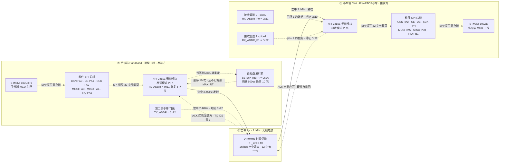
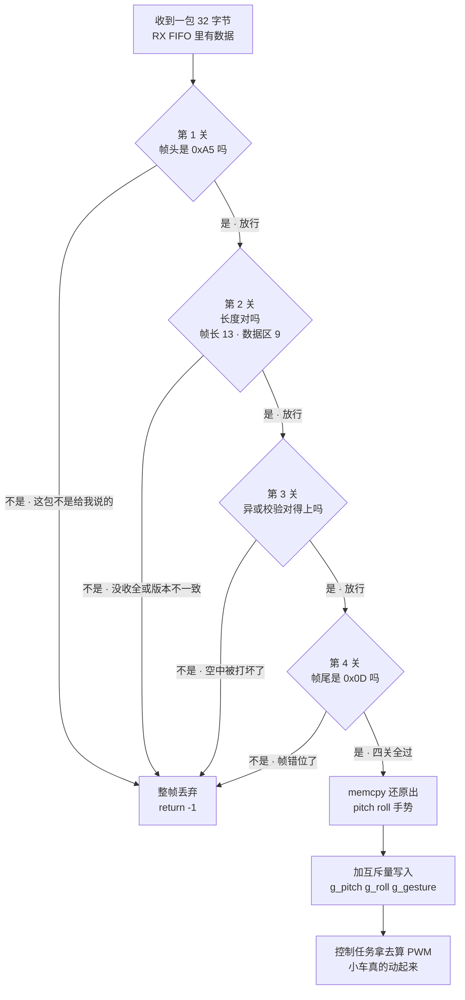

# 阶段四 · 蓝牙 / 无线通信 保姆级图解（HC-05 → nRF24L01 替代版）

> 本文件按你的《图解协议》生成：每张 Mermaid 图的**正下方**都紧跟「👀 导游解说」和「📖 本图名词词典」。
> 对应题目：第四阶段 —— 用蓝牙模块替换有线 UART，实现无线双机通信，并且通信稳定、指令能正确接收执行。
> 对应代码：[手带端 nRF24L01_API.c](../annotated/遥控/APP/nRF24L01_API.c)、[小车端 nRF24L01_API.c](../annotated/FreeRTOS小车/HARDWARE/LED/nRF24L01_API.c)、[手带端 main.c](../annotated/遥控/User/main.c)、[小车端 main.c](../annotated/FreeRTOS小车/USER/main.c)。
>
> ⚠️ **先说清一件事**：题目原文写的是「用**蓝牙模块**（HC-05）替换有线 UART」，但题目允许 **HC-05 蓝牙 或 nRF24L01** 二选一。**本工程没有用 HC-05，用的是 nRF24L01（2.4GHz 无线）**。所以本文出现的每一根线、每一个函数，都是 nRF24L01 的，不是 HC-05 的。

---

## 〇、这个阶段用大白话说要做什么

第三阶段你的两块板子是靠**一根杜邦线**说悄悄话的：手带端的 TX 接到小车端的 RX，还要再拉一根 GND 共地。
第四阶段就是要**把这根线剪断**，让手带端"隔空喊话"。

但隔空喊话有两个新麻烦：

1. **谁都能听见，也谁都能插嘴**。空气里塞满了 WiFi、蓝牙、别人的遥控器，喊出去的话可能被搅乱，所以话必须说成"有编号的句子"（帧头 + 长度 + 校验 + 帧尾）。
2. **喊完不知道对方听没听见**。所以每喊一句，对方要"嗯"一声（ACK 自动应答）；没听见就再喊（自动重发）。

一句话总结：**把有线的那根"电话线"换成了"对讲机"，并且给每句话加了封条和回执。**

顺带一个诚实的事实：`遥控` 工程里**根本没有写任何 USART 串口初始化代码**——线是真的剪断了，所有数据只走无线。

### 题目任务清单

| 任务 | 题目要求 | 怎么算过关 | 你工程里的实现 |
| :--- | :--- | :--- | :--- |
| 任务1 | 用**蓝牙模块替换有线 UART**，实现无线双机通信 | 拔掉杜邦线之后，手带端动，小车端照样收到数据 | **用 nRF24L01 替代 HC-05**：手带端 `NRF24L01_Init()` → `while(NRF24L01_Check())` 自检 → `NRF24L01_TX_Mode_Init(TX_ADDR1)` 进入 **TX 发送模式**，地址 `0x11`；小车端 `NRF24L01_RX_MultiChannel_Init()` 进入**多通道接收**，通道0 = `0x11…`、通道1 = `0x22…` |
| 任务2 | 通信**稳定**、指令能**正确接收并执行** | 连续晃几分钟，不抽风、不乱跑、动作跟得上 | 硬件层：Auto-ACK 自动应答 + 自动重发（`SETUP_RETR = 0x1A`，间隔 500us、最多 10 次）+ 16 位 CRC；软件层：帧头 `0xA5` / 长度 9 / 异或校验 / 帧尾 `0x0D` 五道关，坏帧直接丢；应用层：手带端 100ms 发一帧，小车端 20ms 轮询一次 |

### 为什么选 nRF24L01，而不选 HC-05？

| 理由 | 展开说 |
| :--- | :--- |
| **便宜** | 一块 nRF24L01 模块几块钱，比带底板的 HC-05 便宜不少，坏了也不心疼 |
| **不用配对** | HC-05 要先把它接进 AT 模式，设波特率、改名字、改密码，再用手机/主机搜蓝牙连上；nRF24L01 只要两边**频率、地址、速率、包长**四个参数一致就直接通，上电即用 |
| **有 ACK 重发** | nRF24L01 的"确认收到"和"重发"是**芯片硬件自己做的**，CPU 不用管；HC-05 是串口透传，丢了它不告诉你，得你自己在应用层补 |
| 也要说公道话 | HC-05 的优点是能直接连手机、透传简单（当一根无线串口线用）。本工程不需要连手机，所以选了 nRF24L01 |

---

## 一、图一：两块 nRF24L01 怎么"隔空说话"

> [!example] 👀 导游解说：这张图在讲什么？
>
> 这张图把"隔空喊话"拆成了**三段路**：左边手带端准备话 → 中间空气传话 → 右边小车端听并回应。
>
> - **`A[手带端 MCU]`**：STMicro 的 STM32F103C8T6 最小系统板。它自己不会发无线电，只会"写寄存器"，所以必须靠 B 这根线去指挥 C。
> - **`B[软件 SPI 总线]`**：6 根线，左边 6 个引脚全是 `遥控` 工程的真实引脚（CSN=PA0、CE=PA1、SCK=PA2、MOSI=PA3、MISO=PA4、IRQ=PA5）。"软件"的意思是：没用 STM32 自带的 SPI 外设，而是用 `SPI_RW()` 函数在 GPIO 上**一位一位手动翻电平**，像用手打摩尔斯电码。
> - **`C[nRF24L01 发送模式 PTX]`**：模块被 `NRF24L01_TX_Mode_Init(TX_ADDR1)` 配成"只会喊、不会听"的模式，喊的每句话都带上门牌号 `0x11 0x11 0x11 0x11 0x11`（5 字节）。
> - **`D[2440MHz 射频信道]`**：真正的"空气"。两边都写 `RF_CH = 40`，芯片就用 2400+40=2440MHz 这个频率喊；速率 2Mbps，一包最多 32 字节。两边的 `RF_CH`/速率/地址/包长**四项必须完全一样**，差一项就是"频率对不上，喊破喉咙也听不见"。
> - **`E[小车端 nRF24L01 接收模式 PRX]`**：小车端用 `NRF24L01_RX_MultiChannel_Init()` 配成"只听不喊"，并且**开了两个门**（通道 0 和通道 1）。
> - **`H[通道 0 = 0x11]` / `I[通道 1 = 0x22]`**：这是两条**虚线**，代表"芯片内部的分拣口"，不是飞线。芯片收到包后先看包里地址是 `0x11…` 还是 `0x22…`，是哪个就丢进哪个管道；`NRF24L01_GetChannelFromStatus()` 再从 STATUS 的 bit3..1（`RX_P_NO`）把这个管道号读出来，所以程序能知道"这包是 1 号手环发的还是 2 号手环发的"。
> - **`F → G`**：小车端同样靠软件 SPI（CSN=PA2、CE=PA3、SCK=PA4、MOSI=PA5、MISO=PB0、IRQ=PB1）读 32 字节，交给 `task_rx` 任务解析。⚠️ **注意小车端 PA5 同时还是 LED1 的引脚，代码里这个冲突是存在的**（已在源码注释标 NOTE），接线/改板时要留意。
> - **往上回的那两条虚线 `ACK`**：接收方芯片收到一包且 CRC 对得上，会**在硬件层面自动回一个空包**（Auto-ACK，`EN_AA` 打开），不需要小车端写一行代码；发送方收到这个回执就把 `TX_DS` 置 1，表示"送达"。这就是"喊完有人应一声"。
> - **`RETRY[自动重发]` 那个圈**：发送方把 CE 拉高发射后，如果等不到 ACK，芯片自己按 `SETUP_RETR = 0x1A` 的设定**每 500us 再喊一次，最多喊 10 次**；10 次都没人应，就置 `MAX_RT`，`NRF24L01_TxPacket()` 返回 `0x10` 告诉你"这包没送出去"。
> - **`C2[第二只手环]`**：为什么小车端要开两个通道？就是为了这种"一个接收端听两个发送端"的场景——1 号手环地址 `0x11`、2 号手环地址 `0x22`，小车端不用改一行代码就能分辨。

> [!info] 📖 本图名词词典
> | 缩写/字母 | 全称 | 中文意思 | 在实物/代码里到底是什么？ |
> | :--- | :--- | :--- | :--- |
> | **nRF24L01** | Nordic nRF24L01 | 2.4G 无线收发芯片 | 手带端接 PA0~PA5、小车端接 PA2~PB1 的那块蓝色小板子，模块自带天线 |
> | **MCU** | Microcontroller Unit | 单片机 / 微控制器 | 图里左、右两个大框：手带端 STM32F103C8T6、小车端 STM32F103ZE，只负责算和发命令 |
> | **HC-05** | HC-05 Bluetooth Module | 蓝牙串口透传模块 | 题目原文点名的模块，**本工程没用**，用 nRF24L01 替代 |
> | **2.4GHz** | 2.4 gigahertz | 2.4G 特高频段 | 不用申请许可的公共频段，WiFi、蓝牙、这个模块都挤在这里，所以会互相干扰 |
> | **SPI** | Serial Peripheral Interface | 串行外设接口 | 一种"主从同步"通信：主机出时钟，数据一位一位走，速度快、线少 |
> | **软件 SPI** | bit-banging SPI | 软件模拟 SPI | 不用 STM32 的硬件 SPI 外设，靠 `SPI_RW()` 手动翻 GPIO 电平，慢一点但引脚随便挑 |
> | **CSN** | Chip Select Not | 片选（低电平有效） | 手带端 PA0 / 小车端 PA2。拉低=选中这个芯片，可以开始读写 |
> | **CE** | Chip Enable | 使能 | 手带端 PA1 / 小车端 PA3。发送时高电平触发发射，接收时高电平开始监听 |
> | **SCK** | Serial Clock | 串行时钟 | 手带端 PA2 / 小车端 PA4。主机自己产生的节拍，模块跟着这个节拍采样数据 |
> | **MOSI** | Master Out Slave In | 主机输出、从机输入 | 手带端 PA3 / 小车端 PA5。单片机把命令和数据"吐"给模块的那根线 |
> | **MISO** | Master In Slave Out | 主机输入、从机输出 | 手带端 PA4 / 小车端 PB0。模块把数据"吐"回单片机的那根线，代码里配成上拉输入防悬空 |
> | **IRQ** | Interrupt Request | 中断请求（低电平有效） | 手带端 PA5 / 小车端 PB1。发送成功、重发超限、收到数据——任意一件事发生，这根线就被拉低 |
> | **PTX** | Primary Transmitter | 主发送器 | `TX_Mode_Init()` 配出来的模式：只发不收（只收 ACK），手带端就是它 |
> | **PRX** | Primary Receiver | 主接收器 | `RX_MultiChannel_Init()` 配出来的模式：只听不说，小车端就是它 |
> | **TX_ADDR** | Transmit Address | 发送地址寄存器 | 5 字节门牌号。手带端写 `0x11 0x11 0x11 0x11 0x11`，小车端必须用同一串当地址才收得到 |
> | **RX_ADDR_P0 / P1** | Receive Address Pipe 0 / 1 | 接收地址寄存器（管道0/1） | 小车端的"两个门牌号"：P0=`0x11…`、P1=`0x22…`。只有 P0/P1 能写满 5 字节，P2~P5 只写最低 1 字节 |
> | **通道 / pipe** | data pipe | 数据管道 | 芯片内部有 6 个接收管道，本工程只启用 0 和 1 两个；它不是"频道"，见答辩三问第 2 题 |
> | **payload** | payload | 载荷 / 一包的数据内容 | 本工程固定 32 字节（`TX_PLOAD_WIDTH` / `RX_PLOAD_WIDTH`），改动一边另一边也必须改 |
> | **ACK** | Acknowledgement | 确认应答 | 接收方芯片收到好包后自动回一个空包，告诉发送方"我听到了" |
> | **Auto-ACK** | Automatic Acknowledgement | 自动应答 | 硬件功能，`EN_AA` 写 `0x01`（只开通道0）或 `0x03`（开通道0、1）就打开了 |
> | **自动重发** | Auto Retransmit | 没等到 ACK 就再发一遍 | `SETUP_RETR = 0x1A`：间隔 500us、最多重发 10 次，全程硬件自己做 |
> | **TX_DS** | TX Data Sent | 发送成功标志 | STATUS 寄存器里的位，收到 ACK 就置 1；`NRF24L01_TxPacket()` 靠它返回 `0x20` |
> | **MAX_RT** | Max Retransmit | 重发次数用尽 | 重发 10 次还是没人应就置 1，函数返回 `0x10`，表示这包丢了 |
> | **RF_CH** | RF Channel | 射频信道号 | 写 `40` → 2400+40 = **2440MHz**。这是"频道"，和地址不是一回事 |
> | **空中速率** | air data rate | 无线传输速度 | `RF_SETUP = 0x0F` 里选的是 2Mbps，两边必须一样 |
> | **FIFO** | First In First Out | 先进先出缓冲队列 | 芯片内部的收发排队区，`FLUSH_TX` / `FLUSH_RX` 命令用来清空 |
> | **CRC** | Cyclic Redundancy Check | 循环冗余校验 | 硬件校验，`CONFIG` 里开了 16 位 CRC，用来发现"这包在空中被打坏了" |
> | **UART** | Universal Asynchronous Receiver/Transmitter | 通用异步串口 | 第三阶段那根有线的协议（TX/RX 交叉 + 共地），本阶段把它换成了无线 |
> | **STATUS** | Status Register | 状态寄存器 | 读一次就知道"有没有新包、从哪个管道来的、上次发成功没"，`RxPacket_Multi` 一进门就读它 |
> | **RX_DR** | RX Data Ready | 收到数据标志 | STATUS 的 bit6，为 1 表示 RX FIFO 里躺着一个新包，`RxPacket_Multi` 就是靠它判断"有没有数据" |
> | **RX_P_NO** | RX Pipe Number | 接收管道编号 | STATUS 的 bit3..1，掩码 `0x0E` 再右移 1 位就得到 0~5，靠它知道"这包是哪个通道收到的" |
> | **RX_DR** | RX Data Ready | 收到数据标志 | STATUS 的 bit6，为 1 表示 RX FIFO 里躺着一个新包，`RxPacket_Multi` 就是靠它判断"有没有数据" |
> | **RX_P_NO** | RX Pipe Number | 接收管道编号 | STATUS 的 bit3..1，掩码 `0x0E` 再右移 1 位就得到 0~5，靠它知道"这包是哪个通道收到的" |

---

## 二、图二：为什么无线数据必须"帧头 + 校验 + 帧尾"

一帧长这样（13 字节有效，实际发 32 字节，多出来的补 0）：`[0xA5] [0x09] [pitch 4字节] [roll 4字节] [手势 1字节] [XOR校验] [0x0D]`

> [!example] 👀 导游解说：这张图在讲什么？
>
> 这张图是"收快递先验货"的流程：**四个菱形 = 四道关卡，任何一道不过就整包扔掉**，只有全过才交给控制任务。逐条说清哪一步错会怎样：
>
> - **`A[收到一包]`**：`task_rx` 每 20ms 调一次 `NRF24L01_RxPacket_Multi(buf, &ch)`，返回 0 说明 FIFO 里有 32 字节读进来了。
> - **`B{帧头是 0xA5 吗}`**：**不是** → 走左边 `X[整帧丢弃]`，`Protocol_Unpack` 返回 -1。会发生什么：如果没这道关，开机时 FIFO 里的残留数据、别人模块发的 32 个随机字节都会被当成姿态，小车会突然乱窜。0xA5 是约定好的"开场白"，不是 0xA5 就说明"这包不是我的协议"。
> - **`C{长度对吗}`**：这里其实有两个数——**整帧必须 13 字节**（`len != FRAME_LEN`），**第 1 字节的长度域必须是 9**（`buf[1] != PAYLOAD_LEN`）。**不对** → 丢弃。为什么会错：发送端只发了一半、或者发收两端协议版本不一样（比如你改过结构体字段）。长度不对还硬解析，`memcpy` 就会读到别的字段上，pitch 变成 roll、手势变成小数的一部分。
> - **`D{异或校验对得上吗}`**：把 `buf[1]` 到 `buf[10]`（长度字节 + 9 字节数据区）逐字节异或，结果必须等于 `buf[11]`。**不对** → 丢弃。这是**最主要的一道防线**：空中干扰打翻了 pitch 的某一个 bit，比如 +20.0° 变成 -20.0°，帧头帧尾都还是对的，只有校验能发现。
> - **`E{帧尾是 0x0D 吗}`**：`buf[12]` 必须是 0x0D。**不是** → 丢弃。它管的是"帧边界对不对"：这一关防的是错位——万一上一包少收了几个字节，后面的数据全部往前挪，帧尾一定对不上。
> - **`F[memcpy 还原]`**：用 `memcpy(&p->pitch, buf+2, 4)` 把 4 个字节原样搬进 float。为什么不用强制类型转换？因为发送端也是 memcpy，两边都是小端，字节序天然一致，不用换。
> - **`G[加互斥量写入]`**：`xSemaphoreTake(xMutex, ...)` 保护 `g_pitch / g_roll / g_gesture` 三个全局量，保证控制任务不会读到"新 pitch 配旧 roll"这种缝合怪。
> - **`H[控制任务算 PWM]`**：`task_ctrl` 20ms 一次读这三个全局量，算差速目标、跑 PID、输出 PWM。到这里，"无线指令"才真正变成"轮子转"。
> - 补充一句实话：代码里这四关的**先后顺序**是「帧长 13 → 帧头 → 长度域 9 → 帧尾 → 异或校验」，图里按"帧头→长度→校验→帧尾"排是为了好记。顺序不影响结论——**任何一关不过都是 return -1 丢弃**。
> - 还有一个已知的坑：手带端 `Protocol_Pack()` 组的是 **13 字节**帧，但调用处 `NRF24L01_SendData(tx_frame, 32)` **固定发 32 字节**，后面 19 个字节是 0。所以接收端必须按 32 字节收、再只解析前 13 字节，否则帧会对不齐（源码里已标 NOTE）。

> [!info] 📖 本图名词词典
> | 缩写/字母 | 全称 | 中文意思 | 在实物/代码里到底是什么？ |
> | :--- | :--- | :--- | :--- |
> | **帧 / frame** | frame | 一帧 | 一次完整传输的数据单元，本工程是 13 字节有效内容 |
> | **帧头** | frame header | 一帧的开头标记 | `0xA5`，`Protocol_Pack` 写在 `out[0]`，`Protocol_Unpack` 用它判断"这是不是我的协议" |
> | **帧尾** | frame tail | 一帧的结束标记 | `0x0D`，写在 `out[12]`，用来确认"这一帧收完整了、没错位" |
> | **长度域** | length field | 数据区有多长 | `out[1] = 9`（pitch4 + roll4 + 手势1），接收端比对 `buf[1] != 9` |
> | **0xA5** | — | 十六进制 165 | 帧头常量 `FRAME_HEAD`。选它没有玄学，就是一个不太会连续出错的固定值 |
> | **0x0D** | — | 十六进制 13，回车符 | 帧尾常量 `FRAME_TAIL`，和第一阶段串口协议的结束符同一个值 |
> | **校验 / checksum** | checksum | 校验码 | 本工程用异或：`buf[1]` 到 `buf[10]` 全部 XOR 起来，结果存 `buf[11]` |
> | **XOR / 异或** | Exclusive OR | 异或运算 | 相同为 0、不同为 1。逐字节异或的好处是：任意一位被改动，结果几乎一定变 |
> | **PAYLOAD_LEN** | payload length | 数据区长度宏 | 等于 9，收发两边都用它算校验范围，改一处必须改两处 |
> | **FRAME_LEN** | frame length | 整帧长度宏 | `4 + PAYLOAD_LEN = 13`，`Protocol_Unpack` 第一句就检查 `len != 13` |
> | **memcpy** | memory copy | 内存拷贝 | 把 4 个字节原样搬进 float 变量，避免强制类型转换的字节序问题 |
> | **float 小端** | little-endian | 小端字节序 | 低位字节放低地址。STM32 和 PC 都是小端，所以两边直接 memcpy 就对 |
> | **互斥量 / mutex** | mutex | 互斥锁 | 防止两个任务同时改同一组变量；本工程用 `xSemaphoreTake/Give` 保护三个全局姿态量 |
> | **RX FIFO** | Receive FIFO | 接收队列 | 芯片内部排队区，`NRF24L01_RxPacket_Multi()` 从里面读 32 字节 |
> | **丢帧** | frame drop | 整帧丢弃 | 校验不过就 `return -1` 不更新全局量，保持上一次的有效值，比用坏数据安全 |
> | **32 字节补 0** | padding | 补零对齐 | `NRF24L01_SendData()` 把不足 32 字节的缓冲后面补 0，因为芯片单包固定 32 |
> | **PWM** | Pulse Width Modulation | 脉冲宽度调制 | 控制任务最后输出的就是它：占空比 0~100 对应电机 0~100% 的力气（原理见阶段二那篇） |
> | **PID** | Proportional-Integral-Derivative | 比例-积分-微分控制 | 小车端的速度环算法，把"目标转速与实际转速的差"算成一个 PWM 修正量（详见阶段七） |

---

## 三、图三（表格版）：HC-05 蓝牙 vs nRF24L01 怎么选

| 对比项 | **HC-05 蓝牙** | **nRF24L01 2.4GHz** |
| :--- | :--- | :--- |
| 题目里的定位 | 题目原文点名的模块 | 题目允许的另一选项 |
| 通信方式 | 串口**透传**：把 UART 字节原样搬到空中，对面原样吐出来 | 按**包**发：一次一包，最多 32 字节，带地址和 CRC |
| 要不要配对 | **要**：先接进 AT 模式设波特率/名称/密码，再搜蓝牙连上 | **不用**：频率、地址、速率、包长四个参数一样就直接通 |
| 设备关系 | 通常一对一（一主一从） | 一对多：小车端开两个通道就能同时收 2 只手环 |
| 丢包怎么办 | 透传本身不告诉你，只能自己在应用层加校验/重发 | 硬件 **ACK + 自动重发 + 16 位 CRC**，`TX_DS`/`MAX_RT` 直接告诉你成没成 |
| 速度 | 受蓝牙 SPP 限制，延迟不稳定（几十 ms 级） | 2Mbps 空中速率，一包几十 us 就发完，延迟稳定 |
| 本工程用了吗 | **没用**（源码里没有 HC-05 相关代码） | **用了**，两个工程都靠它通信 |

> 结论一句话：**题目考的是"把有线换成无线 + 通信可靠"，不是"必须用蓝牙"。** nRF24L01 同样满足任务1（无线双机通信），而且在任务2（稳定、可靠）上比 HC-05 更省事，所以这是合理替代。

---

## 四、代码对照：这个阶段落在哪些文件里

| 文件 | 关键函数 / 宏 | 干什么 |
| :--- | :--- | :--- |
| [手带端 nRF24L01_API.c](../annotated/遥控/APP/nRF24L01_API.c) | `NRF24L01_Init()` | 只配 GPIO：PA0~PA5 六根线，CSN 默认拉高、CE 默认拉低，最后 `DelayMs(100)` 等模块上电稳定 |
| 同上 | `NRF24L01_TX_Mode_Init(uchar *tx_addr)` | 配发送模式：写 `TX_ADDR`、`RX_ADDR_P0`、`RX_PW_P0=32`、`EN_AA=0x01`、`SETUP_RETR=0x1A`、`RF_CH=40`、`RF_SETUP=0x0F`、`CONFIG=0x0E`，最后 `CE=1` 进待机-II |
| 同上 | `NRF24L01_SendData(uchar *data, uchar len)` | 应用层入口：把数据拷进 32 字节缓冲、补 0，再调 `NRF24L01_TxPacket()`，等 `TX_DS` 或 `MAX_RT` |
| [小车端 nRF24L01_API.c](../annotated/FreeRTOS小车/HARDWARE/LED/nRF24L01_API.c) | `NRF24L01_RX_MultiChannel_Init()` | 配接收模式：`RX_ADDR_P0 = 0x11…`、`RX_ADDR_P1 = 0x22…`、两个 `RX_PW_Px=32`、`EN_AA=0x03`、`EN_RXADDR=0x03`、`CONFIG=0x0F`，`CE=1` 开始监听 |
| 同上 | `NRF24L01_RxPacket_Multi(uchar *rxbuf, uchar *channel)` | 读 STATUS 判 `RX_DR`，有包就 `RD_RX_PLOAD` 突发读 32 字节，回填通道号，清标志，返回 0 |
| 同上 | `NRF24L01_GetChannelFromStatus(uchar status)` | `(status & RX_P_NO_MASK) >> 1`，把 STATUS 的 bit3..1 变成 0~5 的通道号 |
| [手带端 main.c](../annotated/遥控/User/main.c) | `main()`、`OLED_1menu()`、`Protocol_Pack()` | 上电自检 `while(NRF24L01_Check())` 显示 "ON"；主循环里读姿态、判手势、`Time_ms > 100` 时组 13 字节帧并 `NRF24L01_SendData(tx_frame, 32)` |
| [小车端 main.c](../annotated/FreeRTOS小车/USER/main.c) | `main()`、`task_rx()`、`Protocol_Unpack()` | 自检不过显示"无线模块错误"并停住；`task_rx` 20ms 轮询收包 → 五道校验 → 限幅 ±80 → 加锁写 `g_pitch/g_roll/g_gesture` |

---

## 五、答辩三问（老师最爱问）

**1. 问：有线不是好好的吗，为什么无线一定要加校验？**
答：因为"有线"和"空中"的出错概率不是一个量级。一根杜邦线只要没断，误码率几乎为零；空中要同时面对 WiFi 路由器、蓝牙耳机、金属遮挡、电机电刷火花，**一个 bit 被打翻就够出事**。更关键的是：nRF24L01 自带的 16 位 CRC **只保证"这一包的数据没被打坏"，不保证"这包内容是你的协议"**——比如别人也在这个频率上发 32 字节，CRC 全对，但内容完全不是你的 pitch/roll。所以硬件 CRC 是"快递箱子没破"，软件的帧头 `0xA5` + 长度 9 + XOR + 帧尾 `0x0D` 才是"拆开看看是不是我要的东西"。举个具体数字：pitch 从 `+20.0` 变成 `-20.0`，小车就从前进变成后退，而这一位翻转 CRC 可能没抓到（如果 CRC 也恰好对上），只有异或校验和帧结构能兜底。

**2. 问：nRF24L01 的"地址"和"通道"到底什么关系？**
答：**通道不是频道，地址也不是频率。** 分三层说清：
- **频率层**：`RF_CH = 40` → 2400+40 = **2440MHz**，这是真正的"频道"，两边必须一样，不然连波都收不到。
- **管道层**：芯片内部有 **6 个接收管道 pipe0~pipe5**，每个管道配一个 **5 字节地址**。这就是"通道"——它不是频率，而是"同一频率上的门牌号"。同一秒内 6 个门可以在 2440MHz 上同时收，靠地址区分。
- **配对关系**：发送方只有一个 `TX_ADDR`（手带端 `0x11 0x11 0x11 0x11 0x11`），接收方把它写进某个 pipe 的地址寄存器（`RX_ADDR_P0 = 0x11…`），**地址相同才能配对**。所以本工程 `pipe0 = 0x11` 对应 1 号手环、`pipe1 = 0x22` 对应 2 号手环，收到后再用 `RX_P_NO`（STATUS 的 bit3..1）反查是哪个门进来的。
- 一个必须记住的细节：**只有 P0/P1 能写满 5 字节，P2~P5 只写最低 1 字节**，高 4 字节复用 P1 的——所以想配两个不同地址的发送方，用 P0、P1 就够了。

**3. 问：丢包和干扰你怎么处理的？**
答：分三层，一层比一层靠上：
- **硬件层（芯片自己做，CPU 不管）**：① `EN_AA` 开 **Auto-ACK 自动应答**；② `SETUP_RETR = 0x1A` 开**自动重发**，间隔 500us、最多 10 次；③ `CONFIG` 开 **16 位 CRC**。发完看 `TX_DS`（收到 ACK=成功）还是 `MAX_RT`（重发 10 次没人应=失败）。
- **协议层**：帧头 `0xA5` + 长度 9 + 异或校验 + 帧尾 `0x0D`，**坏帧整包丢弃，绝不拿坏数据去控制电机**；保留上一次的有效值，比乱动安全。
- **应用层**：手带端 **100ms 发一帧**（约 10Hz 目标刷新），小车端 **20ms 轮询**一次。所以偶尔丢一包**不影响体验**——100ms 后新目标值就来了；控制侧还有死区 10°、限幅 ±80、PID 限幅 ±100 兜底。
- **诚实说一个已知坑（老师很爱抓）**：`TX_Mode_Init()` 里把 `RX_ADDR_P0` 写成了 `0xAA 0xAA 0xAA 0xAA 0xAA`，而实际发送地址是 `TX_ADDR1 = 0x11…`。Auto-ACK 要求**发送方收 ACK 的地址 == 接收方的接收地址**，现在两者不一致，所以手带端很可能**收不到 ACK、一路重发到 `MAX_RT`**（现象是"小车其实收到了、也在动，但发送端认为失败"）。正确改法：让 `RX_ADDR_P0` 等于 `TX_ADDR`（即 `0x11…`）。源码里已经用 NOTE 标出来了，答辩时主动说出来反而是加分项。

---

## 六、自测清单（能全部打勾就说明这个阶段真的会了）

- [ ] 能一句话说清"为什么用 nRF24L01 替代 HC-05"，并说出题目允许二选一
- [ ] 能不看图说出两边各 6 个 nRF 引脚：手带端 `PA0~PA5`、小车端 `PA2/PA3/PA4/PA5/PB0/PB1`
- [ ] 能解释"地址"和"通道/pipe"的区别，并说出 `0x11` 走 pipe0、`0x22` 走 pipe1
- [ ] 能背出 13 字节帧格式 `0xA5 | 09 | pitch | roll | 手势 | XOR | 0x0D`，并说出任意一关不过就丢弃
- [ ] 能说出"稳定"靠哪三样：Auto-ACK、自动重发（500us×10）、软件校验；并指出 `TX_Mode_Init()` 里 `RX_ADDR_P0 = 0xAA` 这个坑的正确改法
