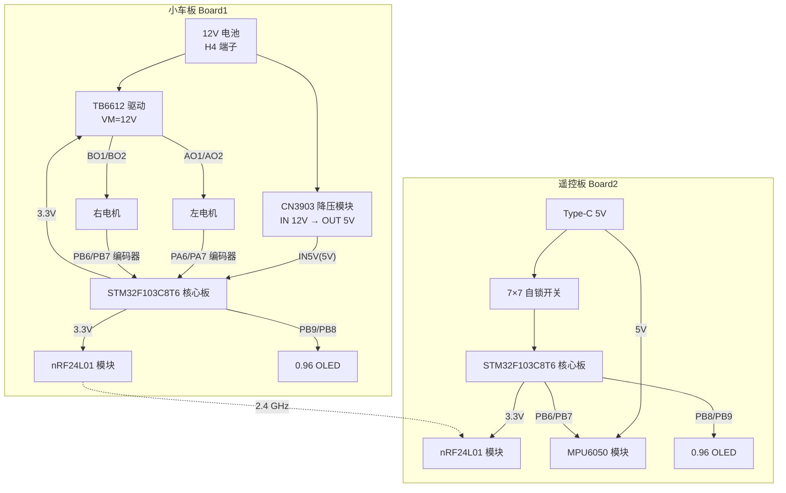
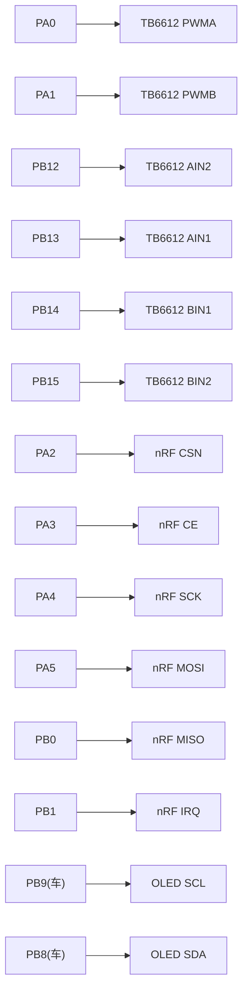
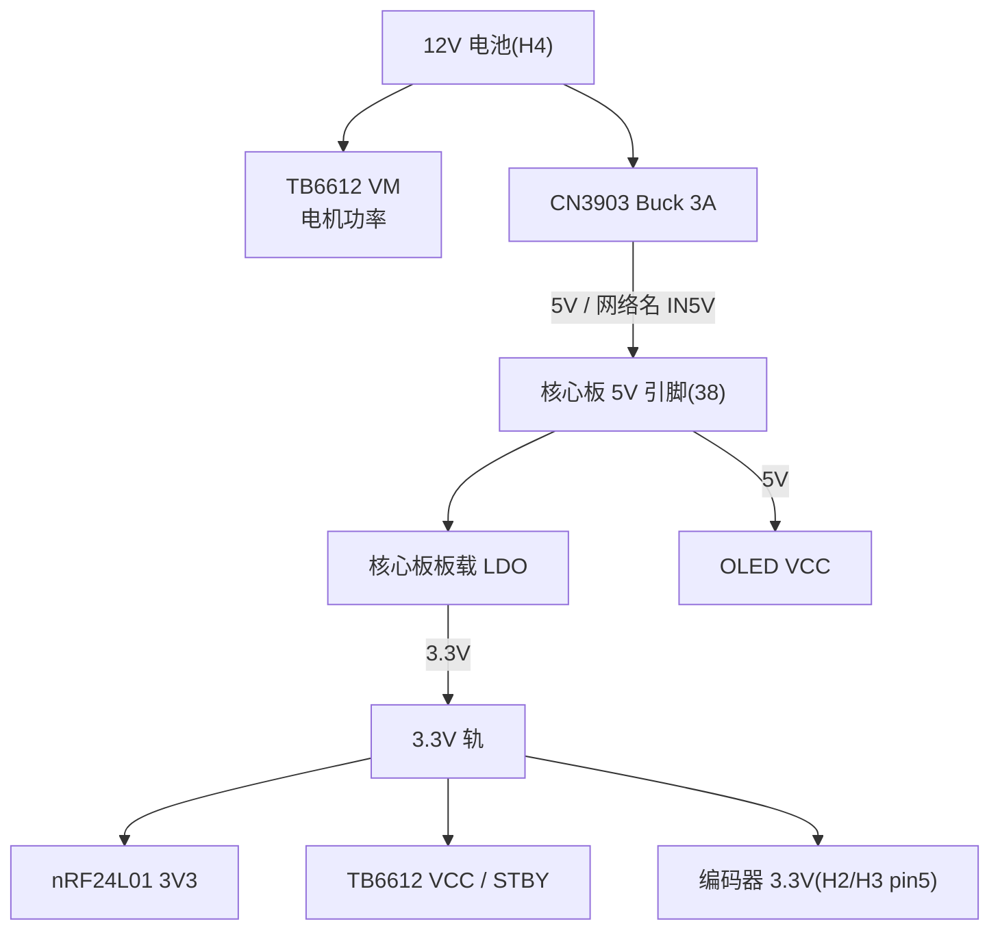

> [!danger] 🚨 版本交接指令
> 本文件为基础篇 V1；后续若补 BOM/高清原理图/PCB 底层图，升 V2 并在此处写明新增来源。

# 00 · 嘉立创硬件解析 · 原理图与软硬映射

> [!warning] 读图边界（防幻觉声明）
> 1. 本笔记只依据你发的 **4 张截图**（Board1 原理图/PCB、Board2 原理图/PCB）与**真实代码**；
> 2. **BOM 文件未提供**（只有界面截图），因此**无法列出具体电阻/电容型号与数值**，相关“为什么需要”只讲通用原理并在文中标注；
> 3. 截图分辨率有限，个别网络标号需用**万用表蜂鸣档**复核，这类项统一进「待确认清单」；
> 4. 未看到的连接**一律写“图纸未标注/需实物确认”**，绝不猜。

---

## 🍼 学前班：四句话看懂硬件

> [!note] 零基础前置扫盲
> | 词 | 一句话 | 生活比喻 |
> |---|---|---|
> | **原理图** | 用符号画出“谁和谁连”的逻辑图 | 城市**地图**：只画路和地名，不画路面材质 |
> | **PCB** | 真正做出来的板子，铜线、焊盘、丝印 | **实际修好的路**：有宽度、有红绿灯 |
> | **网络标号** | 名字相同的两根线，在板内就是通的 | 两人约好用同一个**暗号**，不用手拉手也算一队 |
> | **丝印** | 板子上的白字 `PA9`、`3.3V`、`GND` | 路牌，接线时照着它找 |

> [!note] 电源树是什么
> 12 V 电池不能直接喂 3.3 V 芯片。电源树就是“**电从哪来、经过谁降压、最后喂给谁**”的家族树。看懂了它，你就知道万用表该量哪、烧板子会烧哪一级。

---

## 模块 0：📊 三张图看懂这块板

### 1）硬件系统架构

### 2）引脚映射（MCU → 模块 → 代码宏）

### 3）电源树

---

## 一、两块板的分工（先分清谁是谁）

| 板 | 工程名 | 角色 | 关键器件 |
|---|---|---|---|
| **Board1** | Schematic1 / PCB1 | **小车端**：接收 + 驱动 | STM32F103C8T6 核心板、TB6612、nRF24L01、OLED、CN3903 降压 |
| **Board2** | Schematic2 / PCB2 | **遥控端**：采集 + 发送 | STM32F103C8T6 核心板、MPU6050、nRF24L01、OLED、Type-C + 自锁开关 |

> [!info] 一句话
> 小车板上**没有 MPU6050**（它只负责“收 + 动”）；遥控板上**没有电机驱动**（它只负责“感 + 发”）。这就是双机分工。

---

## 二、Board1 小车板：逐模块对账

### 2.1 TB6612 驱动（核心：方向和 PWM）

> [!tip] 🔌 硬件物理沙盘：TB6612 的 VM / VCC / STBY
> **【1. 物理世界发生了什么？】** `VM` 是电机功率电（12 V，大电流），`VCC` 是芯片内部逻辑电（3.3 V，小电流），`STBY` 是“使能闸门”——低电平芯片整体休眠，电机绝对不动。
> **【2. 生活化比喻】** VM 像水库（推得动电机），VCC 像控制室（只处理信号），STBY 像总闸。
> **【3. 硬件上的后果】** 本板 `STBY` 直接接 3.3 V（常使能），所以代码里**没有 STBY 控制**；若你换板把 STBY 悬空，电机永远不转，代码怎么调都没用。

| TB6612 引脚 | 接到（原理图） | 代码对应 |
|---|---|---|
| `VM`(1) | **+12 V**（电池） | — |
| `VCC`(2) | **3.3 V** | — |
| `GND`(3,8,16) | GND | — |
| `PWMA`(9) | **PA0** | `PWM_SetCompare1()` → `TIM2_CH1` |
| `AIN2`(10) | **PB12** | `Motor_SetPWM(1, +)` 时 PB12=1 |
| `AIN1`(11) | **PB13** | `Motor_SetPWM(1, +)` 时 PB13=0 |
| `STBY`(12) | **3.3 V**（常使能） | 代码不驱动 |
| `BIN1`(13) | **PB14** | `Motor_SetPWM(2, +)` 时 PB14=0 |
| `BIN2`(14) | **PB15** | `Motor_SetPWM(2, +)` 时 PB15=1 |
| `PWMB`(15) | **PA1** | `PWM_SetCompare2()` → `TIM2_CH2` |
| `AO1/AO2`(4,5) | 左电机（H2） | 左轮 |
| `BO1/BO2`(7,6) | 右电机（H3） | 右轮 |

> [!warning] 软硬对账结论（重要）
> 代码里“左轮=1、右轮=2”与原理图**完全一致**：
> - 左轮 = **A 通道** = `PWMA(PA0)` + `AIN1/AIN2(PB13/PB12)`；
> - 右轮 = **B 通道** = `PWMB(PA1)` + `BIN1/BIN2(PB14/PB15)`。
> 所以之前“TB6612 接线未知”的盲区，**现在可以关闭**。

### 2.2 编码器接口 H2 / H3（6 针，电机+编码器合一）

| 连接器 | pin6 | pin5 | pin4 | pin3 | pin2 | pin1 |
|---|---|---|---|---|---|---|
| **H2（左）** | `AO1` | `3.3V` | `PA6` | `PA7` | `GND` | `AO2` |
| **H3（右）** | `BO1` | `3.3V` | `PB6` | `PB7` | `GND` | `BO2` |

> [!info] 对账
> `PA6/PA7` = `TIM3_CH1/CH2`（左编码器 A/B）；`PB6/PB7` = `TIM4_CH1/CH2`（右编码器 A/B）——与代码 `Encoder.c` 一致。编码器供电被设计成 **3.3 V**（不是 5 V），接线时别接错。

### 2.3 nRF24L01 模块（U1）

| 模块引脚 | 接到 | 代码宏 |
|---|---|---|
| `IRQ`(8) | **PB1** | `NRF_IRQ = PBin(1)` |
| `MISO`(7) | **PB0** | `NRF_MISO = PBin(0)` |
| `MOSI`(6) | **PA5** | `NRF_MOSI = PAout(5)` |
| `SCK`(5) | **PA4** | `NRF_SCK = PAout(4)` |
| `CSN`(4) | **PA2** | `NRF_CSN = PAout(2)` |
| `CE`(3) | **PA3** | `NRF_CE = PAout(3)` |
| `3V3`(2) | **3.3 V** | — |
| `GND`(1) | GND | — |

> [!warning] 注意
> `PA5` 同时也是代码里的 `LED1`（`led.h`）——原理图上 PA5 走的是 nRF MOSI，**LED1 与无线 MOSI 抢同一根脚**，这是软硬结合的硬伤（详见阶段二笔记 3.12）。

### 2.4 OLED（U15 → PCB 上的 4 脚排针 H7）

| OLED 引脚 | 接到 | 代码 |
|---|---|---|
| 1 `GND` | GND | — |
| 2 `VCC` | **5 V** | — |
| 3 `SCL` | **PB9** | `OLED_W_SCL` → `GPIO_Pin_9`（`OLED.c:82`） |
| 4 `SDA` | **PB8** | `OLED_W_SDA` → `GPIO_Pin_8`（`OLED.c:99`） |

> [!warning] 待确认（防幻觉）
> 截图上 SCL/SDA 网络标号文字较小，我用代码侧（PB9/PB8）+ 标号位置交叉确认；**上手前建议用万用表蜂鸣档量 H7 的 SCL 与 PB9 是否导通**。

---

## 三、Board2 遥控板：逐模块对账

### 3.1 供电入口：Type-C + 自锁开关

| 器件 | 引脚 | 接到 |
|---|---|---|
| `USB2` Type-C 6P | `VBUS`(5,2) | **IN5V** |
| | `GND`(6,1) | GND |
| | `CC1/CC2`(4,3) | **未接（X）** |
| `电源开关1`（6 脚，只用 2 脚） | pin2 | `IN5V` |
| | pin1 | **+5V** |
| `7×7 自锁开关` | 其余脚 | **未使用（X）** |

> [!warning] 结论
> 遥控板**没有 12 V**，只有 USB 5 V；`+5V` 是“过开关后的 5 V 轨”，给核心板/OLED/MPU 供电，核心板再降压出 3.3 V 给 nRF。

### 3.2 nRF24L01（U1）

| 模块引脚 | 接到 | 代码宏 |
|---|---|---|
| `IRQ`(8) | **PA5** | `NRF_IRQ = PAin(5)` |
| `MOSI`(6) | **PA3** | `NRF_MOSI = PAout(3)` |
| `CSN`(4) | **PA0** | `NRF_CSN = PAout(0)` |
| `MISO`(7) | **PA4** | `NRF_MISO = PAin(4)` |
| `SCK`(5) | **PA2** | `NRF_SCK = PAout(2)` |
| `CE`(3) | **PA1** | `NRF_CE = PAout(1)` |
| `3V3`(2) | **3.3 V** | — |
| `GND`(1) | GND | — |

### 3.3 MPU6050（H4 模块座）

| 模块引脚 | 接到 | 代码 |
|---|---|---|
| `SDA` | **PB7** | `MyI2C.c` 中 `GPIO_Pin_7` |
| `SCL` | **PB6** | `MyI2C.c` 中 `GPIO_Pin_6` |
| `VCC` | **5 V** | 模块板载稳压 |
| `GND` | GND | — |
| `AD0` | **图纸未标注**（模块板上） | 代码按 0x68（`0xD0`）寻址 |
| `INT/ADC/XCL/XDA` | 未接 | 未使用 |

> [!warning] 待确认（防幻觉）
> `AD0` 在原理图模块座里没有单独引出。若模块板把 AD0 拉高，地址会变 0x69，而代码写死 `0xD0` → **读不到数据**。上电先用 `WHO_AM_I` 或观察是否全 0 判定。

### 3.4 OLED（U15）

| OLED 引脚 | 接到 | 代码 |
|---|---|---|
| 1 `GND` | GND | — |
| 2 `VCC` | **5 V** | — |
| 3 `SCL` | **PB8** | 遥控 `OLED.c:82` → `Pin_8` |
| 4 `SDA` | **PB9** | 遥控 `OLED.c:99` → `Pin_9` |

> [!warning] 与小车板不同
> 小车板：SCL=PB9、SDA=PB8；遥控板：SCL=PB8、SDA=PB9——**两板相反**，抄代码时最容易错。

### 3.5 按键（代码有、图纸未见）

> [!warning] 图纸未标注 / 需补图
> 代码 `key.h` 定义 `KEY1~KEY4 = PB12/PB13/PB14/PB15`、`KEY5 = PA8`；但 Board2 原理图截图里**只看到电源开关与自锁开关**，没有独立按键符号。
> 处理：先标“图纸未见”，**不要**据此断定按键不存在；请补发 Board2 完整原理图（或看 PCB2 丝印）确认。

---

## 四、软硬对账总表（一眼核完）

| 代码位置 | 代码写法 | 原理图网络 | 结论 |
|---|---|---|---|
| `PWM.c:18` | `GPIO_Pin_0 \| GPIO_Pin_1` | PA0→PWMA、PA1→PWMB | ✅ 一致 |
| `Motor.c:16` | `GPIO_Pin_12~15` | PB12→AIN2、PB13→AIN1、PB14→BIN1、PB15→BIN2 | ✅ 一致 |
| `Motor.c` 分支 | 左轮 PB12=1/PB13=0 | A 通道正转 | ✅ 一致 |
| `Encoder.c:18` | `PA6/PA7` | 左编码器 A/B | ✅ 一致 |
| `Encoder.c:61` | `PB6/PB7` | 右编码器 A/B | ✅ 一致 |
| 小车 `nRF24L01_API.c:3–8` | PA2/PA3/PA4/PA5/PB0/PB1 | CSN/CE/SCK/MOSI/MISO/IRQ | ✅ 一致 |
| 遥控 `nRF24L01_API.c:4–9` | PA0/PA1/PA2/PA3/PA4/PA5 | CSN/CE/SCK/MOSI/MISO/IRQ | ✅ 一致 |
| 小车 `OLED.c:82/99` | PB9=SCL、PB8=SDA | H7 排针 SCL/SDA | ✅ 一致（建议蜂鸣档复核） |
| 遥控 `OLED.c:82/99` | PB8=SCL、PB9=SDA | OLED 模块 SCL/SDA | ✅ 一致（与小车相反） |
| 遥控 `MyI2C.c:15/27` | PB6=SCL、PB7=SDA | MPU6050 SCL/SDA | ✅ 一致 |
| `key.h` | PB12–15、PA8 | **图纸未见按键** | ⚠️ 待确认 |
| TB6612 `STBY` | 代码不驱动 | 硬件接 3.3 V | ✅ 设计如此 |

---

## 五、BOM / 元件大白话（哪些必须存在、为什么）

> [!warning] 来源声明
> **BOM 表文件未提供**，以下是“从截图可见的模块 + 通用电路常识”，不代表实际阻容清单。

| 元件/模块 | 作用（大白话） | 为什么不能省 |
|---|---|---|
| **CN3903 降压模块**（PWRM_AJ38_Buck_3A） | 把 12 V 降到 5 V | 12 V 直接进 5 V/3.3 V 器件会立刻烧 |
| **STM32 核心板** | 里面已有 3.3 V LDO | 5 V 进核心板，板载 LDO 出 3.3 V 给 nRF/编码器 |
| **TB6612** | 把 3.3 V 逻辑变成 12 V 大电流 | 单片机引脚只能出几 mA，带不动电机 |
| **nRF24L01 模块** | 2.4 G 收发 | 模块板载晶振/匹配网络，自己搭很难 |
| **MPU6050 模块** | 六轴传感器 | 模块板载 LDO 与上拉，5 V 供电也安全 |
| **0.96 OLED** | 显示 | 4 线 I2C，代码里是软件 I2C |
| **Type-C 6P** | 5 V 输入 | 只取 VBUS/GND，CC 未接（不能触发 PD 快充） |
| **7×7 自锁开关** | 电源总开关 | 按下锁住、再按弹起，适合电源 |
| **6P 排针 H2/H3** | 电机+编码器 | 一根线束同时传功率与反馈 |
| **M3 螺丝孔 ×4** | 固定 | 电机震动会把板子抖松 |

> [!note] 图上没看到的分立阻容（通用原理，非 BOM）
> - **去耦电容**（常见 10 µF + 0.1 µF）：并在每个模块电源脚旁，电机一启动电流猛增，没有它就**复位/丢包**；
> - **I2C 上拉电阻**（常见 4.7 kΩ）：开漏总线必须有上拉才能回到高电平，没有就**读不到数据**；
> - **编码器上拉/滤波**：霍尔开漏输出，靠上拉与 RC 滤波抗毛刺。
> 这些很可能做在**模块板上**（截图看不清），需要 BOM 才能确认具体值。

---

## 六、待确认清单（必须实物/补图才能闭环）

| # | 项目 | 现状 | 怎么确认 |
|:--:|---|---|---|
| 1 | 遥控按键 PB12–15/PA8 | 代码有，原理图未见按键符号 | 补 Board2 完整原理图或看 PCB2 丝印 |
| 2 | OLED SCL/SDA 顺序 | 已按代码+标号推断 | 万用表蜂鸣档量 H7/OLED 座与 PB8/PB9 |
| 3 | MPU `AD0` 电平 | 模块座未引出 | 读 `WHO_AM_I` 或看模块丝印 |
| 4 | 编码器 A/B 与 PA6/PA7、PB6/PB7 的对应 | 网络标号已对上，线序仍需核对 | 手转轮子看计数正负，反了就交换 A/B |
| 5 | 电机 AO1/AO2、BO1/BO2 与左右轮 | 原理图已给通道，实物线序 | 架空给 `Motor_SetPWM` 单轮测试 |
| 6 | BOM 阻容值 | **未提供 BOM 文件** | 导出 BOM CSV 后补进本文 V2 |
| 7 | PCB 底层/铺铜/线宽 | 只有顶层截图 | 导出 Gerber 或底层截图 |

---

## 七、硬件 Debug：万用表与上电顺序（保姆级）

> [!todo] 上电前检查清单
> **□ 1. 先不接电机/电池**，只用 USB 给遥控板供电，量 `+5V` 对 GND ≈ 5 V。
> **□ 2. 量 3.3 V 轨**（核心板 3.3 V 脚 / nRF 3V3）≈ 3.3 V；若为 0 V，先查核心板 LDO。
> **□ 3. 小车板**：先接 12 V 电池到 H4，量 buck `OUT+` 对 GND ≈ 5 V；**再**插核心板。
> **□ 4. 量 TB6612 `VM`=12 V、`VCC`=3.3 V、`STBY`=3.3 V；三者缺一电机不动。
> **□ 5. 蜂鸣档对线**：H7 SCL ↔ PB9、SDA ↔ PB8；H2 pin4 ↔ PA6、pin3 ↔ PA7；H3 pin4 ↔ PB6、pin3 ↔ PB7。
> **□ 6. 共地**：电池 GND、驱动 GND、核心板 GND 必须同一点（星形接地），否则电机一转就丢包。

> [!warning] 顺序错了会怎样
> 先插核心板再上 12 V、或 5 V 没稳就插模块 → 浪涌可能打坏 nRF/OLED；**永远先量电压、后插模块**。

---

## 八、防幻觉审计报告

> [!success] 🛡️ 防幻觉审计报告
> 1. **来源核实**：本笔记所有引脚/网络均来自①你提供的 4 张截图（我做了局部放大读图）②真实代码（`PWM.c`、`Motor.c`、`Encoder.c`、`nRF24L01_API.c`、`OLED.c`、`MyI2C.c`、`key.h`）。
> 2. **未提供即标注**：BOM 文件未提供 → 阻容值不写具体数；遥控按键图纸未见 → 标“待确认”；OLED 标号 → 标“建议蜂鸣档复核”。
> 3. **未编造**：没有凭空新增任何引脚、网络名、元件型号；`CN3903`/`TB6612`/`nRF24L01`/`MPU6050`/`OLED0.96` 均来自截图文字。
> 4. **软硬一致性**：PWM/方向/编码器/nRF 四组映射与代码逐项对上；`STBY=3.3V` 解释了“代码不控制 STBY”的现象。
> 5. **仍然悬空**：BOM 阻容、Board2 按键、PCB 底层、AD0 电平——已列入「待确认清单」。

#RM电控 #硬件 #嘉立创 #软硬映射
